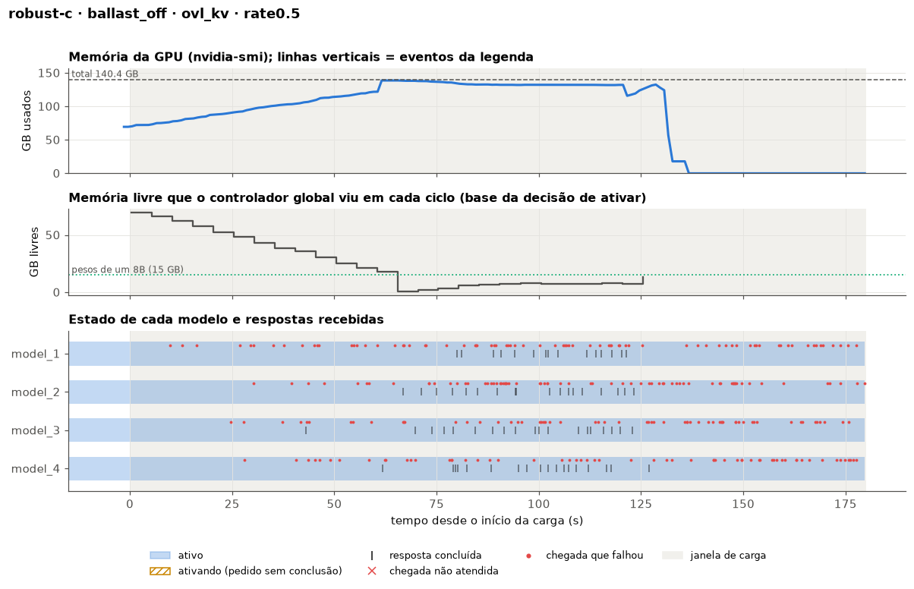
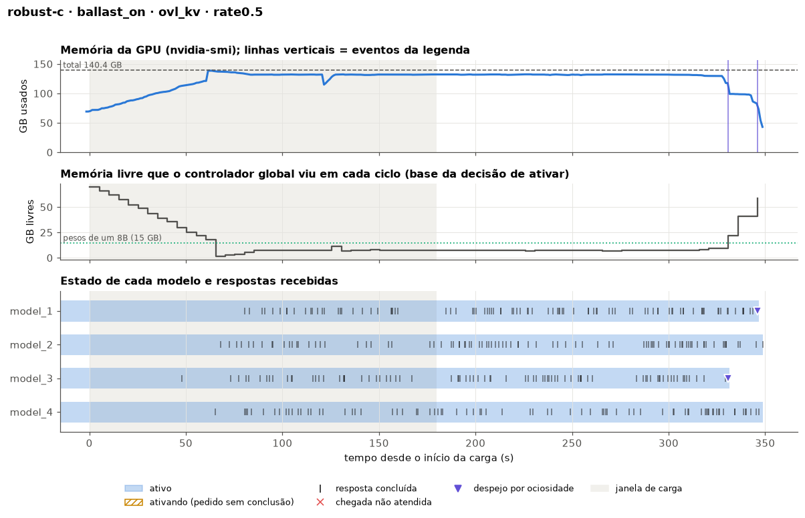
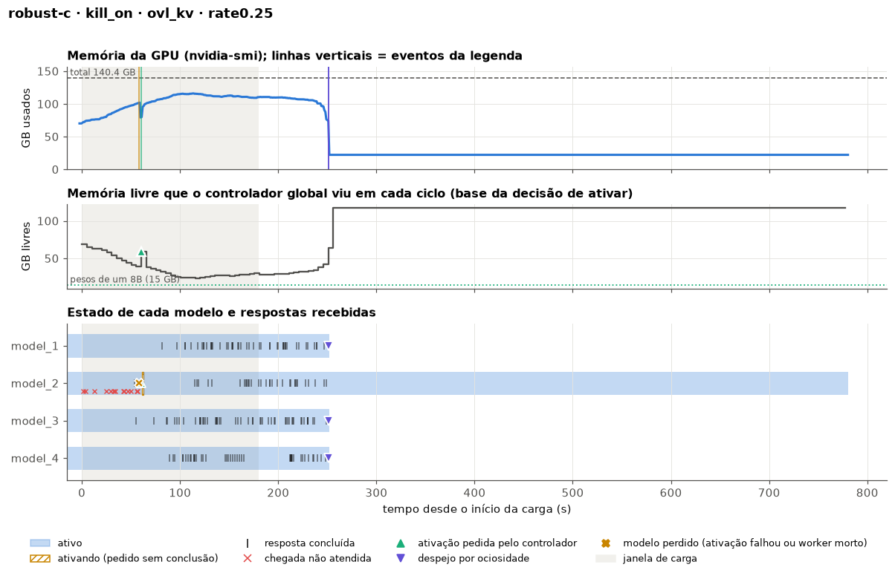
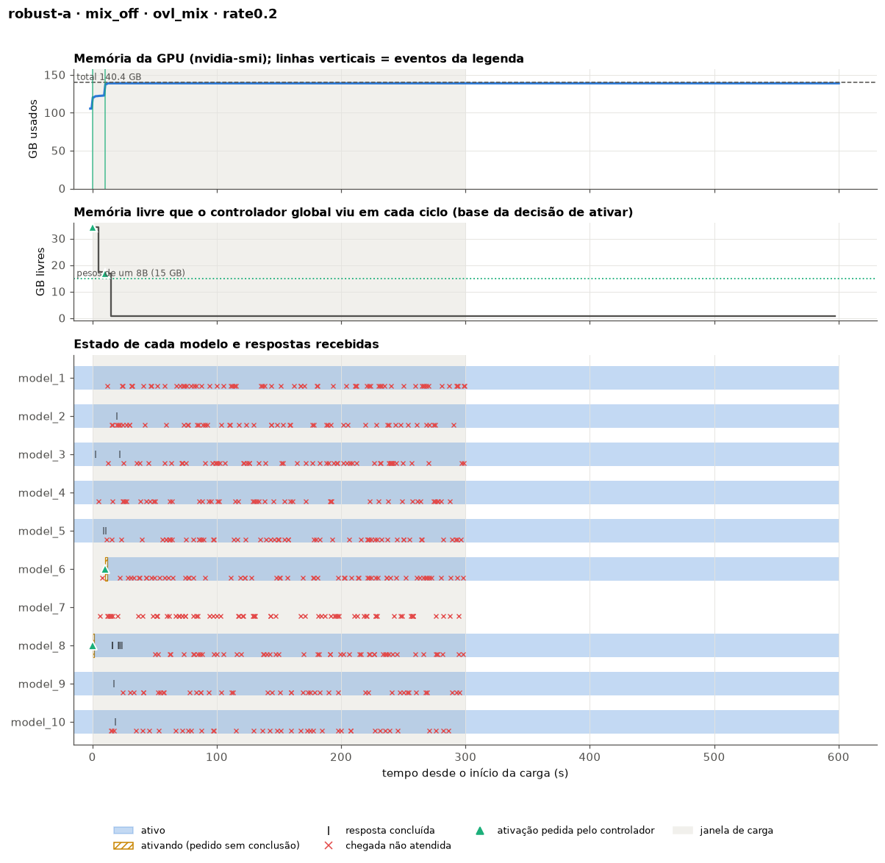
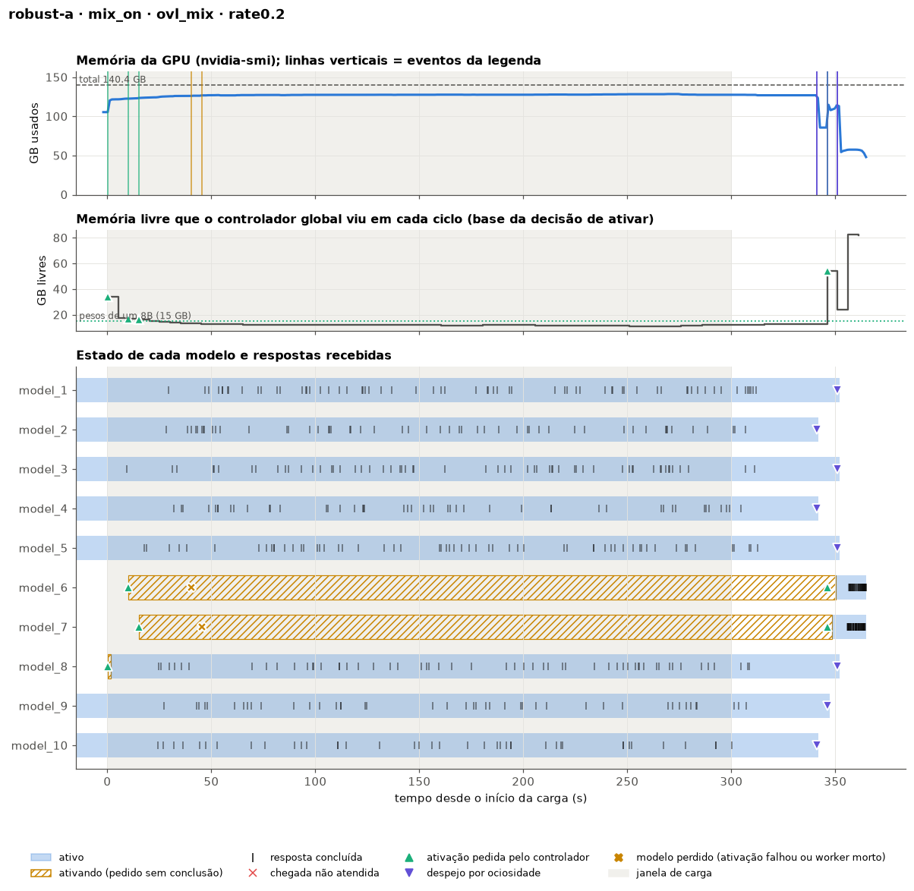

# Correções de robustez de memória no Prism, SGLang (2026-10-22)

## Resumo

O [relatório da janela de ociosidade](2026-10-22%20Janela%20de%20ociosidade%20e%20estratégias%20de%20troca%20no%20Prism%20(SGLang).md) mostrou que o Prism com SGLang falha de cinco maneiras quando a GPU fica sem memória: 19 das 57 execuções perderam requisições. Este relatório descreve, para cada falha, qual era o problema, o que o causava, o que mudou para corrigir e os testes que mostram o efeito da correção.

**Regra seguida:** as mudanças estão só neste repositório e só em código do Prism. O repositório do kvcached (`prism/shm`) não foi alterado: as correções do lado dele são aplicadas pelo Prism quando o worker inicializa, substituindo métodos Python do kvcached. Nenhuma lógica do SGLang foi alterada. A única mudança num arquivo que também existe no SGLang é na função `handle_activate_request` do `scheduler.py`, que é inteiramente do Prism (o SGLang original não ativa nem desativa modelos). Para separar o que é do Prism do que é do SGLang, comparamos cada arquivo com o SGLang 0.3.4.post2 do PyPI.

> **Decisão sobre o que fica ligado (2026-10-22).** Como estes estudos comparam políticas com o Prism publicado, as correções que mudam o comportamento normal do Prism, mesmo quando nada falha, ficam **desligadas por padrão**: o árbitro de memória, os ajustes do kvcached e a reserva na ativação. Elas mudam quanto o SGLang admite, quando ele retira requisições e quanto uma ativação espera, e têm custo medido (ver [Custo da variante com o árbitro](#custo-da-variante-com-o-árbitro)). Ficam disponíveis como uma variante declarada, com `PRISM_MEMORY_ARBITER=1`.
>
> **Ficam ligadas** só as correções que agem quando o Prism quebraria de qualquer jeito: o desfazer e o aviso de uma ativação que fica sem memória, a detecção de workers mortos e o aviso de falta de worker livre ao controlador. No caminho normal, o Prism se comporta exatamente como o original.
>
> **Espaço virtual do kvcached:** continua fixo em 25 GB, como no original. O ajuste que permitiu subir 14 workers foi removido, porque não entendemos por que ele funcionou (ver [falha 5](#5-com-14-workers-o-servidor-não-sobe)). Ver também [O que está valendo](#o-que-está-valendo).

| # | Falha | Situação |
| --- | --- | --- |
| 1 | Ativação que falha sem aviso (kvcached `abort()`) | **Padrão:** o worker ainda pode morrer, mas a morte é detectada e o modelo é reativado em outro worker. **Variante com o árbitro:** a memória é reservada antes da ativação e o mapeamento de páginas é verificado, então a falha não ocorre. |
| 2 | Worker que morre quando o KV não cresce (kvcached `abort()`) | **Padrão:** a morte é detectada e o modelo reativado. **Variante com o árbitro:** as páginas só são mapeadas depois de confirmar, sob um lock entre processos, que cabem. |
| 3 | Worker que morre por falta de KV no prefill (`pretty_print`) e leva todos junto | **Não corrigida**: é código do SGLang. Ocorreu 1 vez em 9 execuções com as correções. A correção proposta está em [O que não foi corrigido](#o-que-não-foi-corrigido). |
| 4 | Servidor que cai com `torch.OutOfMemoryError` ao copiar os pesos | **Padrão:** um OOM na ativação é desfeito e avisado, em vez de derrubar o servidor. **Variante com o árbitro:** além disso, a memória dos pesos é reservada antes da cópia. |
| 5 | Servidor que não sobe com 14 workers | **Não corrigida**: causa não identificada. 14 workers subiram com 12 GB de espaço virtual, mas uma sonda mostrou que o espaço virtual não é a causa. O ajuste foi removido, e a falha fica registrada como comportamento do Prism. |
| — | Worker morto que continua recebendo requisições | **Corrigida**: o GPU scheduler detecta a morte e o controlador reativa o modelo em outro worker em ~4 s. |
| — | Falta de worker livre que o controlador não fica sabendo (o "bug dos 4 workers") | **Corrigida**: vira o mesmo aviso de "modelo perdido". |

**Resultado do A/B** (mesmo job, todas as correções desligadas × todas ligadas, ou seja, a variante com o árbitro):

| Cenário | Correções desligadas | Correções ligadas |
| --- | --- | --- |
| `ovl_mix` (travamento geral) | 13/549 atendidas | **549/549** |
| Lastro tomando a memória livre por 60 s | 70/337, servidor caiu | **337/337** |
| Rodízio anti-fome no `ovl_mem` | 590/599, 2 workers mortos | **599/599** |
| `kill -9` num worker | 140/184 | **171/184** (só as que estavam no worker morto) |
| 14 workers (`ovl_mix` original) | não subia | 855/855, mas com espaço virtual de 12 GB, um ajuste depois removido (ver falha 5) |
| `ovl_mem` a 0,5 req/s | 5/1453, servidor caiu (`torch` OOM) | 760/1453: sobreviveu à falta de memória, mas caiu depois pela falha 3 |

## A causa comum

O SGLang foi feito para um único modelo por GPU, que reserva a memória de KV na inicialização. O Prism coloca de 6 a 14 processos SGLang ("workers") na mesma GPU, e cada um aumenta o KV sob demanda pelo kvcached, em páginas de 2 MB por camada. Cada processo decide sozinho, olhando a memória livre do instante (`torch.cuda.mem_get_info()`), sem nenhuma coordenação com os outros. O mesmo vale para o controlador quando ativa um modelo. Dois processos podem contar a mesma memória livre, e o perdedor falha em código que não espera falhar:

- no kvcached, a falha do driver ao mapear uma página chama `abort()` (`csrc/inc/cuda_utils.hpp:70`) e mata o processo;
- na ativação, a cópia dos pesos levanta `torch.OutOfMemoryError`, e o tratamento de exceção do SGLang (`kill_parent_process`) derruba o servidor.

A peça central das correções é um **árbitro de memória por GPU**, que torna "verificar a memória livre e então usá-la" uma operação atômica entre processos.

## Problema por problema

### 1 e 2. Página de KV que não cabe mata o worker

**Problema.** Um modelo era ativado e ficava em `activating` para sempre, ou um modelo ativo parava de responder de repente. No relatório anterior, chamamos isso de "ativação que falha sem aviso" e "KV que não cresce". Os logs mostraram que, nos dois casos, o worker tinha morrido: no `ovl_phases` com limiar de 5 s, os workers dos modelos 2, 4 e 5 pararam de logar exatamente nas três mensagens `cuMemSetAccess ... out of memory`.

**Causa.**
- O kvcached decide se uma alocação cabe olhando a memória livre (`KVCacheManager.available_size()` → `_physical_free_size()`) e só depois mapeia a página (`map_to_kv_tensors`).
- Entre uma coisa e outra, outro worker pode usar a mesma memória. Na ativação, a thread de pré-alocação do kvcached mapeia 5 páginas logo de início, enquanto os outros workers continuam crescendo o KV.
- Quando o driver recusa, o C++ do kvcached chama `abort()`. O processo morre sem exceção e sem aviso ao Prism, e o GPU scheduler continua mandando requisições para ele.

**O que mudou.**
- **`python/sglang/multi_model/memory_arbiter.py` (novo):**
  - lock por GPU entre processos e threads (`fcntl.flock` + `threading.RLock`);
  - registro das reservas pendentes em `/dev/shm/prism_gpu<N>_<user>_arbiter.json`, ignorando reservas de processos mortos;
  - `free_bytes()` = memória livre do dispositivo − reservas dos outros processos − folga (5% da GPU, como o kvcached, ou `PRISM_GPU_HEADROOM_GB`).
- **`python/sglang/multi_model/kvcached_patches.py` (novo),** aplicado pelo worker antes de criar o primeiro pool de KV:
  - `PageAllocator.alloc_page`: mapeia a página só se `free_bytes()` comportar, sob o lock do árbitro; se não comportar, devolve a página à lista livre e levanta `KVMemoryUnavailable`. O C++ nunca é chamado com uma página que não cabe.
  - `PageAllocator._prealloc_worker`: a pré-alocação mapeia página por página e para na primeira que não cabe.
  - `KVCacheManager.alloc`: se uma página for recusada no meio da alocação, devolve os blocos já entregues e retorna `None`. É o que o kvcached já retornava quando `available_size()` era insuficiente, então o SGLang trata o caso pelos caminhos normais de retirar ou esperar.
  - `KVCacheManager._physical_free_size`: passa a descontar as ativações em andamento.
- **Detecção de workers mortos:**
  - cada worker grava o seu PID (`write_worker_pid`);
  - o GPU scheduler verifica a cada 1 s (`WorkerPool.check_dead_workers`). Um processo zumbi, morto mas ainda não recolhido pelo pai, conta como morto;
  - quando um worker morre, o GPU scheduler devolve a fila do modelo e avisa o controlador (`_on_model_lost`), que marca a instância como inativa (`handle_model_events`, por uma lista no Redis). O modelo pode então ser ativado em outro worker.

**Testes.**
- **Unitários** (`test/multi-model/test_memory_robustness.py`, com o `slab_allocator.py` real do kvcached e uma GPU simulada):
  - `test_original_kvcached_maps_beyond_free_memory` reproduz o bug: com a memória tomada entre a verificação e o mapeamento, o kvcached original tenta mapear (o C++ real daria `abort()`);
  - `test_patched_alloc_refuses_instead_of_failing` mostra que, com a correção, a alocação retorna `None` e nenhuma página vaza;
  - `test_patched_alloc_rolls_back_partial_allocations` verifica a devolução numa alocação recusada no meio;
  - `test_prealloc_thread_skips_pages_that_do_not_fit` verifica que a thread de pré-alocação não mapeia o que não cabe e continua viva.
- **Lastro (`PRISM_FAULT=ballast:60:60`):** com 4 × 8B no `ovl_kv` a 0,5 req/s, um processo externo toma toda a memória livre (até sobrar 1 GB) aos 60 s e a segura por 60 s.
  - Sem as correções, o servidor cai aos ~125 s: 267 das 337 requisições falham.
  - Com as correções, os quatro workers sobrevivem e as 337 são atendidas. Não houve nenhuma falha de driver.




- **`kill -9` no worker do `model_2`** (`PRISM_FAULT=kill:model_2:60`, com 5 workers para 4 modelos). O cronômetro da falha começa ~2 s antes da carga, então o `kill` aconteceu aos 58 s do tempo da carga:
  - Sem a detecção (`PRISM_DETECT_DEAD_WORKERS=0`), o `model_2` nunca mais responde: 44 não atendidas.
  - Com a detecção, a morte é registrada no mesmo segundo (58,5 s), o controlador marca o modelo como inativo e ele volta a responder em outro worker aos 62,9 s, ~4 s depois do `kill`. Ficam 13 não atendidas: as requisições que estavam dentro do worker morto (ver [O que não foi corrigido](#o-que-não-foi-corrigido)).



- **Rodízio anti-fome no `ovl_mem` a 0,2:** sem as correções, 2 falhas de driver mataram 2 workers e 9 requisições ficaram sem resposta. Com as correções, nenhuma falha e 599 de 599 atendidas.

### 4. A ativação derruba o servidor com `torch.OutOfMemoryError`

**Problema.** No `ovl_phases` com limiar de 10 s, uma ativação falhou ao copiar os pesos, e o servidor inteiro caiu.

**Causa.**
- **O controlador ativa olhando a memória livre do instante.** Mas o worker só copia os pesos depois de 1 a 20 s (o model service atende uma ativação por vez), e nesse meio-tempo o KV dos outros modelos ocupa a memória que parecia livre.
- **A espera que existia no worker nunca funcionou.** Em `load_gpu_model`, o worker deveria esperar enquanto a memória livre fosse menor que o modelo, mas no modo worker pool o tamanho do modelo (`model_gpu_mem_usage`) é sempre 0. Com isso, a condição "livre < 0" nunca é verdadeira.
- **O erro derruba tudo.** A exceção sobe até `run_scheduler_process`, cujo `kill_parent_process()` mata o servidor.

**O que mudou** (`worker_pool_model_runner.py`, arquivo do Prism, e `handle_activate_request` em `scheduler.py`, função do Prism):
- **Reserva antes da cópia.** A ativação calcula o tamanho real dos pesos a partir do modelo em CPU e reserva esse tamanho + 1 GB no árbitro, esperando até `PRISM_ACTIVATION_WAIT_S` (30 s). Enquanto a reserva existe, o KV dos outros workers não pode usar essa memória. Ela é liberada assim que os pesos e o pool de KV estão alocados.
- **Falha sem queda.** Se a memória não aparecer em 30 s, ou se mesmo assim houver `torch.OutOfMemoryError`, o worker desfaz o que alocou (`_rollback_activation`), levanta `ActivationOutOfMemory`, e o `handle_activate_request` responde `success=False` em vez de deixar a exceção derrubar o servidor.
- **O resto do sistema fica sabendo.** O GPU scheduler recebe o `success=False`, libera o worker, devolve a fila do modelo e avisa o controlador, que marca a instância como inativa e pode tentar de novo.
- **Falta de worker livre.** Uma ativação sem worker livre (`handle_activate_model` devolvendo `False`) passa pelo mesmo caminho. Antes, o GPU scheduler marcava o modelo como desativado sem avisar o controlador: era o "bug dos 4 workers".

**Testes.**
- **Unitários:**
  - `test_arbiter_reservations_are_atomic_across_processes`: 16 processos reservam 15 GB cada, ao mesmo tempo, com 80 GB livres; exatamente 5 conseguem.
  - `test_pending_activation_hides_memory_from_kv_growth`: com 70 GB reservados por uma ativação em andamento, o pool de KV de outro processo enxerga menos de 10 GB livres, e não os ~79 GB.
- **`ovl_mix`** (8 × 8B + 2 × 3B; com a política original, a GPU enchia e todos os modelos paravam):
  - Sem as correções: 13 de 549 atendidas.
  - Com as correções: 549 de 549, com SLO de 75%. As ativações do `model_6` e do `model_7` não acharam memória por 30 s e foram desfeitas e avisadas (aos 40 s e 45 s). Os dois foram ativados de novo quando a memória foi liberada, aos 348–350 s.
  - Esse atraso é a política original (que não despeja modelos ocupados) fazendo modelos esperarem, e não perda de requisições: o TTFT p99 é 336 s.




- **`ovl_mem` a 0,5 req/s:**
  - Sem as correções, o servidor caiu como antes (`torch` OOM + falha do kvcached): 5 de 1.453 atendidas.
  - Com as correções, a ativação do `model_7` foi desfeita e avisada aos 36 s, sem queda, e o servidor atendeu 760 requisições. Aos ~8 min, porém, um worker caiu pela falha 3 e levou os demais (ver abaixo).

### 5. Com 14 workers, o servidor não sobe

**Problema.** O `ovl_mix` original (6 × 8B + 8 × 3B, 14 workers) ficou parado na inicialização até o limite de 1.200 s, nas duas tentativas (testes rápidos `18411b56` e `4bc42f84`), com 14 mensagens `cuMemSetAccess ... out of memory`. Com 10 workers, como no `ovl_mem`, o servidor sempre subiu.

**Hipótese que testamos e descartamos.** Cada worker inicializa o kvcached com um espaço virtual de 25 GB e, com `reserve_virtual_mem=True`, mapeia todo esse espaço numa "página zero": são 12.800 mapeamentos de 2 MB por worker. A suspeita era um limite de mapeamentos ou de memória do driver. Para testar, a sonda `polyaxon/kvcached_probe.py` (job `97d1819e`) inicializou o kvcached em processos separados, um de cada vez:
- com 25 GB, **24 processos** inicializaram sem falha. Cada um ocupou ~0,6 GB, o contexto CUDA, e levou ~1 s;
- com 12 GB, o resultado foi o mesmo, com ~0,45 s por processo;
- sem a reserva (`reserve_virtual_mem=False`), a memória por processo também foi a mesma, ~0,6 GB.

Ou seja, mapear a página zero não custa memória, e 14 workers com 25 GB cabem.

**O que sobra.** Na sonda, os processos sobem um de cada vez e sem modelos. No servidor, os 14 workers inicializam ao mesmo tempo, enquanto os pesos dos modelos ativos são carregados na GPU. A hipótese é que a falha dependa dessa carga de memória simultânea e não seja determinística. O `ovl_mix` com 14 modelos e 12 GB de espaço virtual subiu uma vez (855 de 855 atendidas), mas isso pode ter sido coincidência.

**O que mudou.** Nada. A variável que eu tinha criado para o espaço virtual foi removida, e ele continua fixo em 25 GB, como no original. "O Prism não sobe com 14 workers numa H200" fica registrado como comportamento do Prism, com causa não identificada. O próximo passo, se for preciso, é uma sonda que inicialize os processos em paralelo e com modelos carregando.

### Achados ao longo do caminho

- **A espera por memória do worker pool nunca funcionou** (`model_gpu_mem_usage = 0`, ver falha 4). Ela foi substituída pela reserva no árbitro.
- **A primeira versão do árbitro travava** quando a thread de pré-alocação e a thread principal do mesmo worker usavam o lock ao mesmo tempo: o contador de reentrância era compartilhado entre threads. O teste unitário pegou o problema, e a correção foi o `threading.RLock`.
- **Um worker morto por `kill -9` vira zumbi** até o servidor recolhê-lo, e `os.kill(pid, 0)` trata zumbis como vivos. O primeiro teste rápido (`34d05934`) mostrou que a detecção não disparava. A correção lê o estado em `/proc/<pid>/stat`, e o teste `test_killed_worker_is_dead_even_as_a_zombie` cobre o caso.

## Custo da variante com o árbitro

Medimos o custo com as correções ligadas e desligadas, alternadas no mesmo job, em cenários onde nada falha (suítes `cost_a`, job `ad40a440`, e `cost_b`, job `d9f058a5`; 2 repetições de cada). O árbitro registra no log de cada worker quantas vezes pegou o lock, quanto esperou por ele e quanto o segurou, e cada ativação registra quanto esperou pela reserva.

| Cenário | Modo | Vazão em regime (req/s) | TTFT p50 / p99 (s) | TPOT (ms) | SLO (2 execuções) | Lock por worker | Tempo esperando o lock | Maior espera | Espera das ativações |
| --- | --- | --- | --- | --- | --- | --- | --- | --- | --- |
| `ovl_compute` 20 req/s | desligado | 16,5 | 0,10 / 9,6 | 75 | 57% (51–63%) | — | — | — | — |
| | ligado | 16,2 | 11,0 / 15,6 | 87 | 54% (8–100%) | 85 /s | 9,5% | 7,6 s | — |
| `ovl_compute` 50 req/s | desligado | 24,2 | 58,8 / 118 | 89 | 6% | — | — | — | — |
| | ligado | 25,6 | 53,5 / 112 | 87 | 6% | 78 /s | 2,1% | 0,4 s | — |
| `ovl_kv` 0,5 | desligado | 0,91 | 19,8 / 124 | 65 | 35% (35–35%) | — | — | — | — |
| | ligado | 0,82 | 26,3 / 132 | 70 | 29% (23–36%) | 53 /s | **16%** | 6,2 s | — |
| `ovl_phases` 0,5 | desligado | 2,66 | 0,16 / 53,9 | 50 | 72% (71–72%) | — | — | — | — |
| | ligado | 2,65 | 0,16 / 53,4 | 54 | 65% (64–65%) | 77 /s | 8,5% | 13,3 s | até 14,6 s (28 s somados em 20 ativações) |

"Tempo esperando o lock" é a soma das esperas de cada worker dividida pela duração da execução: a fração do tempo em que o worker estava parado esperando outro processo.

**O que os números mostram:**
- **O custo não é desprezível.** No `ovl_kv`, cada worker passou **16% do tempo** esperando o lock. A vazão caiu ~10% (0,82 contra 0,91 req/s) e o TTFT mediano subiu ~30%, nas duas repetições. No `ovl_phases`, o SLO caiu ~7 pontos nas duas repetições. No `ovl_compute` a 20 req/s, uma das duas execuções ligadas teve espera de até 7,6 s e o TTFT mediano subiu para 22 s, enquanto a outra foi melhor que as desligadas. É uma cauda ruim e instável.
- **De onde vem o custo.** Não vem dos mapeamentos de página, que são poucos por segundo. Vem do `available_size()` do kvcached: o escalonador do SGLang o chama em toda iteração, e na variante ele passa a consultar o árbitro (a memória livre menos as reservas) **sob o lock**. Isso dá 50 a 85 aquisições por segundo em cada worker. Uma operação custa ~20 µs sem disputa, mas com 4 a 10 workers disputando o mesmo lock, a espera acumula. Quando quem segura o lock é uma thread que perde o GIL no meio, a espera chega a vários segundos (o maior tempo segurando o lock foi de 13 s).
- **Custo da reserva prévia.** As ativações passaram a esperar a memória livre antes de copiar os pesos: até 14,6 s numa ativação, 28 s somados nas 20 ativações do `ovl_phases`. Antes, a ativação começava logo e podia matar o worker ou derrubar o servidor.
- **Como baratear, se a variante for usada.** A consulta de `available_size()` não precisa do lock: basta ler as reservas sem travar, ou guardá-las em cache por alguns milissegundos. O lock fica só no mapeamento de páginas, que é raro. Isso deve eliminar quase toda a espera, mas não foi implementado nem medido.

## O que não foi corrigido

1. **Falha 3: falta de KV no prefill.**
   - O que acontece: o escalonador do SGLang admite um prefill olhando `available_size()` e, milissegundos depois, aloca. No `ovl_mem` a 0,5 com as correções, ele admitiu 8.192 tokens e, na hora de alocar, havia 1.320, porque outros workers cresceram no intervalo.
   - Por que derruba tudo: `alloc_token_slots` chama `tree_cache.pretty_print()`, que no `ChunkCache` levanta `NotImplementedError`. O tratamento de exceção do SGLang (`run_scheduler_process` → `kill_parent_process`) mata o processo pai e **todos os workers irmãos**. Foi o que aconteceu: os workers 1, 3, 4, 5, 8 e 9 pararam no mesmo instante.
   - Por que não foi corrigida: as correções ficariam no código do SGLang:
     - (a) reativar a reserva do kvcached na admissão: `try_to_reserve`, que o Prism deixou comentado em `srt/managers/schedule_policy.py:297` e `schedule_batch.py:751`;
     - (b) trocar `kill_parent_process` por encerrar só o worker, já que agora o Prism detecta workers mortos e reativa o modelo.
   
   Recomendamos (a) e (b) como próximo passo, com sua autorização para mexer nesses arquivos.
2. **Requisições dentro de um worker que morre se perdem.** O GPU scheduler devolve as filas que ainda estão com ele, mas as que o worker já tinha recebido não voltam. O cliente espera até o prazo: foram 13 no teste do `kill`. Corrigir exige guardar as requisições em andamento por worker para reenviá-las.
3. **A política original continua deixando modelos esperarem.** As correções trocam perdas e quedas por espera (TTFT p99 de 300–340 s no `ovl_mix` e no `ovl_mem`). Resolver isso é papel das estratégias de despejo do relatório anterior.
4. **Falhas aleatórias e uma execução por configuração.**
   - Nesta rodada, o `ovl_phases` com limiar de 10 s e o despejo sob pressão **não falharam nem com as correções desligadas**, ao contrário do relatório anterior. Por isso, o A/B deles não mostra diferença de perdas. O SLO com as correções foi 81% contra 89% no limiar de 10 s e 78% contra 65% no despejo sob pressão, dentro do ruído entre execuções.
   - Quatro cenários (`ovl_mix`, lastro, rodízio e `kill`) mostraram a falha sem as correções e a ausência dela com as correções. O lastro e o `kill`, como são provocados, reproduzem a falha toda vez.
   - Para medir quanto a frequência caiu nos cenários aleatórios, são precisas repetições.

## Todas as execuções

| Suíte | Configuração | Atendidas | Não atendidas | Falhas | SLO | Pior 1ª resposta (s) | Falhas de driver kvcached | `torch` OOM | Ativações desfeitas | Modelos perdidos | Workers mortos detectados |
| --- | --- | --- | --- | --- | --- | --- | --- | --- | --- | --- | --- |
| A | `ovl_mem` 0,5, desligadas | 5 | 0 | 1448 | 0% | nunca | 1 | 1 | 0 | 0 | 0 |
| A | `ovl_mem` 0,5, ligadas | 760 | 0 | 693 | 13% | nunca | 0 | 0 | 1 | 1 | 0 |
| A | `ovl_mix`, desligadas | 13 | 536 | 0 | 2% | nunca | 0 | 0 | 0 | 0 | 0 |
| A | `ovl_mix`, ligadas | 549 | 0 | 0 | 75% | 350 | 0 | 0 | 2 | 2 | 0 |
| B | `ovl_phases` limiar 10 s, desligadas | 1564 | 0 | 0 | 89% | 34 | 0 | 0 | 0 | 0 | 0 |
| B | `ovl_phases` limiar 10 s, ligadas | 1564 | 0 | 0 | 81% | 27 | 0 | 0 | 0 | 0 | 0 |
| B | despejo sob pressão, desligadas | 1564 | 0 | 0 | 65% | 70 | 0 | 0 | 0 | 0 | 0 |
| B | despejo sob pressão, ligadas | 1564 | 0 | 0 | 78% | 50 | 0 | 0 | 0 | 0 | 0 |
| C | rodízio, desligadas | 590 | 9 | 0 | 32% | 328 | 2 | 0 | 1 | 2 | 2* |
| C | rodízio, ligadas | 599 | 0 | 0 | 27% | 343 | 0 | 0 | 0 | 0 | 0 |
| C | `kill -9`, detecção desligada | 140 | 44 | 0 | 76% | 94 | 0 | 0 | 0 | 0 | 0 |
| C | `kill -9`, detecção ligada | 171 | 13 | 0 | 92% | 89 | 0 | 0 | 0 | 1 | 1 |
| C | lastro, desligadas | 70 | 0 | 267 | 21% | 75 | 0 | 0 | 0 | 0 | 0 |
| C | lastro, ligadas | 337 | 0 | 0 | 27% | 76 | 0 | 0 | 0 | 0 | 0 |
| C | `ovl_mix` com 14 workers, ligadas | 855 | 0 | 0 | 79% | 344 | 0 | 0 | 1 | 1 | 0 |

\* No rodízio com as correções desligadas, só a detecção de workers mortos estava ligada (ela é independente do árbitro). Ela registrou os 2 workers mortos pelo kvcached, e os modelos foram reativados, mas 9 requisições ficaram dentro dos workers mortos.

A "pior 1ª resposta" mede quanto um modelo esperou para ser atendido pela primeira vez. Nesses cenários, a espera vem da política original, não das correções.

## O que está valendo

| Mudança | Padrão | Como mudar | Muda o comportamento normal? |
| --- | --- | --- | --- |
| Árbitro de memória por GPU, ajustes do kvcached, reserva antes da ativação | **desligado** | `PRISM_MEMORY_ARBITER=1` | sim: o que o SGLang admite, quando retira requisições e quanto a ativação espera |
| Desfazer a ativação que fica sem memória e responder `success=False` | **ligado** | sempre ligado | não: só age quando a ativação derrubaria o servidor |
| Aviso de "modelo perdido" ao controlador (ativação desfeita, worker morto, falta de worker livre) | **ligado** | sempre ligado | não: só age quando o modelo já foi perdido |
| Detecção de workers mortos | **ligado** | `PRISM_DETECT_DEAD_WORKERS=0` | não: só age quando um worker morre |
| Espaço virtual do kvcached | 25 GB fixo | não configurável | é o original |

Parâmetros da variante com o árbitro: `PRISM_GPU_HEADROOM_GB` (folga mantida livre, padrão 5% da GPU) e `PRISM_ACTIVATION_WAIT_S` (quanto uma ativação espera pela memória antes de desistir, padrão 30 s).

Sem o árbitro, uma ativação que fica sem memória ainda pode morrer pelo `abort()` do kvcached (falhas 1 e 2). Nesse caso, a detecção de workers mortos percebe a morte, e o modelo é reativado em outro worker.

## Arquivos alterados

| Arquivo | Mudança |
| --- | --- |
| `python/sglang/multi_model/memory_arbiter.py` (novo) | árbitro de memória por GPU, `ActivationOutOfMemory`, registro de PIDs dos workers |
| `python/sglang/multi_model/kvcached_patches.py` (novo) | ajustes do kvcached aplicados pelo Prism |
| `python/sglang/srt/model_executor/worker_pool_model_runner.py` (do Prism) | reserva (com o árbitro) e desfazer da ativação, registro do PID |
| `python/sglang/srt/managers/scheduler.py` (só `handle_activate_request`, do Prism) | responde `success=False` quando a ativação não tem memória |
| `python/sglang/multi_model/scheduling/gpu/gpu_scheduler.py` | `_on_model_lost`, detecção de mortes, aviso da falta de worker livre |
| `python/sglang/multi_model/scheduling/gpu/worker_pool.py` | `check_dead_workers` |
| `python/sglang/multi_model/scheduling/controller_global.py` | `handle_model_events` (lê os avisos no Redis) |
| `python/sglang/multi_model/scheduling/constants.py` | `controller_events_key` |
| `test/multi-model/test_memory_robustness.py` (novo) | 8 testes unitários sem GPU |
| `polyaxon/run_examples.sh` | `PRISM_FAULT` (`kill`/`ballast`), `PRISM_OVL_WORKERS` |
| `polyaxon/extract_ovl.py`, `polyaxon/ovl_plots.py` | eventos novos (`model_lost`, `worker_dead`, `act_failed`, `kv_refused`) |
| `polyaxon/kvcached_probe.py`, passo `kvcached_probe` em `run_examples.sh` | sonda de inicialização do kvcached (falha 5) |
| `polyaxon/configs/robust_{a,b,c}_suite.tsv`, `robust_smoke_suite.tsv`, `cost_{a,b}_suite.tsv` | suítes deste relatório. As configurações "ligadas" agora trazem `PRISM_MEMORY_ARBITER=1` explícito. Os `.tsv` são ignorados pelo `.gitignore`: usar `git add -f` |

## Como reproduzir

```bash
# testes unitários (sem GPU; precisam de numpy e das fontes do kvcached em ../kvcached ou KVCACHED_SRC)
python3 test/multi-model/test_memory_robustness.py -v
# A/B no Polyaxon (SGLang); robust_a: ovl_mix e ovl_mem 0,5; robust_b: ovl_phases; robust_c: falhas provocadas e 14 workers
PRISM_JOB_SUFFIX=-robust-a PRISM_JOB_ENV="PRISM_SUITE=polyaxon/configs/robust_a_suite.tsv PRISM_TIMEOUT=6500" polyaxon/submit.sh
PRISM_JOB_SUFFIX=-robust-c PRISM_JOB_ENV="PRISM_SUITE=polyaxon/configs/robust_c_suite.tsv PRISM_TIMEOUT=9000" polyaxon/submit.sh
# custo da variante com o árbitro (alterna ligado/desligado no mesmo job)
PRISM_JOB_SUFFIX=-cost-a PRISM_JOB_ENV="PRISM_SUITE=polyaxon/configs/cost_a_suite.tsv PRISM_TIMEOUT=9000" polyaxon/submit.sh
# sonda do kvcached (falha 5)
PRISM_JOB_ENV="PRISM_STEPS=kvcached_probe PRISM_TIMEOUT=2400" polyaxon/submit.sh
# uma falha provocada solta (a variante com o árbitro exige PRISM_MEMORY_ARBITER=1)
PRISM_JOB_ENV="PRISM_STEPS=ovl_kv PRISM_OVL_RATES=0.25 PRISM_OVL_WORKERS=5 PRISM_FAULT=kill:model_2:60 PRISM_TIMEOUT=2400" polyaxon/submit.sh
# extrair e gerar figuras
python3 polyaxon/extract_ovl.py <outputs>/<config> reports/data/2026-10-22-robustez/<suíte>/<config>
python3 polyaxon/plot_suite.py reports/data/2026-10-22-robustez reports/figs/2026-10-22-robustez
```

| Job | O quê |
| --- | --- |
| `76e9194f` | suíte A (`ovl_mix`, `ovl_mem` 0,5) |
| `8921a779` | suíte B (`ovl_phases` limiar 10 s, despejo sob pressão) |
| `8c9a3008` | suíte C (rodízio, `kill`, lastro, 14 workers) |
| `34d05934` | teste rápido: lastro OK; detecção falhou com zumbis (motivou a correção) |
| `3d24a037` | teste rápido do `kill` com a detecção corrigida |
| `97d1819e` | sonda do kvcached: 24 processos com 25 GB cabem (falha 5) |
| `ad40a440`, `d9f058a5` | custo da variante com o árbitro (`cost_a`, `cost_b`) |

Os dados estão em `reports/data/2026-10-22-robustez/`, e as figuras e a tabela de métricas (`metricas.csv`), em `reports/figs/2026-10-22-robustez/`.
