# Janela de ociosidade e estratégias de troca de modelos no Prism, SGLang (2026-10-22)

> **Correção (2026-10-22, após a análise de robustez).** Duas das falhas descritas aqui como modelos "pendurados" (a ativação que falha sem aviso e o KV que não cresce) eram, na verdade, **workers mortos**: quando o driver recusa uma página, o kvcached chama `abort()` e mata o processo, e o Prism continua mandando requisições para ele. A [seção das falhas](#fragilidades-do-prism-sob-pressão-de-memória) foi corrigida. A análise completa, com as correções e os testes, está em [Correções de robustez de memória no Prism](2026-10-22%20Correções%20de%20robustez%20de%20memória%20no%20Prism%20(SGLang).md).

## Resumo

O Prism só tira um modelo da GPU depois de **50 s sem requisições** (`MODEL_IDLE_THRESHOLD`, fixo no código). No [relatório anterior](2026-10-21%20Sobrecarga%20real%20no%20Prism%20(SGLang%20e%20vLLM).md), essa regra causou ~50 s de espera em cada troca de grupo e deixou modelos sem atendimento quando todos tinham tráfego. Testamos três frentes, só no SGLang e numa H200 por job, sempre com a política original rodando no mesmo nó para comparação:

1. **Variar o limiar de ociosidade** (1, 5, 10, 25 e 50 s), com o ciclo do controlador = min(5 s, limiar).
2. **Três estratégias simples**: despejo sob pressão, limiar adaptativo por modelo e rodízio anti-fome, além de uma folga de memória na ativação.
3. **Troca por throughput por GB**, com e sem preempção das requisições em execução e com e sem drenagem da fila do modelo que sai.

O que encontramos:

- **Quando a carga se alterna, um limiar curto ajuda muito.** No `ovl_phases`, com limiar de 1 s, o TTFT p90 cai de 53 s para 0,6 s e o SLO sobe de 51% para 90%. A troca por throughput dá ganho parecido sem mexer no limiar: p90 de 33 s para 9 s e SLO de 73% para ~80%.
- **Quando todos os modelos têm demanda, o limiar não resolve, e a troca por throughput sim.** No `ovl_mem` e no `ovl_mix`, a troca atende 100% das requisições, contra 89% e 2% da política original. O pior tempo até a primeira resposta de um modelo cai de "nunca" para 54–86 s.
- **Mas a troca tem um custo:** o tempo de espera se espalha por todos os modelos. O TTFT mediano sobe de <1 s para 15–35 s, e o SLO não melhora. Nessa sobrecarga, a escolha é entre deixar alguns modelos sem atendimento e atender todos devagar.
- **O maior limite é o SGLang 0.3.4 com kvcached sob pressão de memória.** Ele falha de 5 maneiras diferentes: worker morto pelo kvcached ao ativar um modelo, worker morto pelo kvcached ao crescer o KV, worker morto por falta de KV no prefill (que leva os outros workers junto), queda por `torch.OutOfMemoryError` e travamento geral. 19 das 57 execuções terminaram com perdas (requisições não atendidas ou falhas), quase todas por uma dessas falhas, inclusive com a política original. Toda estratégia que troca mais de modelo se expõe mais a elas.
- **A ordenação por tamanho funcionou só em parte.** No `ovl_mix`, os modelos de 3B são 20% dos modelos e foram 18–26% das vítimas: não ficaram protegidos. Com o sistema saturado, o envelhecimento da demanda faz qualquer troca valer a pena, e o tamanho só decide a ordem entre as vítimas permitidas.

> **Atualização após 3 repetições (ver [seção 4](#4-repetições-3)):** o limiar de 1 s se confirmou como a melhor opção para a troca de grupos (melhor que a política original nas 3 repetições). A troca P1D1 acaba com a fome no `ovl_mem` e no `ovl_mix` (onde a original trava sempre), mas não melhora o SLO, e duas falhas do Prism apareceram: uma corrida entre desativar e reativar o mesmo modelo, e o travamento geral da política original.

**Recomendação:** seguir com a **troca por throughput, com drenagem e preempção (P1D1)**. Ela foi a única configuração que atendeu tudo nos quatro cenários e teve o melhor SLO no `ovl_mix`, no `ovl_trace` e (empatada) no `ovl_phases`. Antes de qualquer ajuste fino, porém, é preciso **tornar o SGLang robusto às falhas de memória** (ver [Próximos passos](#próximos-passos)). Sem isso, as diferenças entre estratégias ficam escondidas pelo ruído das quedas.

## Como os testes foram feitos

| Item | O que foi usado |
| --- | --- |
| Onde | Polyaxon, projeto `kunumi/hpc4ai`, fila `axia/default`, 1 NVIDIA H200 por job |
| Imagem | `gabrielliman/prism:sglang0.3.4-cu121` (o container do `install.md` + kvcached `prism/shm` + Redis) |
| Servidor | flags do exemplo 3 do README (kvcached, GPU scheduler, controlador `simple-global`, model service, worker pool), `--workers-per-gpu` = número de modelos |
| Carga | `polyaxon/overload_load.py`: chegadas abertas, saída de tamanho exato. Requisições pendentes no fim do prazo contam como **não atendidas**; erros de conexão contam como **falhas** |
| SLO | TTFT ≤ 1 s e TPOT ≤ 100 ms |
| Mesmo nó | Cada **suíte** (`PRISM_SUITE`) roda todas as configurações em sequência no mesmo job, para que a diferença entre H200s não se misture com a variável testada |

**Cenários.**

| Cenário | Modelos | Carga | O que testa |
| --- | --- | --- | --- |
| `ovl_mem` | 10 × Llama-3.1-8B (151 GB de pesos), 6 ativos | 0,2 ou 0,5 req/s por modelo, sempre | todos os modelos com demanda, sem ninguém ocioso |
| `ovl_phases` | os mesmos 10, 5 ativos | 2 grupos de 5 que se alternam a cada 150 s, 0,5 req/s | compartilhamento no tempo |
| `ovl_trace` (novo) | 8 × Llama-3.1-8B, 6 ativos | o trace real do benchmark e2e do Prism (`real_trace.pkl`, 754 requisições), acelerado 1×, 2× e 4× (escala 1, 0,5 e 0,25) | popularidade desigual e fases naturais |
| `ovl_mix` (novo) | 8 × Llama-3.1-8B (15 GB) + 2 × Llama-3.2-3B (6 GB), 5 + 2 ativos, ~132 GB de pesos | 8B a 0,2 req/s, 3B a 0,12 req/s | tamanhos diferentes: um 3B entrega menos tokens/s que um 8B, mas mais por GB |

O `ovl_trace` usa as mesmas requisições do `benchmark.py --e2e-benchmark` (com `trace.py:generate_e2e_benchmark_reqs`, inclusive os SLOs por modelo que vão ao servidor), enviadas pelo nosso gerador para que a saída tenha o formato das linhas do tempo.

**Como ler as tabelas.**
- *Atendidas*: requisições respondidas por completo.
- *Pior 1ª resposta*: o maior tempo, entre todos os modelos, da primeira requisição do modelo até a sua primeira resposta. "Nunca" quer dizer que algum modelo não foi atendido nenhuma vez.
- *Ativações / despejos*: o total de cada uma das duas ações do controlador.

## 1. Limiar de ociosidade

O limiar e o ciclo do controlador agora vêm de variáveis de ambiente: `PRISM_IDLE_THRESHOLD` e `PRISM_SCHEDULE_INTERVAL`, com padrões de 50 s e 5 s. O ciclo importa porque o controlador só verifica a ociosidade uma vez por ciclo. Com ciclo de 5 s, um limiar de 1 s funcionaria como 5 s. Por isso o ciclo foi definido como min(5 s, limiar).

### `ovl_phases` (troca de grupos)

| Configuração | Atendidas | Perdas | TTFT p50 / p90 / p99 (s) | SLO | Pior 1ª resposta (s) | Ativações / despejos |
| --- | --- | --- | --- | --- | --- | --- |
| limiar 1 s | 1564/1564 | — | 0,13 / 0,6 / 13,4 | 90% | 23 | 21 / 26 |
| limiar 5 s | 1470/1564 | 94 não atendidas | 0,14 / 6,5 / 25,0 | 75% | 41 | 15 / 17 |
| limiar 10 s | 368/1564 | 1196 falhas | 0,14 / 5,7 / 19,5 | 15% | nunca | 4 / 2 |
| limiar 25 s | 1564/1564 | — | 0,16 / 20,6 / 60,0 | 61% | 104 | 15 / 17 |
| limiar 50 s (original) | 1564/1564 | — | 0,43 / 53,3 / 110,7 | 51% | 158 | 15 / 15 |

Nas figuras abaixo, o fundo cinza de cada linha marca quando o grupo daquele modelo recebe carga (grupo A, `model_1`–`model_5`: 0–150 s e 300–450 s; grupo B, `model_6`–`model_10`: 150–300 s e 450–600 s). Os `x` vermelhos são requisições que chegaram e nunca foram respondidas até o fim do prazo ("não atendidas"); os pontos vermelhos são requisições que receberam erro de conexão ("falhas").

**Limiar de 1 s: sem perdas.** Os modelos do grupo que sai são despejados poucos segundos depois que o grupo desliga, e os do grupo novo entram logo. As 1.564 requisições foram atendidas.

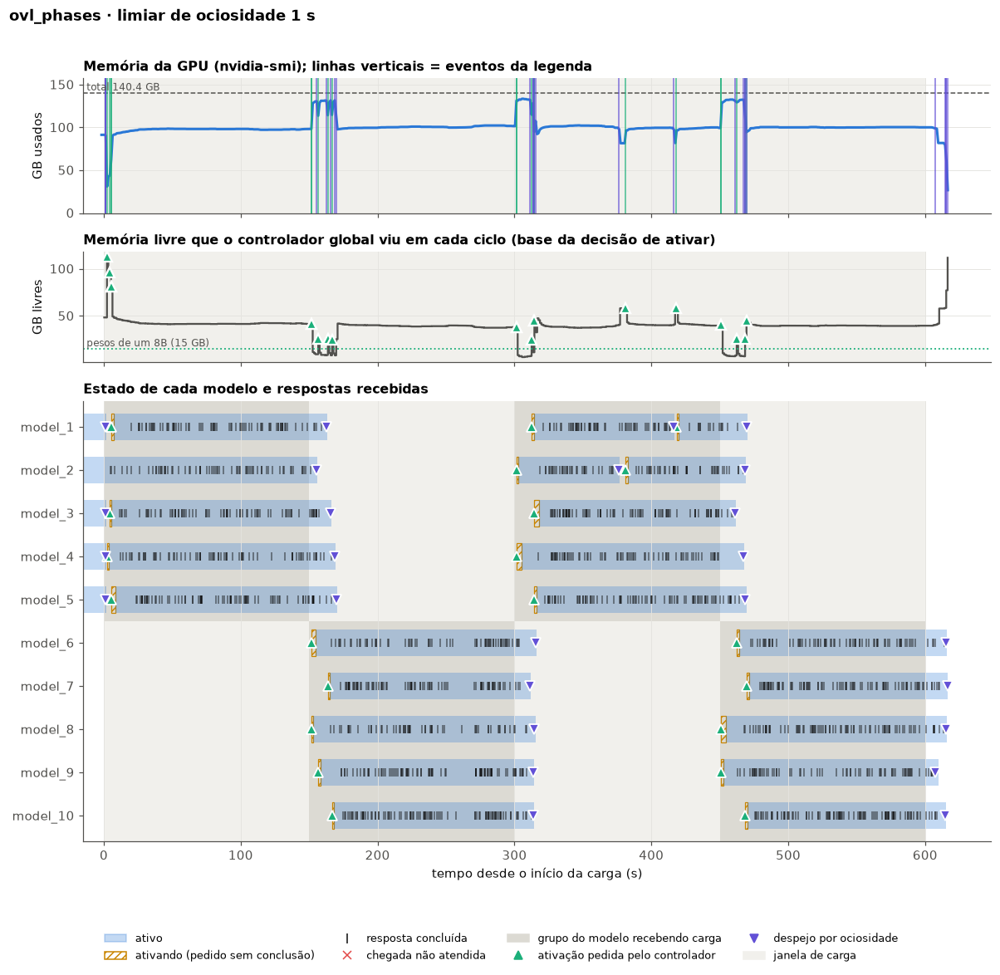

**Limiar de 5 s: 94 não atendidas, todas de 3 modelos.**
- As 94 requisições são do `model_2` (33), do `model_4` (25) e do `model_5` (36), e todas chegaram entre 388 s e 449 s, na segunda fase do grupo A.
- Esses três modelos responderam pela última vez entre 407 s e 429 s. Por volta de 444 s, o `server.log` registra três falhas do kvcached (`cuMemSetAccess ... out of memory`), e os três workers morreram (o kvcached chama `abort()`). As requisições que estavam na fila deles se perderam.
- Naquela versão, o Prism não detectava workers mortos: os três modelos continuaram "ativos" até o fim (as faixas azuis vão até 900 s) e nunca foram despejados, e as requisições seguintes ficaram esperando por eles até o prazo.
- A GPU tinha ~31 GB livres quando os workers morreram (105–109 GB usados). A falha do kvcached não foi falta de memória em bytes. Ela aconteceu às 07:29:37 (horário dos logs), no mesmo instante em que outros três jobs tiveram a mesma falha: ver [Uma falha externa, em quatro jobs ao mesmo tempo](#uma-falha-externa-em-quatro-jobs-ao-mesmo-tempo). O horário das falhas é aproximado, porque o `server.log` só registra segundos inteiros e a mensagem do kvcached não tem horário próprio.

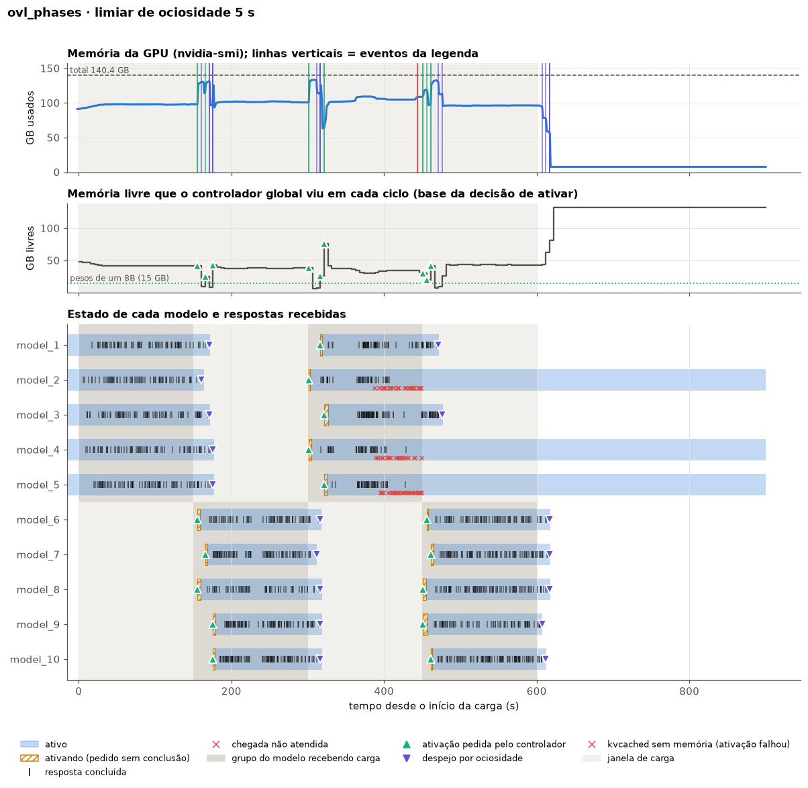

**Limiar de 10 s: 1.196 falhas, o servidor caiu aos ~188 s.**
- Na troca para o grupo B (150 s), o controlador ativou o `model_8` e o `model_9`, que couberam. Com limiar de 10 s, o grupo A só começou a sair aos ~163 s, e o controlador ativou também o `model_6` (aos ~168 s) e o `model_7` (aos ~173 s), ambos quando via ~25 GB livres. O KV dos modelos ativos continuou crescendo, e a GPU chegou a 140 GB.
- Aos ~183 s, o kvcached falhou (`cuMemSetAccess ... out of memory`). Aos ~188 s, um worker teve `torch.OutOfMemoryError` ao copiar os pesos de uma ativação, e o tratamento de exceção derrubou o servidor inteiro. A memória da GPU vai a zero por volta de 212 s.
- Das 1.196 falhas: 102 eram requisições em andamento na queda (`Server disconnected`), 1.093 chegaram depois, com o servidor fora do ar (`Connect call failed`), e 1 teve a conexão reiniciada. As 368 atendidas são de antes da queda. As falhas atingem os 10 modelos, porque o servidor inteiro caiu.
- As faixas hachuradas do `model_6` e do `model_7` até o fim são ativações que nunca terminaram, por causa da queda.

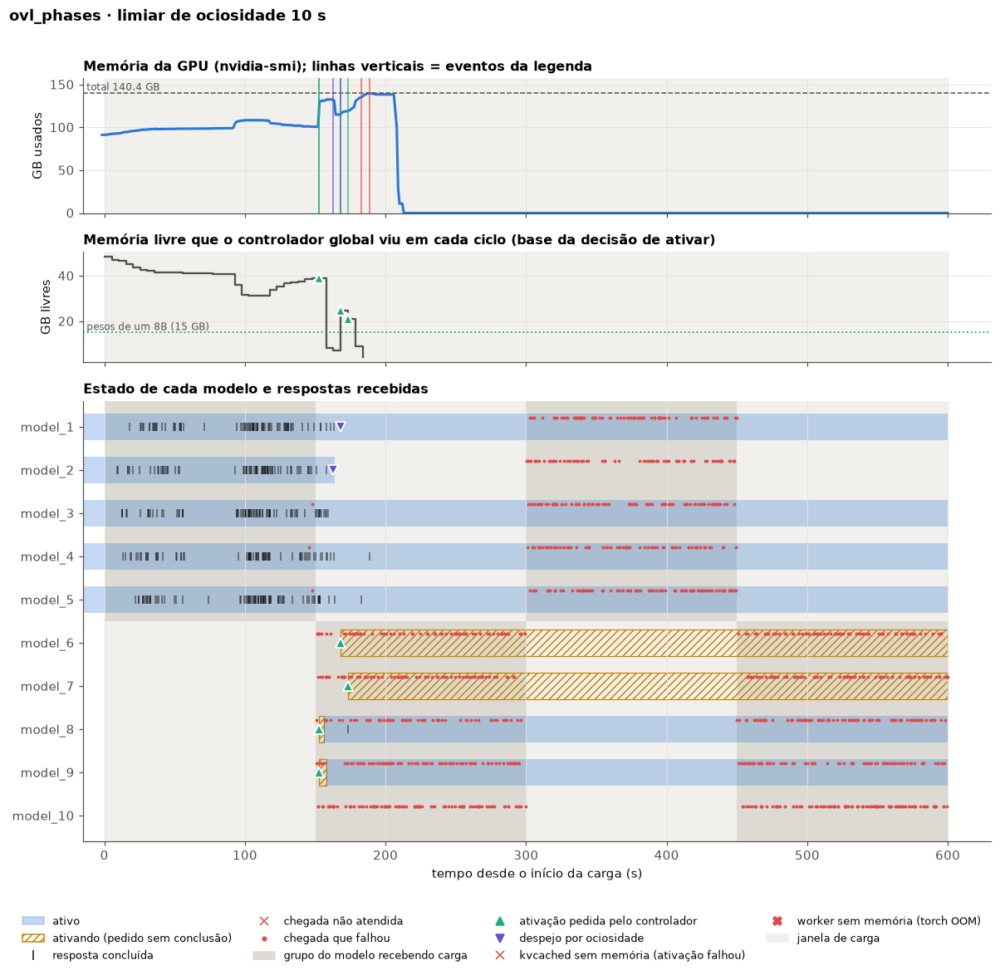

**Limiar de 25 s: sem perdas.** Os modelos do grupo que sai demoram ~25 s para ser despejados, e os do grupo novo que não cabem esperam esse tempo. É o "degrau" de TTFT depois de cada troca, menor que com 50 s.

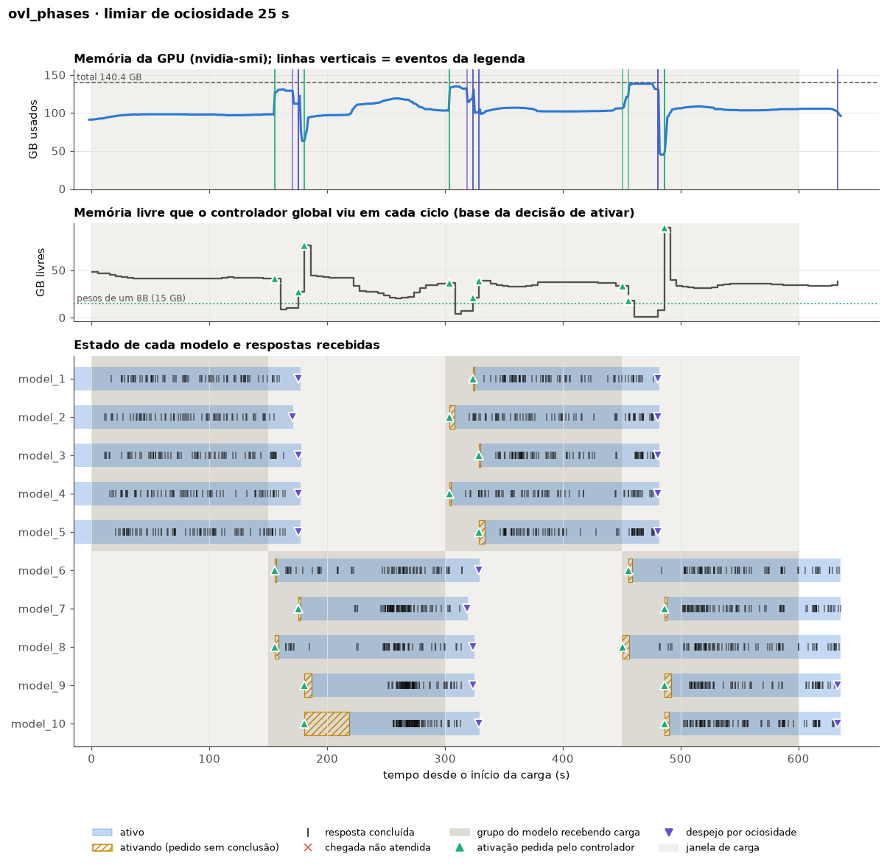

**Limiar de 50 s (original): sem perdas.** Os modelos novos que não cabem esperam quase um minuto depois de cada troca.

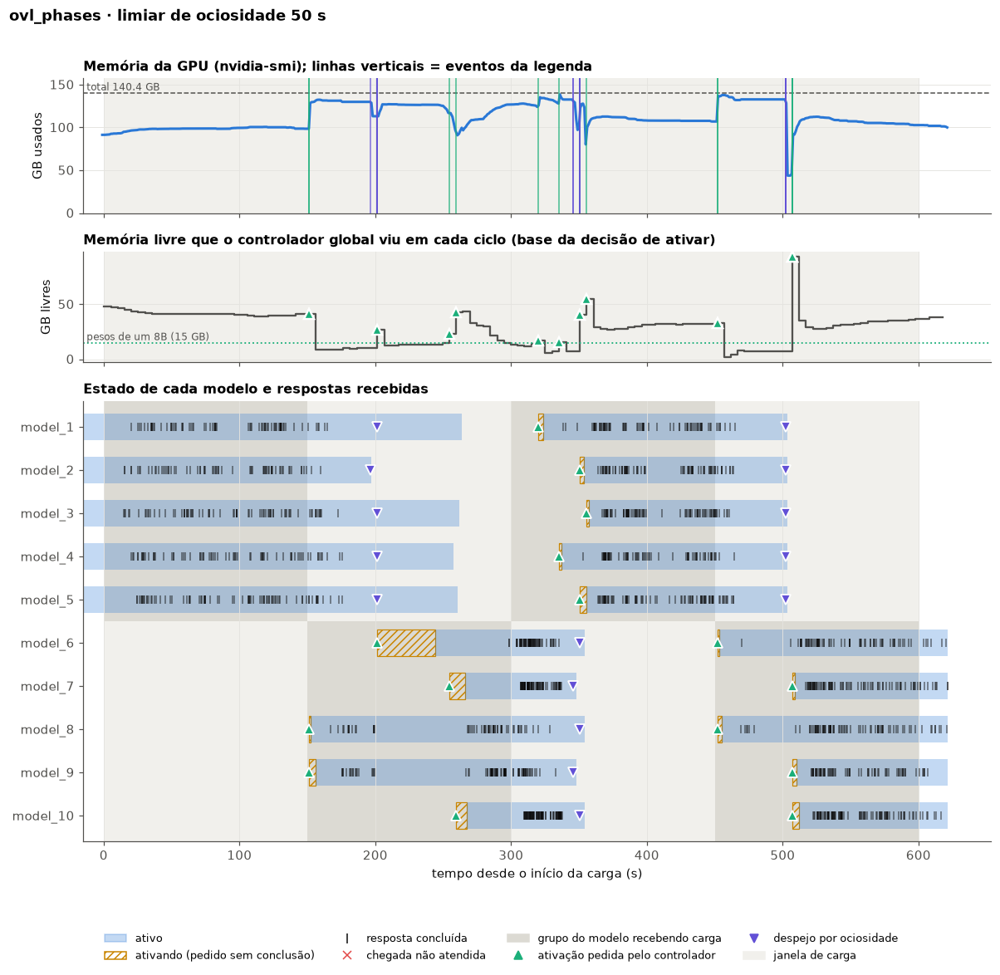

**As perdas dos limiares de 5 s e 10 s não vêm do limiar em si,** e sim das [fragilidades do Prism sob pressão de memória](#fragilidades-do-prism-sob-pressão-de-memória): workers mortos pelo kvcached e queda por `torch.OutOfMemoryError`. Um limiar mais curto aumenta o número de ativações e despejos, e com isso a exposição a essas falhas. Nas [repetições](#4-repetições-3), o limiar de 1 s também perdeu requisições numa das 3 vezes, por uma corrida no Prism.

### `ovl_mem` (todos com demanda)

| Configuração | 0,2 req/s: atendidas | 0,2: TTFT p90 / p99 (s) | 0,5 req/s: atendidas | 0,5: TTFT p90 / p99 (s) |
| --- | --- | --- | --- | --- |
| limiar 1 s | 547/599 | 112 / 224 | 0/1453 (queda) | — |
| limiar 5 s | 534/599 | 145 / 306 | 1453/1453 | 255 / 340 |
| limiar 10 s | 464/599 | 45 / 197 | 3/1453 (queda) | — |
| limiar 25 s | 5/599 (queda) | — | 1453/1453 | 308 / 391 |
| limiar 50 s (original) | 534/599 | 242 / 338 | 5/1453 (queda) | — |

Com todos os modelos recebendo tráfego, quase nunca há um modelo ocioso para despejar, então o limiar muda pouco. O que domina são as quedas do servidor: 4 das 10 execuções caíram, sem relação com o limiar. As 65 não atendidas do limiar de 5 s a 0,2 req/s vieram de uma falha do kvcached às 07:29:38, no mesmo instante em que outros três jobs falharam (ver [Uma falha externa](#uma-falha-externa-em-quatro-jobs-ao-mesmo-tempo)). Esses testes estão sendo repetidos.

### `ovl_trace` (trace real)

8 cópias do Llama-3.1-8B, 6 ativas no início, com o trace real do benchmark e2e do Prism (754 requisições em 600 s na escala 1). As escalas 0,5 e 0,25 aceleram o trace em 2× e 4×. Diferente do `ovl_phases`, aqui a popularidade é muito desigual: o `model_1` e o `model_4` recebem quase todas as requisições, e alguns modelos aparecem só por alguns minutos.

| Escala (aceleração) | Limiar | Atendidas | TTFT p50 / p90 / p99 (s) | SLO | Pior 1ª resposta (s) | Ativações / despejos | GPU pico (GB) |
| --- | --- | --- | --- | --- | --- | --- | --- |
| 1 (1×) | 1 s | 754/754 | 0,06 / 2,2 / 18,3 | 79% | 29 | 74 / 80 | 106 |
| 1 (1×) | 5 s | 754/754 | 0,06 / 2,3 / 7,8 | 86% | 20 | 45 / 48 | 106 |
| 1 (1×) | 10 s | 754/754 | 0,07 / 1,5 / 10,2 | 80% | 12 | 27 / 31 | 106 |
| 1 (1×) | 25 s | 754/754 | 0,06 / 0,3 / 5,8 | 96% | 10 | 13 / 14 | 122 |
| 1 (1×) | 50 s | 754/754 | 0,08 / 0,8 / 4,1 | 84% | 22 | 4 / 5 | 122 |
| 0,5 (2×) | 1 s | 652/754 | 0,08 / 2,7 / 23,1 | 61% | 24 | 22 / 27 | 106 |
| 0,5 (2×) | 5 s | 754/754 | 0,08 / 1,0 / 11,0 | 80% | 12 | 13 / 18 | 106 |
| 0,5 (2×) | 10 s | 754/754 | 0,07 / 0,5 / 5,2 | 93% | 10 | 11 / 16 | 106 |
| 0,5 (2×) | 25 s | 754/754 | 0,09 / 0,8 / 9,0 | 80% | 17 | 4 / 9 | 122 |
| 0,5 (2×) | 50 s | 754/754 | 0,09 / 3,1 / 21,9 | 71% | 18 | 4 / 5 | 124 |
| 0,25 (4×) | 1 s | 754/754 | 0,08 / 1,9 / 9,2 | 85% | 7 | 8 / 14 | 106 |
| 0,25 (4×) | 5 s | 754/754 | 0,09 / 1,3 / 9,0 | 83% | 17 | 6 / 12 | 119 |
| 0,25 (4×) | 10 s | 754/754 | 0,08 / 0,4 / 4,1 | 94% | 12 | 5 / 10 | 122 |
| 0,25 (4×) | 25 s | 754/754 | 0,09 / 1,5 / 7,8 | 79% | 12 | 4 / 6 | 124 |
| 0,25 (4×) | 50 s | 754/754 | 0,08 / 0,4 / 5,1 | 96% | 9 | 4 / 5 | 126 |

**O que a tabela mostra:**
- **O SLO varia entre 61% e 96% sem tendência clara com o limiar.** O trace sobrecarrega pouco a memória: a GPU ficou em 105–126 GB, então quase sempre cabe quem precisa entrar. Sem pressão, o limiar decide só quantas vezes um modelo é despejado e reativado.
- **Limiar curto, muitas partidas a frio.** Na escala 1, o limiar de 1 s fez 74 ativações e 80 despejos, contra 4 e 5 com 50 s. Os modelos de tráfego esparso (como o `model_5` e o `model_2`) saem entre uma requisição e outra e voltam logo depois, e cada volta é uma partida a frio de alguns segundos. É daí que vêm o TTFT p99 maior e o pior tempo até a primeira resposta mais alto com 1 s. Quanto mais acelerado o trace, menos intervalos longos entre requisições, e menos trocas: com 1 s, 74 ativações na escala 1, 22 na 0,5 e 8 na 0,25.
- **A GPU pico é menor com limiares curtos** (106 GB contra 122–126 GB com 25–50 s), porque os modelos sem tráfego saem logo. Aqui isso não ajuda ninguém, porque havia memória sobrando.

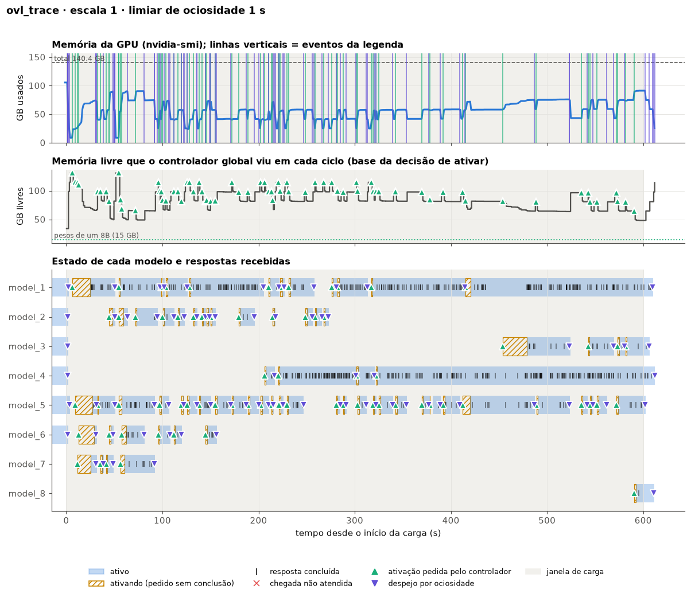
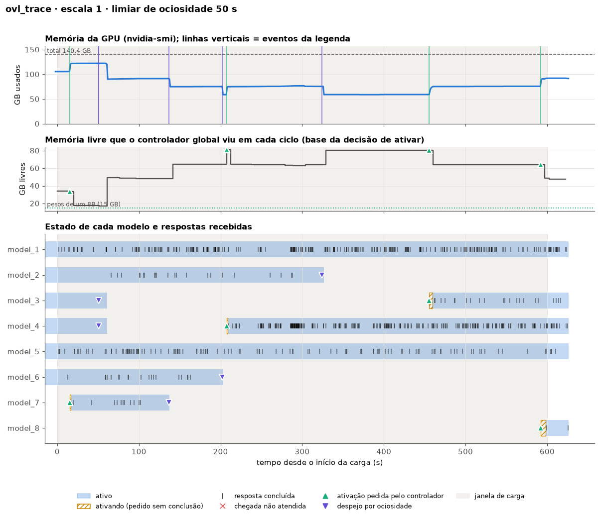

**Limiar de 1 s, escala 0,5: 102 não atendidas, todas do `model_4`.**
- O `model_4` foi ativado aos 105 s e respondeu normalmente até 252 s. As 102 requisições que chegaram dele entre 197 s e 300 s nunca foram respondidas.
- Por volta de 252 s, o `server.log` registra uma falha do kvcached (`cuMemSetAccess ... out of memory`), e o worker do `model_4` parou de registrar no log: morreu pelo `abort()` do kvcached. Naquela versão, o Prism não detectava workers mortos, e o modelo continuou "ativo" até o fim (a faixa azul vai até 600 s).
- A GPU tinha **62 GB livres** nesse momento (77 GB usados). Não foi falta de memória em bytes.

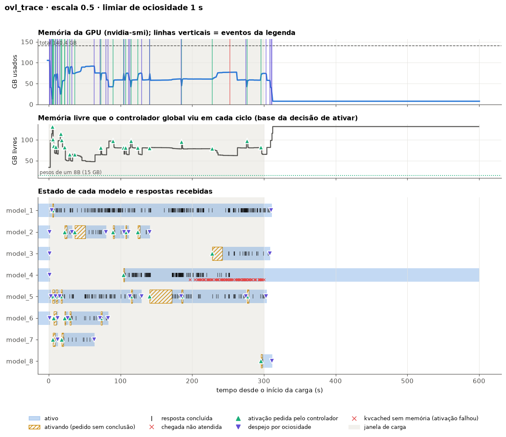

### Uma falha externa, em quatro jobs ao mesmo tempo

A falha do kvcached no `ovl_trace` (limiar de 1 s, escala 0,5) aconteceu às 07:29:36 (horário dos logs). No mesmo par de segundos, entre 07:29:36 e 07:29:38, **outros três jobs** tiveram a mesma falha (`cuMemSetAccess ... out of memory`):
- `ovl_phases` com limiar de 5 s (os 3 workers mortos, 94 não atendidas);
- `ovl_mem` com limiar de 5 s a 0,2 req/s (65 não atendidas);
- despejo sob pressão no `ovl_phases` (o `model_9` que nunca terminou de ativar, 157 não atendidas).

Eram jobs independentes, cada um numa GPU diferente (barramentos `04`, `23` e `C3`, entre outros), com políticas diferentes e, em pelo menos dois casos, com dezenas de GB livres. O Polyaxon não informa o nó de cada job, então não dá para saber se estavam no mesmo servidor. De qualquer forma, quatro falhas simultâneas apontam para um **evento externo ao Prism e à política** (do driver, do nó ou do cluster) no instante 07:29:37, que o kvcached transforma em `abort()`. As perdas desses quatro testes não devem ser atribuídas ao limiar nem à estratégia.

## 2. Estratégias simples

Implementadas em `simple_global.py` e selecionadas por `PRISM_EVICTION`. Cada uma rodou no cenário que pretende resolver, ao lado da política original no mesmo nó.

| Estratégia (`PRISM_EVICTION`) | Ideia |
| --- | --- |
| `pressure` (despejo sob pressão) | Se um modelo com fila não cabe, despeja o modelo ocioso há mais tempo (≥ 2 s sem fila), sem esperar 50 s |
| `adaptive` (ociosidade adaptativa) | Cada modelo tem um limiar de 3× o p90 dos intervalos entre as suas próprias requisições (5–50 s); sob pressão, sai o mais "atrasado" em relação ao seu ritmo |
| `fair` (rodízio anti-fome) | `pressure`, mais: se um modelo espera ≥ 30 s e ninguém está ocioso, sai o modelo ativo há mais tempo, mesmo ocupado |
| `PRISM_ACTIVATION_HEADROOM_GB` (folga) | Exige memória livre além dos pesos para ativar, para o KV inicial caber |

| Cenário | Configuração | Atendidas | Perdas | TTFT p50 / p90 / p99 (s) | SLO | Pior 1ª resposta (s) |
| --- | --- | --- | --- | --- | --- | --- |
| `ovl_phases` | original | 1564/1564 | — | 0,15 / 32,7 / 54,1 | 65% | 67 |
| `ovl_phases` | despejo sob pressão | 1407/1564 | 157 não atendidas | 0,13 / 12,0 / 42,9 | 60% | nunca |
| `ovl_trace` 0,5 | original | 754/754 | — | 0,06 / 0,1 / 7,3 | 95% | 10 |
| `ovl_trace` 0,5 | adaptativa | 754/754 | — | 0,07 / 1,1 / 7,9 | 82% | 10 |
| `ovl_mem` 0,2 | original | 534/599 | 65 não atendidas | 0,25 / 245,8 / 336,4 | 47% | nunca |
| `ovl_mem` 0,2 | só folga de 3 GB | 599/599 | — | 0,25 / 272,7 / 343,6 | 50% | 363 |
| `ovl_mem` 0,2 | rodízio anti-fome | 445/599 | 154 falhas | 8,21 / 58,2 / 144,5 | 20% | nunca |

- **Despejo sob pressão.** O TTFT p90 caiu de 33 s para 12 s. Mas o `model_9` travou: a ativação levou 20 s, 17,8 s deles esperando o model service, porque duas ativações simultâneas disputavam os pesos. Quando o kvcached foi iniciar, havia só 6 GB livres: o driver recusou a página, o kvcached matou o worker, e o Prism nunca soube. Essa falha aconteceu às 07:29:36, junto com a de outros três jobs (ver [Uma falha externa](#uma-falha-externa-em-quatro-jobs-ao-mesmo-tempo)), então não dá para atribuí-la só à estratégia.
- **Adaptativa.** Pior que a original no trace, que nessa velocidade quase não pressiona a memória. Despejar mais cedo só acrescenta partidas a frio. Além disso, com o ciclo de 5 s a estimativa dos intervalos fica grosseira (o controlador só vê a última chegada de cada modelo por ciclo).
- **Só a folga de 3 GB.** Evitou a ativação que falha sem aviso: atendeu tudo, sem nenhuma falha do kvcached, contra 65 não atendidas na original. Mas, como no vLLM, troca perda por espera: p99 de 344 s. Na pressão do `ovl_phases`, 3 GB não bastaram.
- **Rodízio anti-fome.** O rodízio funcionou entre os modelos 1 a 8 (ver a figura), mas houve 154 falhas, por dois motivos:
  - Um worker morreu com o bug do `pretty_print` (ver abaixo), e o worker pool continuou entregando esse worker morto como livre. Quando o `model_9` e o `model_10` foram ativados nele, todas as requisições pendentes deles falharam.
  - Há uma falha de desenho: quem entra é escolhido pela ordem de violação de SLO do Prism, e não por quem espera há mais tempo. Por isso esses dois modelos só tiveram vez no fim.

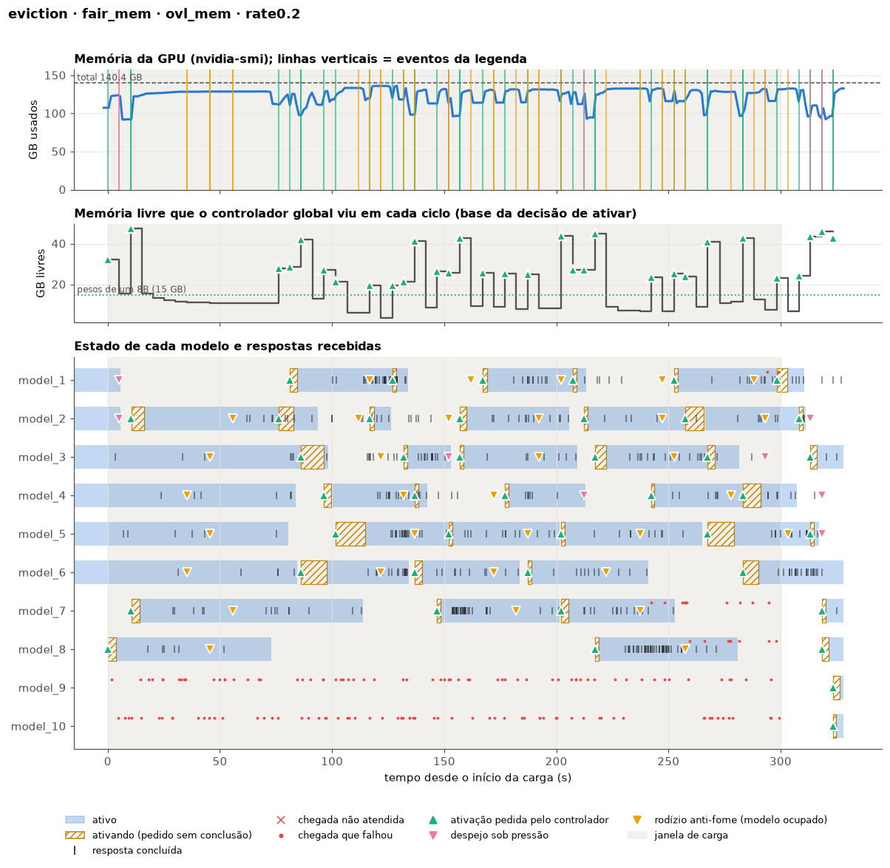

## 3. Troca por throughput por GB

### Desenho (`PRISM_EVICTION=throughput`)

A cada ciclo do controlador, para cada modelo inativo com fila que não coube:

1. **Valor de cada ativo** = tokens que ele processou nos últimos 30 s (o worker informa a contagem a cada 1 s) + os tokens da fila dele ÷ 30 s. A densidade é esse valor dividido pelos GB que ele ocupa (pesos + KV estimado).
2. **Demanda do candidato** = tokens na fila ÷ 30 s, multiplicada por (1 + espera da requisição mais antiga ÷ 30 s). Esse envelhecimento garante que um modelo esperando acabe entrando.
3. **Vítimas**: os ativos há pelo menos 20 s, em ordem crescente de densidade, até liberar os pesos do candidato + 3 GB de folga. A troca só acontece se a demanda do candidato superar o valor das vítimas em 20%. A memória liberada fica reservada para o candidato por 15 s.
4. **Modo de saída da vítima**:

| | sem preempção (P0) | com preempção (P1) |
| --- | --- | --- |
| **sem drenagem (D0)** | o Prism atual: as em execução terminam, a fila volta para a fila geral | as em execução são retiradas e recomputadas depois; troca imediata |
| **com drenagem (D1)** | serve a fila já aceita e as em execução, até 15 s | serve por até 15 s e retira o que sobrou |

Duas mudanças no worker do SGLang (`srt/managers/scheduler.py`) foram necessárias:
- **Correção da preempção:** com `RECOMPUTE`, as requisições retiradas ficavam na fila local do worker, e o worker pool pode passar esse worker para outro modelo. Agora elas voltam para a fila do modelo e recomeçam do prompt.
- **Drenagem com prazo:** campo `drain_timeout` na desativação.

O teste rápido confirmou o caminho completo: um modelo drenou por 15 s, retirou 3 requisições em execução, e elas voltaram e foram atendidas.

### Resultados

| Cenário | Configuração | Atendidas | Perdas | TTFT p50 / p90 / p99 (s) | SLO | Pior 1ª resposta (s) | Trocas |
| --- | --- | --- | --- | --- | --- | --- | --- |
| `ovl_mem` 0,2 | original | 534/599 | 65 não atendidas | 0,64 / 247 / 340 | 30% | nunca | 0 |
| | P0D0 | 599/599 | — | 28,2 / 70 / 105 | 12% | 71 | 42 |
| | P0D1 | 599/599 | — | 35,1 / 142 / 182 | 10% | 86 | 40 |
| | P1D0 | 46/599 | 553 falhas (queda) | — | 4% | — | 20 |
| | P1D1 | 599/599 | — | 33,1 / 122 / 187 | 14% | 54 | 46 |
| `ovl_mix` | original | 13/549 | 536 não atendidas (travou) | — | 1% | nunca | 0 |
| | P0D0 | 549/549 | — | 17,2 / 73 / 145 | 20% | 76 | 42 |
| | P0D1 | 549/549 | — | 28,6 / 119 / 201 | 15% | 61 | 36 |
| | P1D0 | 375/549 | 174 falhas (worker morto) | 48,3 / 140 / 211 | 9% | 52 | 60 |
| | P1D1 | 549/549 | — | 14,9 / 70 / 121 | 30% | 64 | 39 |
| `ovl_phases` | original | 1564/1564 | — | 0,14 / 33,0 / 52,8 | 73% | 68 | 0 |
| | P0D0 | 1564/1564 | — | 0,13 / 9,3 / 42,3 | 79% | 27 | 9 |
| | P0D1 | 1168/1564 | 396 falhas (queda) | 0,14 / 8,1 / 22,9 | 60% | 27 | 9 |
| | P1D0 | 1564/1564 | — | 0,14 / 10,1 / 47,5 | 81% | 27 | 13 |
| | P1D1 | 1564/1564 | — | 0,14 / 9,6 / 41,8 | 80% | 29 | 9 |
| `ovl_trace` 0,5 | original | 754/754 | — | 0,10 / 2,1 / 10,7 | 68% | 12 | 0 |
| | P0D0 | 754/754 | — | 0,12 / 3,9 / 24,5 | 65% | 26 | 0 |
| | P0D1 | 754/754 | — | 0,08 / 0,7 / 7,0 | 83% | 10 | 0 |
| | P1D0 | 754/754 | — | 0,09 / 3,9 / 18,4 | 69% | 18 | 0 |
| | P1D1 | 754/754 | — | 0,08 / 0,5 / 4,2 | 92% | 10 | 0 |

A coluna "Trocas" conta só as trocas por throughput. Os despejos por ociosidade continuam acontecendo e estão nas figuras.

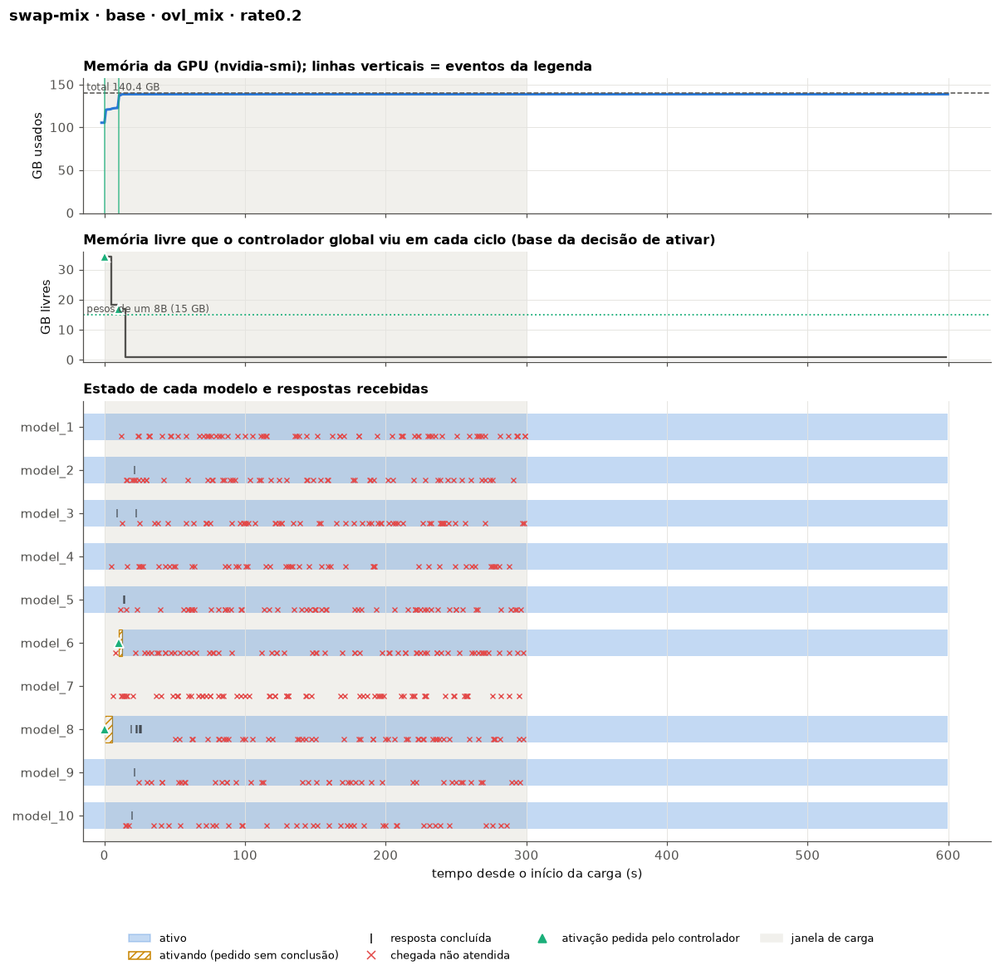
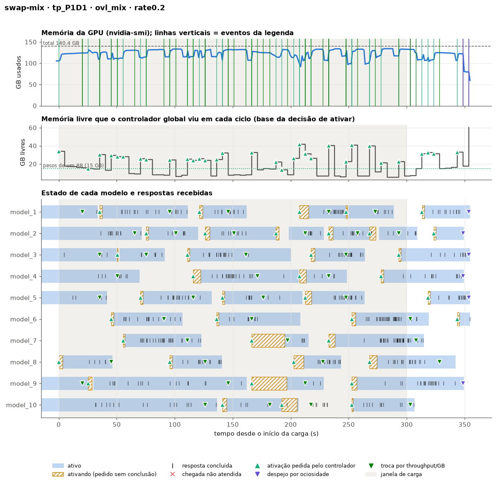

**O que os resultados mostram:**

- **Fome resolvida.** No `ovl_mem` e no `ovl_mix`, todo modelo recebe a primeira resposta em ≤ 86 s, contra "nunca" na política original. No `ovl_mix`, a original travou por completo aos ~15 s: ativou o `model_6` com 17 GB livres, a GPU encheu, e nenhum modelo voltou a responder.
- **O custo é a espera distribuída.** Com a GPU sem capacidade para todos, as trocas fazem cada modelo esperar sua vez. O TTFT mediano sobe para 15–35 s, e o SLO de 1 s fica baixo para todos.
- **Troca de grupos.** No `ovl_phases`, a troca entra assim que o grupo antigo para, sem esperar 50 s ocioso. O pior tempo até a primeira resposta cai de 68 s para 27 s.
- **Preempção e drenagem.** P1D1 foi a única configuração que atendeu tudo nos quatro cenários e teve o melhor SLO em dois deles. Com uma execução por configuração, não dá para afirmar que a combinação é melhor. As falhas de P1D0 e P0D1 vêm das fragilidades do SGLang (queda por `torch` OOM e worker morto pelo bug do `pretty_print`), e não de um erro na lógica de preempção ou drenagem.
- **`ovl_trace`.** Nenhuma troca aconteceu, porque o trace a 0,5 não deixa modelos de fora por muito tempo. As cinco configurações são, na prática, a mesma política, e o SLO variou de 65% a 92%. **Esse é o tamanho do ruído entre execuções no mesmo nó.**
- **Tamanho.** No `ovl_mix`, os 3B foram 18–26% das vítimas (7 a 12 de 39 a 60 trocas), contra 20% dos modelos. Eles não ficaram protegidos, por dois motivos:
  - os 8B recém-ativados ficam protegidos pelo tempo mínimo na GPU, e sobram os 3B;
  - o envelhecimento faz a demanda dos candidatos chegar a 500–1.100 tokens/s, o que torna qualquer troca vantajosa.
  
  A densidade só ordena as vítimas; ela não impede trocas ruins quando todos estão saturados.

## 4. Repetições (3×)

Repetimos 3 vezes as configurações mais promissoras: o limiar de 1 s no `ovl_phases` e a troca P1D1 no `ovl_phases`, no `ovl_mem` a 0,2 e no `ovl_mix`. Cada repetição roda num job separado, para cair em nós diferentes, e dentro de cada job a política original roda ao lado das candidatas. Depois do [relatório de robustez](2026-10-22%20Correções%20de%20robustez%20de%20memória%20no%20Prism%20(SGLang).md), a memória funciona como no Prism publicado (árbitro desligado), e ficam ligadas só as correções que agem quando o Prism quebraria: desfazer e avisar uma ativação sem memória, e detectar workers mortos.

Três jobs do `ovl_mix` e um do `ovl_mem` ficaram presos na primeira tentativa: começaram depois das 22:06 UTC e não reagiram nem a `kill -9`, o que sugere um problema do cluster. Reenviados, terminaram normalmente. Foram usadas só as execuções completas, comparadas sempre dentro do mesmo job.

### `ovl_phases`

| Configuração | Repetição | Atendidas | TTFT p90 / p99 (s) | SLO | Pior 1ª resposta (s) |
| --- | --- | --- | --- | --- | --- |
| original | 1 | 1564/1564 | 30,6 / 53,6 | 70% | 68 |
| original | 2 | 1564/1564 | 32,3 / 56,8 | 68% | 67 |
| original | 3 | 1564/1564 | 34,9 / 56,4 | 65% | 72 |
| limiar de 1 s | 1 | 1564/1564 | 6,4 / 26,6 | 82% | 30 |
| limiar de 1 s | 2 | 1564/1564 | 6,9 / 32,7 | 81% | 65 |
| limiar de 1 s | 3 | 1427/1564 | 1,0 / 14,0 | 77% | 26 |
| troca P1D1 | 1 | 1175/1564 | 7,7 / 22,1 | 62% | 28 |
| troca P1D1 | 2 | 1510/1564 | 20,8 / 44,0 | 71% | 66 |
| troca P1D1 | 3 | 1564/1564 | 11,3 / 39,2 | 71% | 27 |

### `ovl_mem` a 0,2 req/s

| Configuração | Repetição | Atendidas | TTFT p90 / p99 (s) | SLO | Pior 1ª resposta (s) |
| --- | --- | --- | --- | --- | --- |
| original | 1 | 16/599 | 8,3 / 19,0 | 1% | nunca |
| original | 2 | 599/599 | 274,5 / 349,2 | 52% | 359 |
| original | 3 | 599/599 | 273,0 / 342,7 | 56% | 362 |
| troca P1D1 | 1 | 599/599 | 69,1 / 97,1 | 20% | 50 |
| troca P1D1 | 2 | 599/599 | 64,7 / 115,3 | 17% | 63 |
| troca P1D1 | 3 | 599/599 | 65,3 / 118,0 | 23% | 55 |

### `ovl_mix`

| Configuração | Repetição | Atendidas | TTFT p90 / p99 (s) | SLO | Pior 1ª resposta (s) |
| --- | --- | --- | --- | --- | --- |
| original | 1 | 16/549 | 13,6 / 16,1 | 2% | nunca |
| original | 2 | 11/549 | 21,7 / 39,9 | 0% | nunca |
| original | 3 | 13/549 | 1,6 / 7,0 | 2% | nunca |
| troca P1D1 | 1 | 526/549 | 63,0 / 97,9 | 30% | 77 |
| troca P1D1 | 2 | 512/549 | 35,3 / 62,1 | 44% | 64 |
| troca P1D1 | 3 | 512/549 | 28,1 / 63,3 | 54% | 49 |

### O que as repetições confirmam

- **O limiar de 1 s é a melhor opção para a troca de grupos.** Nas 3 repetições do `ovl_phases`, ele foi melhor que a política original: TTFT p90 de 1–7 s contra 31–35 s, e 77–82% de SLO contra 65–70%. Numa delas, um modelo deixou de ser atendido por uma corrida no Prism (ver abaixo).
- **A troca P1D1 acaba com a fome, mas não melhora o SLO.**
  - No `ovl_mem`, atendeu tudo nas 3 repetições, e o pior tempo até a primeira resposta de um modelo caiu de ~360 s (ou "nunca") para 50–63 s. Mas o SLO ficou em 17–23%, contra 52–56% da original, porque a espera passa a ser dividida por todos os modelos.
  - No `ovl_mix`, a política original **travou nas 3 repetições** (11 a 16 de 549 atendidas), e a troca atendeu 93–96%.
  - No `ovl_phases`, ela melhora o p90, mas não o SLO, e perdeu requisições em 2 das 3 repetições.
- **A variação entre repetições é grande.** O SLO da troca P1D1 no `ovl_mix` foi de 30% a 54%. Comparações com uma execução só não são confiáveis.

### Falhas encontradas nas repetições

1. **Corrida entre desativar e ativar o mesmo modelo (Prism).**
   - O que acontece: o controlador manda reativar um modelo cuja desativação anterior ainda está em andamento em outro worker. A reativação termina, e depois chega a confirmação da desativação antiga. O GPU scheduler marca o modelo como desativado, enquanto o controlador continua achando que ele está ativo e nunca o reativa. O modelo deixa de ser atendido até o fim.
   - Onde apareceu: no `ovl_phases` com limiar de 1 s (repetição 3: o `model_4` foi despejado e reativado em ~2 s, e 137 requisições ficaram sem resposta) e em 2 das 3 repetições da troca P1D1 no `ovl_mix`, porque a drenagem deixa a desativação em andamento por até 15 s (o `model_9` perdeu 37 requisições em cada uma).
   - É um bug do controle de estado do Prism, exposto pelas políticas que despejam e reativam rápido. A correção provável é o GPU scheduler ignorar a confirmação de uma desativação que já foi superada por uma ativação mais nova do mesmo modelo.

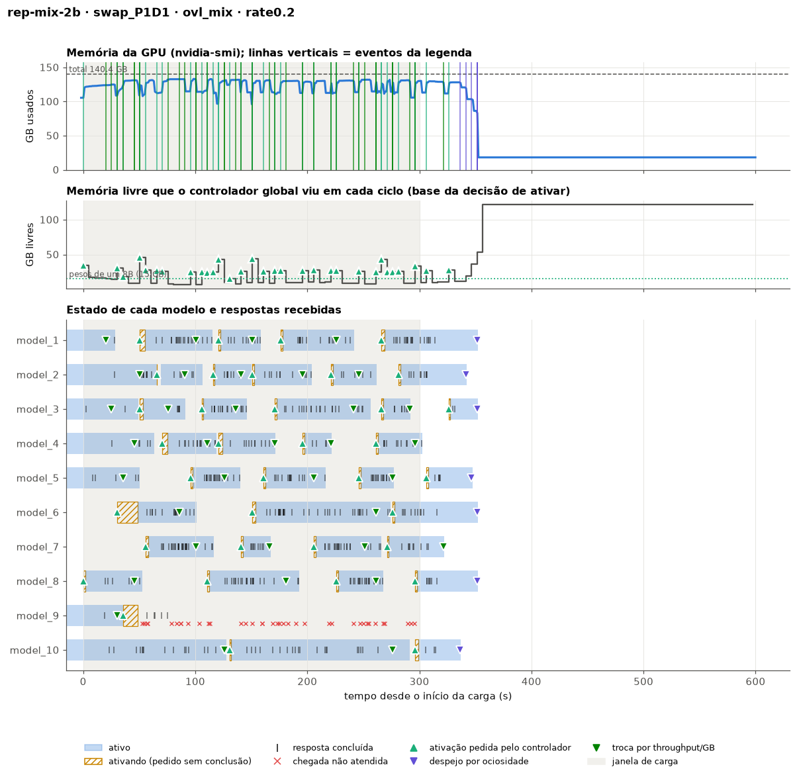

2. **Travamento geral com a política original no `ovl_mix`** (3 de 3 repetições) e no `ovl_mem` (1 de 3). A GPU enche (até 142,9 de 143,7 GB) e nenhum modelo progride. No `ovl_mem`, isso aconteceu logo depois de dois workers morrerem e um modelo ser reativado. A detecção de workers mortos funcionou, mas a reativação sem reserva de memória encheu a GPU. Sem o árbitro (desligado por padrão), nada impede isso.
3. **A falha 3 continua** (`pretty_print` do SGLang): ela derrubou o servidor na repetição 1 da troca P1D1 no `ovl_phases` (389 perdas).
4. **As correções que só evitam quedas funcionaram.** Numa repetição do limiar de 1 s, cinco ativações ficaram sem memória e foram desfeitas e avisadas, sem nenhuma requisição perdida.

**Jobs:**

| Cenário | Jobs |
| --- | --- |
| `ovl_phases` | `8098e726`, `e4927caa`, `618a6745` |
| `ovl_mem` | `cc480dcf`, `6d7b6081`, `c23826d0` (reenvio de `941c9fac`) |
| `ovl_mix` | `1281bda8`, `b2f43240`, `ede340b5` (reenvios de `a96c44a6`, `373c6488`, `8f35c520`) |

Suítes: `polyaxon/configs/rep_{phases,mem,mix}_suite.tsv`. Dados em `reports/data/2026-10-22-repeticoes/`; figuras e `metricas.csv` em `reports/figs/2026-10-22-repeticoes/`.

## Fragilidades do Prism sob pressão de memória

Encontradas nesta rodada. Elas aparecem com qualquer política, inclusive a original, mas quem troca mais se expõe mais. A causa comum é que 6 a 14 processos SGLang dividem a memória de uma GPU, cada um decidindo sozinho a partir de uma foto da memória livre. A coluna "De quem é" diz onde está o código que falha. O detalhamento está no [relatório de robustez](2026-10-22%20Correções%20de%20robustez%20de%20memória%20no%20Prism%20(SGLang).md).

| # | Falha | Onde apareceu | Efeito | De quem é |
| --- | --- | --- | --- | --- |
| 1 | Ao ativar um modelo, o driver recusa a página inicial de KV (`cuMemCreate`/`cuMemSetAccess ... out of memory`) e o kvcached chama `abort()`, matando o worker | original no `ovl_mem`, despejo sob pressão | o modelo fica em `activating` para sempre; o Prism não percebe a morte e continua mandando requisições | kvcached (`abort()`) + Prism (não detecta o worker morto) |
| 2 | O mesmo `abort()` num modelo já ativo, quando o KV precisa de mais uma página | limiar 5 s no `ovl_phases`, original no `ovl_mix` | as requisições do worker morto ficam sem resposta; no `ovl_mix`, todos os workers pararam | kvcached + Prism |
| 3 | Falta de KV no prefill → `tree_cache.pretty_print()` → `NotImplementedError` (radix cache desligado) | rodízio, P1D0 no `ovl_mix`, P0D1 no `ovl_phases` | o worker morre, e o tratamento de exceção do SGLang (`kill_parent_process`) mata também os outros workers da GPU | código do SGLang original, disparado pelo compartilhamento de memória do Prism |
| 4 | `torch.OutOfMemoryError` ao copiar os pesos de uma ativação | `ovl_mem` 0,5 (3 limiares), P1D0 no `ovl_mem`, limiar 10 s no `ovl_phases` | o servidor inteiro cai | Prism (ativação decidida pela memória do instante; espera por memória que nunca funcionou no worker pool) + SGLang (exceção derruba o servidor) |
| 5 | 14 workers numa GPU | `ovl_mix` com 14 modelos | o servidor não sobe (`cuMemSetAccess` out of memory na inicialização) | causa não identificada. Uma sonda subiu 24 processos com o kvcached um por um sem falha; a hipótese é que dependa da carga de memória simultânea na inicialização e não seja determinística |

## Próximos passos

Em ordem de prioridade, para decidir a direção:

1. **Robustez antes de política.** Sem isto, as comparações ficam dominadas por quedas e travamentos:
   - corrigir o `pretty_print` (no `ChunkCache`, retirar requisições em vez de levantar exceção);
   - avisar o controlador quando uma ativação falha, para ele tentar de novo ou desistir;
   - fazer o worker pool detectar workers mortos;
   - fazer o kvcached recusar crescer o KV de forma explícita, em vez de matar o processo.
2. **Reserva de memória que cubra o tempo real de ativação.** A ativação levou até 20 s por disputa no model service. Uma folga fixa de 3 GB não basta. Possíveis caminhos: reservar a memória do candidato no kvcached no momento da decisão, ou serializar as ativações.
3. **Troca por throughput, versão 2:**
   - limitar o envelhecimento (teto na demanda) e exigir que a troca melhore a densidade total por GB, e não só que o candidato espere;
   - escolher quem entra pela espera mais antiga (corrige também o rodízio);
   - medir a vazão por tokens de decode, que é o que ocupa o KV.
4. **Controle de admissão.** Na sobrecarga do `ovl_mem`/`ovl_mix`, nenhuma troca dá SLO bom para todos. Recusar ou adiar requisições é a alternativa a espalhar a espera.
5. **Repetições.** O ruído entre execuções iguais chega a ~25 pontos de SLO. Cada configuração promissora precisa de pelo menos 3 execuções.

## Limitações

- **Uma execução por configuração.** No `ovl_trace`, configurações que se comportaram igual variaram de 65% a 92% de SLO.
- **Base diferente em cada nó.** A política original no `ovl_phases` deu 51%, 65% e 73% de SLO em três nós diferentes. Por isso as comparações são sempre dentro da mesma suíte.
- **O `ovl_trace` a 0,5 quase não sobrecarrega.** Não serve para avaliar a troca, só para medir o ruído.
- **O `ovl_mix` tem só 10 modelos e 2 tamanhos.** Com 14 workers, o servidor não sobe.
- **A estratégia adaptativa** viu os intervalos entre chegadas só uma vez por ciclo de 5 s.

## Como reproduzir

| O quê | Arquivo |
| --- | --- |
| Limiar, ciclo, estratégias e troca por throughput | `python/sglang/multi_model/scheduling/policy/simple_global.py` (`PRISM_IDLE_THRESHOLD`, `PRISM_EVICTION`, `PRISM_SWAP_*`, `PRISM_ACTIVATION_HEADROOM_GB`), `scheduling/controller_global.py` (`PRISM_SCHEDULE_INTERVAL`, contagem de tokens servidos) |
| Preempção e drenagem no worker | `python/sglang/srt/managers/scheduler.py` (`handle_deactivate_request`, `_run_to_completion_normal`), `drain_timeout` em `srt/managers/io_struct.py` e `scheduling/action.py` |
| Cenários `ovl_*` (inclui `ovl_trace` e `ovl_mix`) | `polyaxon/run_examples.sh` |
| Gerador de carga (`--real-trace`, `--model-rates`) | `polyaxon/overload_load.py` |
| Suítes (uma por job, mesmo nó) | `polyaxon/configs/idle_{mem,phases,trace}_suite.tsv`, `eviction_suite.tsv`, `swap_{mem,mix,phases,trace}_suite.tsv` |
| Extração, figuras e tabelas | `polyaxon/extract_ovl.py`, `polyaxon/ovl_plots.py`, `polyaxon/plot_suite.py` |
| Dados e figuras deste relatório | `reports/data/2026-10-22-ociosidade/`, `reports/figs/2026-10-22-ociosidade/` (inclui `metricas.csv`) |

```bash
# uma suíte por job (SGLang); trocar o arquivo para as outras
PRISM_JOB_SUFFIX=-swap-mix PRISM_JOB_ENV="PRISM_SUITE=polyaxon/configs/swap_mix_suite.tsv PRISM_TIMEOUT=6500" polyaxon/submit.sh
# uma configuração solta
PRISM_JOB_ENV="PRISM_STEPS=ovl_phases PRISM_IDLE_THRESHOLD=1 PRISM_TIMEOUT=3600" polyaxon/submit.sh
PRISM_JOB_ENV="PRISM_STEPS=ovl_mix PRISM_EVICTION=throughput PRISM_SWAP_PREEMPT=1 PRISM_SWAP_DRAIN=1 PRISM_ACTIVATION_HEADROOM_GB=3 PRISM_TIMEOUT=3600" polyaxon/submit.sh
# baixar, extrair e gerar figuras (uma pasta por configuração da suíte)
polyaxon ops artifacts -p kunumi/hpc4ai -uid <uuid> -d outputs --path <dir>
python3 polyaxon/extract_ovl.py <dir>/outputs/<config> reports/data/2026-10-22-ociosidade/<suite>/<config>
python3 polyaxon/plot_suite.py reports/data/2026-10-22-ociosidade reports/figs/2026-10-22-ociosidade
```

| Job | Suíte |
| --- | --- |
| `bc5712af` | limiar, `ovl_mem` |
| `ebafecd8` | limiar, `ovl_phases` |
| `474770d4` | limiar, `ovl_trace` |
| `faadf3d5` | estratégias simples |
| `57a698c8` | troca por throughput, `ovl_mem` |
| `8db586d3` | troca por throughput, `ovl_mix` |
| `0bc0f97c` | troca por throughput, `ovl_phases` |
| `1e50e2fb` | troca por throughput, `ovl_trace` |
| `e92eed1e`, `b56dfb0b` | testes rápidos (`ovl_trace`; troca P1D1 no `ovl_mix`) |
