# Janela de ociosidade e estratégias de troca no Prism, com as correções, SGLang (2026-10-28)

## Como os testes foram feitos

| Item | O que foi usado |
| --- | --- |
| Onde | Polyaxon, projeto `kunumi/hpc4ai`, fila `axia/default`, 1 NVIDIA H200 por job. |
| Imagem | `gabrielliman/prism:sglang0.3.4-cu121` (o container do `install.md` + kvcached `prism/shm` + Redis) |
| Servidor | flags do exemplo 3 do README (kvcached, GPU scheduler, controlador `simple-global`, model service, worker pool), `--workers-per-gpu` = número de modelos |
| Memória | como no Prism publicado: árbitro desligado (`PRISM_MEMORY_ARBITER=0`), espaço virtual do kvcached de 25 GB.  |
| Carga | `polyaxon/overload_load.py`: chegadas abertas, saída de tamanho exato. A carga dura um tempo fixo, e depois o gerador espera mais 300 s pelas respostas. O que não foi respondido até lá conta como **não atendida**; erros de conexão contam como **falhas** |
| SLO | o dos testes (enviado ao servidor e calculado pelo gerador de carga): TTFT < 1 s **e** TPOT < 100 ms. As tabelas mostram também o TTFT sozinho com limites de 1, 2 e 5 s e o TPOT sozinho com limite de 100 ms |

**Cenários.**

| Cenário | Modelos | Carga | O que testa |
| --- | --- | --- | --- |
| `ovl_phases` | 10 × Llama-3.1-8B, 5 ativos | 2 grupos de 5 que se alternam a cada 150 s, 0,5 req/s por modelo, 600 s (1.564 requisições) | troca de grupos |
| `ovl_mem` | 10 × Llama-3.1-8B, 6 ativos | 0,2 ou 0,5 req/s por modelo, sempre, 300 s (599 ou 1.453 requisições) | todos com demanda, mais modelos do que memória |
| `ovl_trace_big` | 12 × Llama-3.1-8B, 6 ativos | o trace real do benchmark do Prism (`real_trace.pkl`), um adaptador por modelo (os 12 mais frequentes), 600 s (1.275 requisições), escala 1 (1×) e 0,5 (2×) | popularidade desigual: o `model_1` recebe 296 requisições e o `model_12` recebe 36 |
| `ovl_mix` | 8 × Llama-3.1-8B + 2 × Llama-3.2-3B, 5 + 2 ativos | 8B a 0,2 req/s, 3B a 0,12 req/s, 300 s (549 requisições) | tamanhos diferentes |

**Configurações.**

| Nome | O que muda | Variáveis |
| --- | --- | --- |
| original | a política do Prism: despeja depois de 50 s ocioso | — |
| limiar X s | despeja depois de X s ocioso; ciclo do controlador = min(5 s, X) | `PRISM_IDLE_THRESHOLD`, `PRISM_SCHEDULE_INTERVAL` |
| despejo sob pressão | se um modelo com fila não cabe, despeja o ocioso há mais tempo (≥ 2 s) | `PRISM_EVICTION=pressure` |
| ociosidade adaptativa | limiar de cada modelo = 3× o p90 dos intervalos entre as suas requisições (5–50 s) | `PRISM_EVICTION=adaptive` |
| só folga de 3 GB | exige 3 GB livres além dos pesos para ativar | `PRISM_ACTIVATION_HEADROOM_GB=3` |
| rodízio anti-fome | pressão + tira o modelo ativo há mais tempo se alguém espera ≥ 30 s | `PRISM_EVICTION=fair` |
| troca PxDy | troca por throughput por GB; P = preempção das requisições em execução, D = drenagem da fila de quem sai (até 15 s); desenho na [seção 3 do relatório de 22/10](2026-10-22%20Janela%20de%20ociosidade%20e%20estratégias%20de%20troca%20no%20Prism%20(SGLang).md#3-troca-por-throughput-por-gb) | `PRISM_EVICTION=throughput`, `PRISM_SWAP_PREEMPT`, `PRISM_SWAP_DRAIN` |

**Como ler as tabelas.**
- *Rep.*: quantas repetições a linha tem.
- *Perdas*: o total nas repetições e, entre parênteses, o de cada uma.
- *TTFT < 1 s / 2 s / 5 s* e *TPOT < 100 ms*: a porcentagem das requisições enviadas que cumpre só aquele limite (média das repetições).
- *SLO: TTFT < 1 s e TPOT < 100 ms*: a porcentagem que cumpre os dois limites ao mesmo tempo. É o SLO usado nos testes e o mesmo valor que o gerador de carga calcula.
- Em todas as colunas de SLO, a base é o total de requisições enviadas: as não atendidas e as falhas contam como fora do SLO. A comparação é estrita (`<`), como no gerador.
- *TTFT p90* e *SLO*: a média das repetições, com o mínimo e o máximo entre parênteses.
- **O que as colunas novas mostram nestes dados:**
  - Afrouxar o limite de TTFT de 1 s para 5 s acrescenta só 0–8 pontos (4 em média). Quase toda requisição ou é atendida em menos de 1 s, ou espera dezenas de segundos pela ativação do modelo. Por isso, a ordem das configurações não muda com o limite.
  - O TPOT quase nunca é o que reprova uma requisição: o SLO só de TPOT fica em ≥ 89% em 45 das 48 configurações. As exceções são as duas com perdas grandes (`ovl_mix` original, 3%, e `ovl_mem` 0,5 com limiar de 5 s, 77%) e o limiar de 5 s no `ovl_trace_big` 2× (85%). Assim, o SLO combinado fica próximo do SLO de TTFT < 1 s.
- *Pior espera pelo 1º token*: entre todos os modelos, o maior tempo da primeira requisição do modelo até o primeiro token dele. Mede a fome: um valor perto da duração da carga quer dizer que o modelo só foi atendido quando a carga acabou. "nunca" = algum modelo não foi atendido nem no prazo extra.
- *Ativações*: a média por execução.

## 1. Limiar de ociosidade

### `ovl_phases` (troca de grupos)

| Configuração | Rep. | Atendidas | Perdas | TTFT p50 / p99 (s) | TTFT p90 (s) | TTFT < 1 s (%) | TTFT < 2 s (%) | TTFT < 5 s (%) | TPOT < 100 ms (%) | SLO: TTFT < 1 s e TPOT < 100 ms (%) | Pior espera pelo 1º token (s) | Ativações |
| --- | --- | --- | --- | --- | --- | --- | --- | --- | --- | --- | --- | --- |
| original (50 s) | 4 | 100,0% | — | 0,15 / 54,5 | 33,6 (32,3–34,3) | 72 | 73 | 75 | 100 | 71 (69–73) | 58 (57–59) | 15 |
| limiar 25 s | 3 | 100,0% | — | 0,14 / 31,9 | 10,5 (7,5–16,1) | 84 | 85 | 86 | 99 | 82 (75–86) | 38 (34–48) | 15 |
| limiar 10 s | 3 | 100,0% | — | 0,13 / 20,8 | 2,4 (0,3–5,1) | 88 | 90 | 92 | 98 | 87 (81–90) | 22 (21–24) | 16 |
| limiar 5 s | 3 | 100,0% | — | 0,13 / 24,3 | 4,3 (1,7–9,0) | 88 | 89 | 91 | 100 | 88 (85–89) | 22 (21–23) | 16 |
| limiar 1 s | 3 | 100,0% | — | 0,13 / 20,4 | 2,7 (0,2–7,1) | 89 | 90 | 92 | 98 | 87 (78–93) | 17 (16–18) | 20 |
| limiar 0,5 s | 3 | 100,0% | — | 0,13 / 16,1 | 0,8 (0,3–1,4) | 91 | 92 | 94 | 100 | 91 (89–92) | 19 (18–20) | 20 |
| limiar 0,1 s | 3 | 100,0% | — | 0,13 / 16,9 | 1,7 (0,3–2,6) | 90 | 91 | 93 | 99 | 89 (86–93) | 18 (17–19) | 20 |

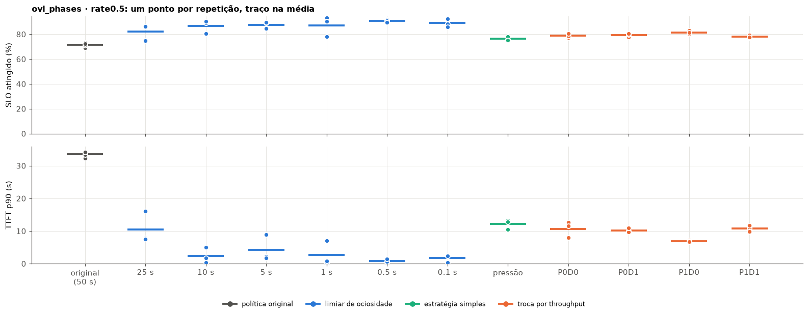

- **Nenhuma perda, em nenhum limiar.** Em 22/10, os limiares de 5 s e 10 s tinham perdido 94 e 1.196 requisições, por workers mortos e por uma queda com `torch.OutOfMemoryError`. Com a contabilidade das ativações pendentes, o controlador não ativa mais um modelo que não cabe, e essas falhas sumiram.
- **Qualquer limiar de até 10 s dá praticamente o mesmo resultado.** As faixas de SLO de 1 s, 5 s e 10 s se sobrepõem. O limiar de 0,5 s teve a menor variação (89–92%) e o melhor p90, mas a vantagem sobre 1–10 s é menor que o ruído entre repetições.
- **25 s já é um meio-termo ruim:** p90 de 10 s e pior espera de 38 s.

**Quanto o grupo novo espera em cada troca.** Para cada modelo em cada fase (menos a primeira), o tempo entre a primeira requisição da fase e o primeiro token:

| Configuração | Espera média na troca (s) | Pior espera na troca (s) | Despejos no meio da fase, por execução |
| --- | --- | --- | --- |
| original (50 s) | 37,7 | 62,1 | 0 |
| limiar 25 s | 23,7 | 38,3 | 0 |
| limiar 10 s | 14,9 | 27,3 | 0,7 |
| limiar 5 s | 17,2 | 31,4 | 0,7 |
| limiar 1 s | 12,6 | 27,9 | 1,3 |
| limiar 0,5 s | 10,4 | 21,1 | 1,3 |
| limiar 0,1 s | 11,2 | 22,8 | 1,3 |

- **O piso de ~10 s não vem do limiar.** Quando a fase troca, os modelos do grupo que sai ainda têm requisições em andamento (cada uma leva 6–25 s), e só ficam ociosos quando elas terminam. Na figura abaixo, o grupo A só sai entre 165 s e 175 s, 15–25 s depois do fim da fase. Até lá, só cabem os modelos do grupo B que encontram memória livre. Para baixar esse piso seria preciso tirar o modelo antes de ele ficar ocioso (preempção ou drenagem), que é o que a troca por throughput faz.
- **Limiar curto tem um custo pequeno: despejos no meio da fase.** Com limiar ≤ 10 s, cerca de 1 vez por execução um modelo é despejado durante a sua própria fase e reativado em seguida (uma partida a frio de alguns segundos).
- **Quanto um modelo fica ocioso dentro da fase:**
  - entre duas chegadas do mesmo modelo, o intervalo tem p50 de 1,3 s, p99 de 8,7 s e máximo de 14,8 s;
  - mas um modelo quase nunca fica **sem nada em andamento**, porque cada requisição dura mais que esse intervalo: são 1–3 janelas por execução, de no máximo 5,3 s.
  
  É por isso que limiares de 0,1 s a 10 s despejam quase igual: o modelo só fica ocioso, de fato, quando a fase acaba.

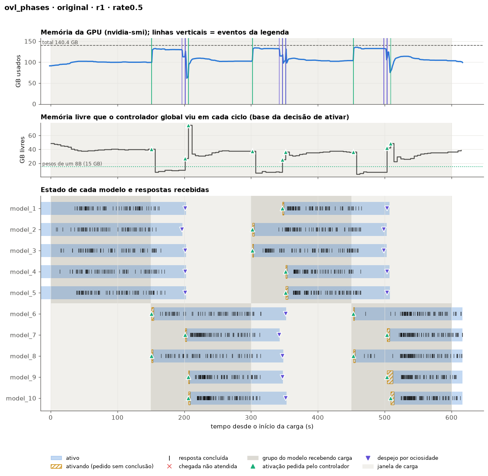
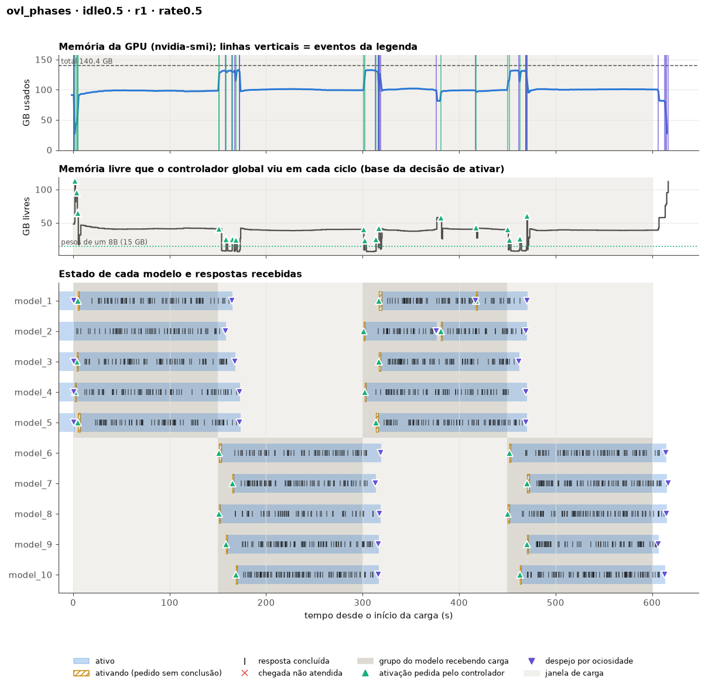

### `ovl_mem` (todos com demanda)

**A 0,2 req/s por modelo:**

| Configuração | Rep. | Atendidas | Perdas | TTFT p50 / p99 (s) | TTFT p90 (s) | TTFT < 1 s (%) | TTFT < 2 s (%) | TTFT < 5 s (%) | TPOT < 100 ms (%) | SLO: TTFT < 1 s e TPOT < 100 ms (%) | Pior espera pelo 1º token (s) | Ativações |
| --- | --- | --- | --- | --- | --- | --- | --- | --- | --- | --- | --- | --- |
| original (50 s) | 6 | 100,0% | — | 0,20 / 340,3 | 268,1 (266,0–270,0) | 64 | 65 | 65 | 98 | 62 (50–66) | 352 (350–355) | 4 |
| limiar 25 s | 3 | 100,0% | — | 2,78 / 313,8 | 225,9 (221,7–229,5) | 55 | 58 | 60 | 90 | 48 (20–67) | 327 (323–331) | 6 |
| limiar 10 s | 3 | 100,0% | — | 4,06 / 309,4 | 187,9 (171,3–199,2) | 53 | 54 | 56 | 97 | 51 (33–65) | 327 (324–330) | 11 |
| limiar 5 s | 3 | 100,0% | — | 0,19 / 305,7 | 199,5 (193,1–208,0) | 66 | 67 | 68 | 98 | 66 (65–67) | 325 (313–339) | 15 |
| limiar 1 s | 3 | 100,0% | — | 11,98 / 231,2 | 139,5 (89,9–169,8) | 37 | 39 | 45 | 98 | 36 (27–42) | 55 (33–80) | 19 |

**A 0,5 req/s por modelo:**

| Configuração | Rep. | Atendidas | Perdas | TTFT p50 / p99 (s) | TTFT p90 (s) | TTFT < 1 s (%) | TTFT < 2 s (%) | TTFT < 5 s (%) | TPOT < 100 ms (%) | SLO: TTFT < 1 s e TPOT < 100 ms (%) | Pior espera pelo 1º token (s) | Ativações |
| --- | --- | --- | --- | --- | --- | --- | --- | --- | --- | --- | --- | --- |
| original (50 s) | 3 | 100,0% | — | 88,02 / 381,1 | 312,9 (280,3–341,1) | 21 | 22 | 26 | 99 | 21 (15–29) | 373 (362–390) | 4 |
| limiar 25 s | 3 | 100,0% | — | 56,97 / 360,6 | 276,8 (269,3–283,1) | 20 | 21 | 26 | 98 | 19 (15–25) | 372 (365–379) | 4 |
| limiar 10 s | 3 | 100,0% | — | 80,51 / 356,9 | 278,5 (269,2–290,3) | 29 | 31 | 36 | 99 | 29 (27–33) | 368 (340–387) | 4 |
| limiar 5 s | 3 | 85,9% | 614 (0, 614, 0) | 90,32 / 346,4 | 291,8 (279,0–303,6) | 16 | 17 | 20 | 77 | 16 (0–31) | nunca (348–nunca) | 4 |
| limiar 1 s | 3 | 100,0% | — | 38,01 / 337,7 | 265,6 (252,6–276,3) | 16 | 18 | 22 | 89 | 13 (6–22) | 344 (336–357) | 7 |

- **"100% atendidas" esconde a fome.** A carga dura 300 s, e os modelos que começam inativos esperam ~350 s pelo primeiro token: só são atendidos no prazo extra, depois que a carga acabou e os ativos ficaram ociosos. A pior espera pelo 1º token é o que mostra isso.
- **O limiar só muda algo a 0,2 req/s e com 1 s.** A 0,2 req/s, cada modelo tem pausas curtas entre as requisições, e com 1 s o controlador aproveita essas pausas para revezar. A pior espera cai de 352 s para 55 s, mas o SLO cai de 62% para 36%. A 0,5 req/s nenhum modelo para, e todos os limiares se comportam como o original.
- **As 614 não atendidas do limiar de 5 s a 0,5 req/s**  vêm de duas causas:
  - **Fome (455):** o `model_8`, o `model_9` e o `model_10` começaram inativos e não couberam até o fim da carga, porque os ativos nunca ficaram ociosos. O `model_8` só entrou aos 583 s, e o prazo acabou antes de as requisições dele serem respondidas.
  - **Um modelo ativo que não atende (137):** o `model_6` foi despejado aos 5 s, depois que uma requisição dele terminou. Foi reativado aos 28 s, com ~7 GB livres na visão do controlador, e ficou ativo até o fim **sem responder nada** até ~593 s. O GPU scheduler parou de lhe enviar requisições: ele contava 11 na fila do worker (o limite), mas o worker só recebeu 1, e nem ela passou pelo prefill. O modelo nunca ficou ocioso, então nunca foi despejado.
  
  O segundo caso tem o mesmo sintoma do travamento da política original no `ovl_mix` (seção 3). Lá também os modelos ficam ativos, com 11 requisições na fila de cada worker e nenhuma resposta. A hipótese é que um modelo ativado quando só cabem os pesos fica sem espaço para KV. Ele não atende, não fica ocioso e não sai. Isso ainda precisa ser confirmado.

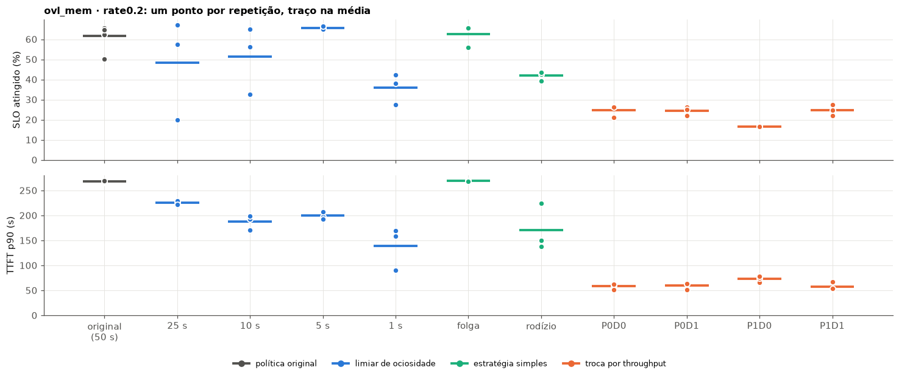

**Linhas do tempo.** Em cada figura, a faixa azul mostra quando o modelo está ativo, e cada traço preto é uma resposta concluída, no instante em que terminou. Um "x" vermelho marca a chegada de uma requisição que nunca foi respondida.

**Política original, 0,2 req/s.** Nesta repetição, o `model_8` é ativado logo no início, e os 7 modelos ativos ocupam a GPU (~130 de 140 GB) durante toda a carga. O `model_7`, o `model_9` e o `model_10` recebem requisições desde o começo, mas a primeira resposta deles só sai aos 355–362 s: eles só entram depois que a carga acaba e os outros ficam ociosos por 50 s.

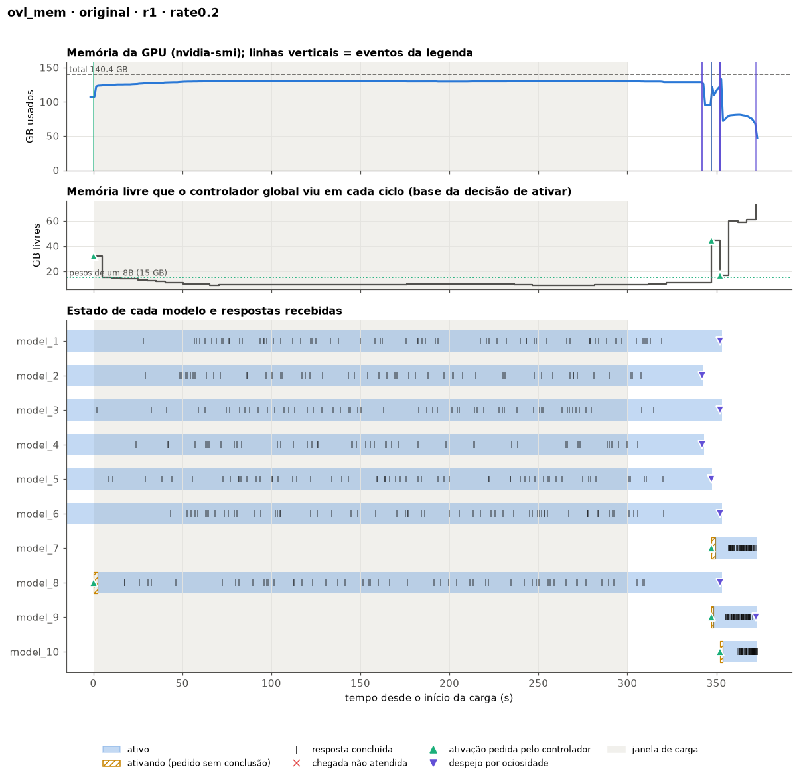

**Limiar de 1 s, 0,2 req/s.** Os modelos saem nas pausas curtas entre requisições e cedem lugar, e todos passam pela GPU várias vezes durante a carga. Cada volta é uma partida a frio (faixa amarela), e as quedas na memória da GPU marcam as trocas. Por isso, a pior espera cai de 352 s para 55 s, mas o SLO cai de 62% para 36%.

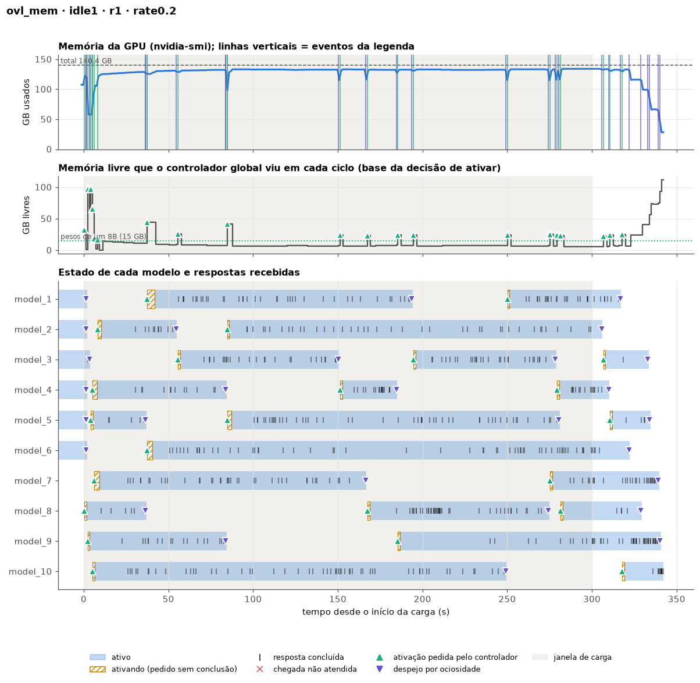

**Limiar de 5 s, 0,5 req/s, a repetição com 614 não atendidas.** O `model_8`, o `model_9` e o `model_10` nunca entram durante a carga. O `model_6` fica ativo a partir dos 28 s, mas acumula "x" até o fim, sem nenhuma resposta (explicação acima).

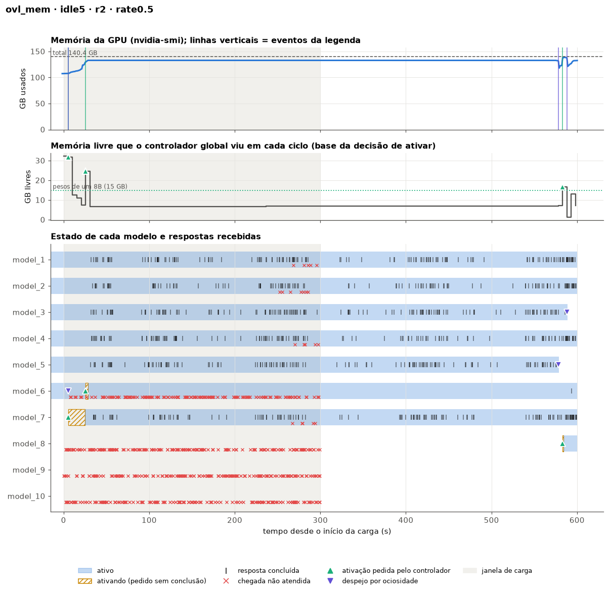

### `ovl_trace_big` (trace real com 12 modelos)

**Escala 1 (1×):**

| Configuração | Rep. | Atendidas | Perdas | TTFT p50 / p99 (s) | TTFT p90 (s) | TTFT < 1 s (%) | TTFT < 2 s (%) | TTFT < 5 s (%) | TPOT < 100 ms (%) | SLO: TTFT < 1 s e TPOT < 100 ms (%) | Pior espera pelo 1º token (s) | Ativações |
| --- | --- | --- | --- | --- | --- | --- | --- | --- | --- | --- | --- | --- |
| original (50 s) | 5 | 100,0% | — | 0,48 / 425,2 | 214,2 (162,2–276,5) | 74 | 75 | 76 | 92 | 69 (28–81) | 649 (648–650) | 12 |
| limiar 25 s | 3 | 100,0% | — | 0,11 / 343,1 | 50,2 (46,2–55,1) | 82 | 83 | 84 | 98 | 81 (80–83) | 54 (54–56) | 28 |
| limiar 10 s | 3 | 100,0% | — | 0,11 / 287,9 | 35,1 (29,8–41,6) | 79 | 80 | 83 | 98 | 77 (74–81) | 42 (30–62) | 52 |
| limiar 5 s | 3 | 100,0% | — | 0,12 / 266,7 | 36,1 (31,2–42,2) | 77 | 79 | 81 | 96 | 74 (64–81) | 47 (34–55) | 59 |
| limiar 1 s | 3 | 100,0% | — | 0,14 / 247,2 | 31,0 (19,6–50,6) | 74 | 77 | 81 | 92 | 69 (49–79) | 67 (27–94) | 68 |

**Escala 0,5 (2×):**

| Configuração | Rep. | Atendidas | Perdas | TTFT p50 / p99 (s) | TTFT p90 (s) | TTFT < 1 s (%) | TTFT < 2 s (%) | TTFT < 5 s (%) | TPOT < 100 ms (%) | SLO: TTFT < 1 s e TPOT < 100 ms (%) | Pior espera pelo 1º token (s) | Ativações |
| --- | --- | --- | --- | --- | --- | --- | --- | --- | --- | --- | --- | --- |
| original (50 s) | 3 | 100,0% | — | 0,16 / 247,7 | 205,1 (203,5–206,1) | 63 | 64 | 64 | 97 | 61 (56–64) | 355 (353–356) | 8 |
| limiar 25 s | 3 | 100,0% | — | 0,14 / 220,3 | 173,7 (170,6–175,3) | 64 | 64 | 65 | 98 | 64 (62–64) | 329 (329–330) | 11 |
| limiar 10 s | 3 | 100,0% | ___ | 0,17 / 198,7 | 135,3 (106,5–152,3) | 59 | 60 | 61 | 97 | 57 (54–63) | 210 (203–220) | 18 |
| limiar 5 s | 3 | 100,0% | — | 12,02 / 253,4 | 177,8 (107,7–273,9) | 47 | 51 | 53 | 85 | 41 (13–59) | 248 (206–327) | 21 |
| limiar 1 s | 3 | 100,0% | — | 0,15 / 210,8 | 151,5 (143,2–165,4) | 63 | 63 | 65 | 98 | 62 (62–63) | 211 (208–213) | 32 |

**O que os resultados mostram:**

- **A política original deixa 4 modelos com fome por quase toda a carga.** Na escala 1, os modelos 7 a 12 começam inativos. No começo, alguns modelos ainda param por 50 s, e o controlador consegue revezar: o `model_7`, o `model_9`, o `model_10` e o `model_11` entram. Depois de ~200 s, os ativos recebem tráfego contínuo, nunca ficam 50 s ociosos, e ninguém mais entra. Na repetição da figura abaixo:
  - o `model_8` e o `model_12` só recebem o primeiro token depois de 600 s, quando a carga acaba;
  - o `model_10` e o `model_11`, que foram despejados cedo, ficam com 34 e 38 requisições sem resposta até o fim da carga.
  
  Isso se repetiu nas 5 repetições, sempre com o `model_12` em ~649 s.
- **Qualquer limiar até 25 s resolve a fome na escala 1:** a pior espera cai para 42–67 s e o p90 de 214 s para 31–50 s. O SLO, porém, fica igual ao da original: 74–81% contra 79–81% (sem a repetição atípica, ver abaixo). O ganho está na cauda e nos modelos pequenos, não na mediana.
- **Limiar de 25 s foi o melhor SLO na escala 1** (81%, com pouca variação). Limiares menores fazem 2× mais ativações, porque os modelos de tráfego esparso saem e voltam entre requisições, e cada volta custa uma partida a frio.
- **Na escala 0,5, o trace satura a GPU,** e nenhum limiar resolve: a pior espera fica em 212–330 s. É o mesmo quadro do `ovl_mem`, em que todos os modelos têm demanda.
- **Uma repetição da política original destoa** (SLO de 28%, contra 79–81% nas outras 4). Ela é da rodada `fix3` (job `8426cbcd`, suíte de estratégias), que rodou no fim do período em que o nó estava degradado. Não houve falha registrada nela, então ela fica, mas puxa a média para baixo.

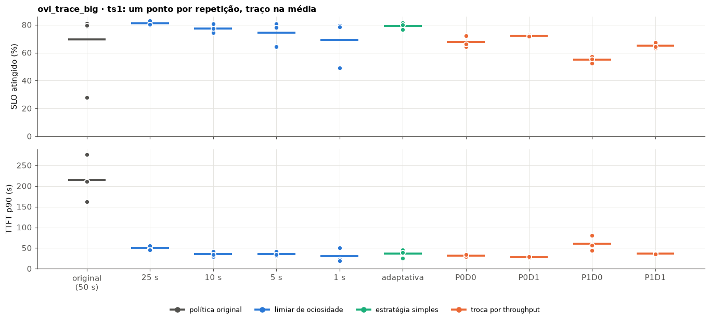
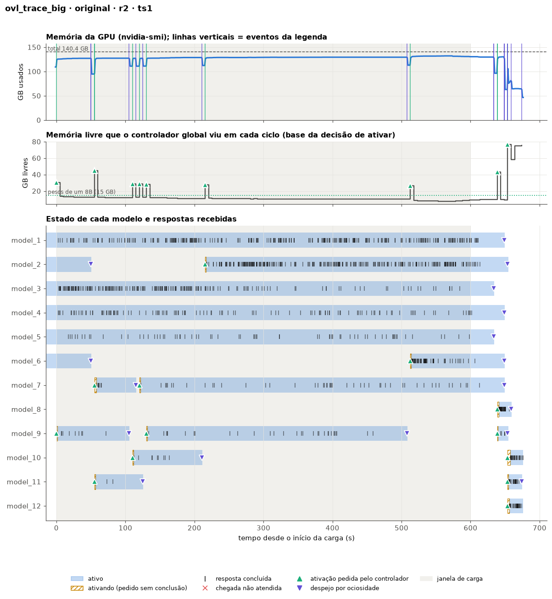
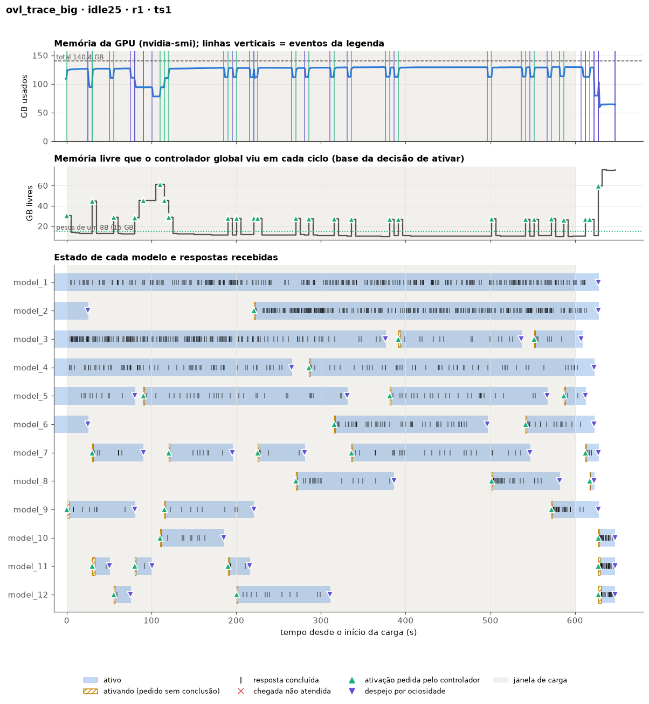

## 2. Estratégias simples

Cada uma no cenário que pretende resolver. A linha da política original é a mesma das tabelas da seção 1.

| Estratégia (`PRISM_EVICTION`) | Ideia |
| --- | --- |
| `pressure` (despejo sob pressão) | Se um modelo com fila não cabe, despeja o modelo ocioso há mais tempo (≥ 2 s sem fila), sem esperar 50 s |
| `adaptive` (ociosidade adaptativa) | Cada modelo tem um limiar de 3× o p90 dos intervalos entre as suas próprias requisições (5–50 s); sob pressão, sai o mais "atrasado" em relação ao seu ritmo |
| `fair` (rodízio anti-fome) | `pressure`, mais: se um modelo espera ≥ 30 s e ninguém está ocioso, sai o modelo ativo há mais tempo, mesmo ocupado |

| Cenário | Configuração | Rep. | Atendidas | Perdas | TTFT p50 / p99 (s) | TTFT p90 (s) | TTFT < 1 s (%) | TTFT < 2 s (%) | TTFT < 5 s (%) | TPOT < 100 ms (%) | SLO: TTFT < 1 s e TPOT < 100 ms (%) | Pior espera pelo 1º token (s) | Ativações |
| --- | --- | --- | --- | --- | --- | --- | --- | --- | --- | --- | --- | --- | --- |
| `ovl_phases` | original | 4 | 100,0% | — | 0,15 / 54,5 | 33,6 (32,3–34,3) | 72 | 73 | 75 | 100 | 71 (69–73) | 58 (57–59) | 15 |
| | despejo sob pressão | 3 | 100,0% | — | 0,14 / 46,6 | 12,2 (10,5–13,3) | 77 | 79 | 83 | 100 | 76 (75–78) | 29 (21–33) | 15 |
| `ovl_trace_big` 1× | original | 5 | 100,0% | — | 0,48 / 425,2 | 214,2 (162,2–276,5) | 74 | 75 | 76 | 92 | 69 (28–81) | 649 (648–650) | 12 |
| | ociosidade adaptativa | 3 | 100,0% | — | 0,11 / 313,4 | 36,7 (25,1–45,5) | 80 | 81 | 83 | 99 | 79 (76–81) | 59 (35–86) | 51 |
| `ovl_mem` 0,2 | original | 6 | 100,0% | — | 0,20 / 340,3 | 268,1 (266,0–270,0) | 64 | 65 | 65 | 98 | 62 (50–66) | 352 (350–355) | 4 |
| | rodízio anti-fome | 3 | 100,0% | — | 6,74 / 303,5 | 170,7 (137,6–224,9) | 42 | 44 | 48 | 100 | 42 (39–44) | 320 (313–329) | 45 |

- **Despejo sob pressão** melhora a troca de grupos (p90 de 34 s para 12 s), mas menos que um limiar curto (1–4 s). Ele só despeja quem está ocioso há ≥ 2 s, e o grupo que sai continua ocupado até terminar as requisições em andamento. 
- **Ociosidade adaptativa** resolve a fome do trace (pior espera de 649 s para 59 s), com SLO de 79%. Fica no mesmo nível dos limiares fixos de 10–25 s, então não justifica a complexidade.
- **Rodízio anti-fome** não resolve a fome (pior espera de 320 s) e derruba o SLO para 42%. Ele faz 45 ativações por execução, mas quem entra é escolhido pela ordem de violação de SLO, e não por quem espera há mais tempo. O `model_10` espera 313–329 s nas 3 repetições, e o `model_9` 317 s numa delas. Em 22/10 ele perdeu 154 requisições por um worker morto; agora não perde nada.

## 3. Troca por throughput por GB
### Desenho (`PRISM_EVICTION=throughput`)

A cada ciclo do controlador, para cada modelo inativo com fila que não coube:

1. **Valor de cada ativo** = tokens que ele processou nos últimos 30 s (o worker informa a contagem a cada 1 s) + os tokens da fila dele ÷ 30 s. A densidade é esse valor dividido pelos GB que ele ocupa (pesos + KV estimado).
2. **Demanda do candidato** = tokens na fila ÷ 30 s, multiplicada por (1 + espera da requisição mais antiga ÷ 30 s). Esse envelhecimento garante que um modelo esperando acabe entrando.
3. **Vítimas**: os ativos há pelo menos 20 s, em ordem crescente de densidade, até liberar os pesos do candidato + 3 GB de folga. A troca só acontece se a demanda do candidato superar o valor das vítimas em 20%. A memória liberada fica reservada para o candidato por 15 s.
4. **Modo de saída da vítima**:

| | sem preempção (P0) | com preempção (P1) |
| --- | --- | --- |
| **sem drenagem (D0)** | o Prism atual: as em execução terminam, a fila volta para a fila geral | as em execução são retiradas e recomputadas depois; troca imediata |
| **com drenagem (D1)** | serve a fila já aceita e as em execução, até 15 s | serve por até 15 s e retira o que sobrou |

A coluna "Trocas / preemptadas" é a média, por execução, das trocas feitas e das requisições em execução retiradas.

### `ovl_mem` a 0,2 req/s

| Configuração | Rep. | Atendidas | Perdas | TTFT p50 / p99 (s) | TTFT p90 (s) | TTFT < 1 s (%) | TTFT < 2 s (%) | TTFT < 5 s (%) | TPOT < 100 ms (%) | SLO: TTFT < 1 s e TPOT < 100 ms (%) | Pior espera pelo 1º token (s) | Trocas / preemptadas |
| --- | --- | --- | --- | --- | --- | --- | --- | --- | --- | --- | --- | --- |
| original | 6 | 100,0% | — | 0,20 / 340,3 | 268,1 (266,0–270,0) | 64 | 65 | 65 | 98 | 62 (50–66) | 352 (350–355) | 0 / 0 |
| troca P0D0 | 3 | 100,0% | — | 15,75 / 102,8 | 58,3 (51,6–62,7) | 25 | 27 | 33 | 99 | 25 (21–27) | 43 (39–47) | 41 / 0 |
| troca P0D1 | 3 | 100,0% | — | 15,95 / 94,6 | 59,7 (52,0–63,9) | 25 | 28 | 33 | 98 | 24 (22–26) | 39 (38–41) | 37 / 0 |
| troca P1D0 | 3 | 100,0% | — | 20,41 / 149,3 | 73,3 (66,7–78,9) | 17 | 19 | 24 | 100 | 17 (16–17) | 31 (30–32) | 65 / 327 |
| troca P1D1 | 3 | 100,0% | — | 15,01 / 94,4 | 58,1 (52,7–67,5) | 25 | 27 | 33 | 100 | 25 (22–28) | 38 (37–39) | 45 / 51 |

### `ovl_mix`

| Configuração | Rep. | Atendidas | Perdas | TTFT p50 / p99 (s) | TTFT p90 (s) | TTFT < 1 s (%) | TTFT < 2 s (%) | TTFT < 5 s (%) | TPOT < 100 ms (%) | SLO: TTFT < 1 s e TPOT < 100 ms (%) | Pior espera pelo 1º token (s) | Trocas / preemptadas |
| --- | --- | --- | --- | --- | --- | --- | --- | --- | --- | --- | --- | --- |
| original | 3 | 2,6% | 1605 (536, 536, 533) | 0,12 / 9,4 | 2,1 (1,3–3,4) | 2 | 2 | 2 | 3 | 2 (2–2) | nunca | 0 / 0 |
| troca P0D0 | 3 | 99,9% | 1 (0, 0, 1) | 4,70 / 72,4 | 41,7 (31,8–57,6) | 46 | 48 | 52 | 97 | 44 (30–53) | 54 (47–64) | 38 / 0 |
| troca P0D1 | 3 | 100,0% | — | 1,14 / 58,2 | 36,1 (33,3–40,1) | 51 | 53 | 57 | 99 | 51 (46–56) | 53 (39–73) | 38 / 0 |
| troca P1D0 | 3 | 100,0% | — | 3,46 / 86,3 | 36,3 (30,1–45,0) | 46 | 47 | 52 | 100 | 46 (34–53) | 30 (24–33) | 51 / 158 |
| troca P1D1 | 3 | 100,0% | — | 1,00 / 57,7 | 34,5 (31,1–38,5) | 51 | 54 | 56 | 100 | 51 (48–55) | 44 (40–51) | 38 / 26 |

### `ovl_trace_big` escala 1

| Configuração | Rep. | Atendidas | Perdas | TTFT p50 / p99 (s) | TTFT p90 (s) | TTFT < 1 s (%) | TTFT < 2 s (%) | TTFT < 5 s (%) | TPOT < 100 ms (%) | SLO: TTFT < 1 s e TPOT < 100 ms (%) | Pior espera pelo 1º token (s) | Trocas / preemptadas |
| --- | --- | --- | --- | --- | --- | --- | --- | --- | --- | --- | --- | --- |
| original | 5 | 100,0% | — | 0,48 / 425,2 | 214,2 (162,2–276,5) | 74 | 75 | 76 | 92 | 69 (28–81) | 649 (648–650) | 0 / 0 |
| troca P0D0 | 3 | 100,0% | — | 0,13 / 79,3 | 32,0 (29,0–34,1) | 71 | 73 | 74 | 96 | 68 (64–72) | 57 (48–62) | 62 / 0 |
| troca P0D1 | 3 | 100,0% | — | 0,11 / 71,3 | 27,7 (26,4–28,7) | 73 | 74 | 76 | 99 | 72 (72–73) | 50 (48–54) | 62 / 0 |
| troca P1D0 | 3 | 99,3% | 25 (25, 0, 0) | 0,16 / 267,6 | 60,4 (44,5–80,1) | 55 | 57 | 59 | 99 | 55 (53–57) | 48 (48–49) | 132 / 599 |
| troca P1D1 | 3 | 100,0% | — | 0,12 / 105,4 | 36,5 (35,3–38,0) | 65 | 66 | 68 | 100 | 65 (63–68) | 48 (48–48) | 72 / 56 |

### `ovl_phases`

| Configuração | Rep. | Atendidas | Perdas | TTFT p50 / p99 (s) | TTFT p90 (s) | TTFT < 1 s (%) | TTFT < 2 s (%) | TTFT < 5 s (%) | TPOT < 100 ms (%) | SLO: TTFT < 1 s e TPOT < 100 ms (%) | Pior espera pelo 1º token (s) | Trocas / preemptadas |
| --- | --- | --- | --- | --- | --- | --- | --- | --- | --- | --- | --- | --- |
| original | 4 | 100,0% | — | 0,15 / 54,5 | 33,6 (32,3–34,3) | 72 | 73 | 75 | 100 | 71 (69–73) | 58 (57–59) | 0 / 0 |
| limiar 0,5 s (seção 1) | 3 | 100,0% | — | 0,13 / 16,1 | 0,8 (0,3–1,4) | 91 | 92 | 94 | 100 | 91 (89–92) | 19 (18–20) | 0 / 0 |
| troca P0D0 | 3 | 100,0% | — | 0,14 / 38,9 | 10,7 (8,0–12,6) | 79 | 81 | 84 | 100 | 79 (77–81) | 21 (21–21) | 9 / 0 |
| troca P0D1 | 3 | 100,0% | — | 0,13 / 41,0 | 10,2 (9,7–10,9) | 79 | 81 | 85 | 100 | 79 (78–81) | 23 (21–28) | 9 / 0 |
| troca P1D0 | 3 | 100,0% | — | 0,14 / 38,7 | 7,0 (6,8–7,2) | 82 | 83 | 88 | 100 | 82 (80–83) | 25 (21–27) | 12 / 3 |
| troca P1D1 | 3 | 100,0% | — | 0,14 / 41,4 | 10,8 (9,8–11,7) | 79 | 81 | 85 | 100 | 78 (77–79) | 25 (21–27) | 9 / 0 |

**Espera do grupo novo em cada troca de fase** (mesma medida da seção 1):

| Configuração | Espera média na troca (s) | Pior espera na troca (s) | Despejos no meio da fase, por execução |
| --- | --- | --- | --- |
| original (50 s) | 37,7 | 62,1 | 0 |
| limiar 0,5 s | 10,4 | 21,1 | 1,3 |
| troca P0D0 | 17,2 | 44,9 | 0 |
| troca P0D1 | 17,1 | 45,9 | 0 |
| troca P1D0 | 15,7 | 34,6 | 0 |
| troca P1D1 | 18,9 | 47,5 | 0 |

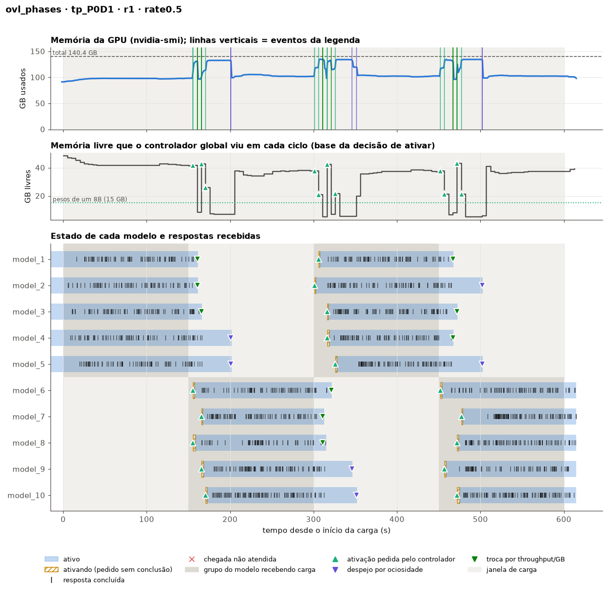

- **A troca melhora a troca de grupos, mas menos que um limiar curto.** O SLO sobe de 71% para 78–82% e o p90 cai de 34 s para 7–11 s. Fica no nível do despejo sob pressão (76%, 12 s) e abaixo do limiar de 0,5–10 s (87–91%, 1–4 s).
- **Por que fica atrás.** Na figura, a fase muda aos 150 s. A troca tira 3 modelos do grupo A entre 160 s e 167 s, e o grupo B entra escalonado entre 155 s e 172 s. Os outros 2 modelos do grupo A (`model_4` e `model_5`) não são escolhidos para a troca, porque já há memória para o grupo B. Eles só saem aos 200 s, pelo limiar de 50 s, que as configurações de troca mantêm. A espera média na troca (16–19 s) fica acima da do limiar curto (10 s), e a pior chega a 35–48 s.
- **A troca não despeja ninguém no meio da fase,** ao contrário do limiar curto (~1 vez por execução). Ela só tira um modelo quando há outro com fila esperando.
- **Aqui a preempção sem drenagem (P1D0) é a melhor variante** (82%, p90 de 7 s), ao contrário dos cenários com pressão contínua. Na troca de grupos, o modelo que sai está terminando a fase e quase não tem nada em execução (3 requisições retiradas por execução), então a preempção libera a memória mais cedo quase sem custo.
- **Isso reforça a combinação** limiar curto + troca: o limiar tira o grupo antigo assim que ele fica ocioso, e a troca resolve os casos em que ninguém fica ocioso (`ovl_mem`, `ovl_mix`, trace12).

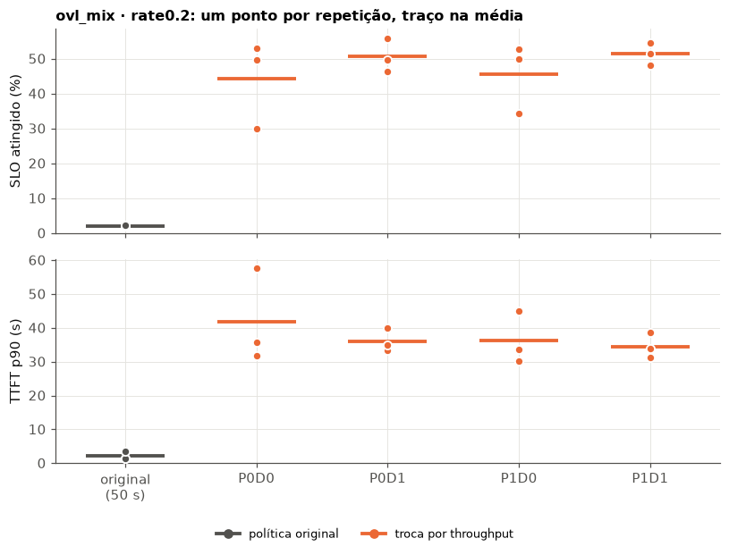
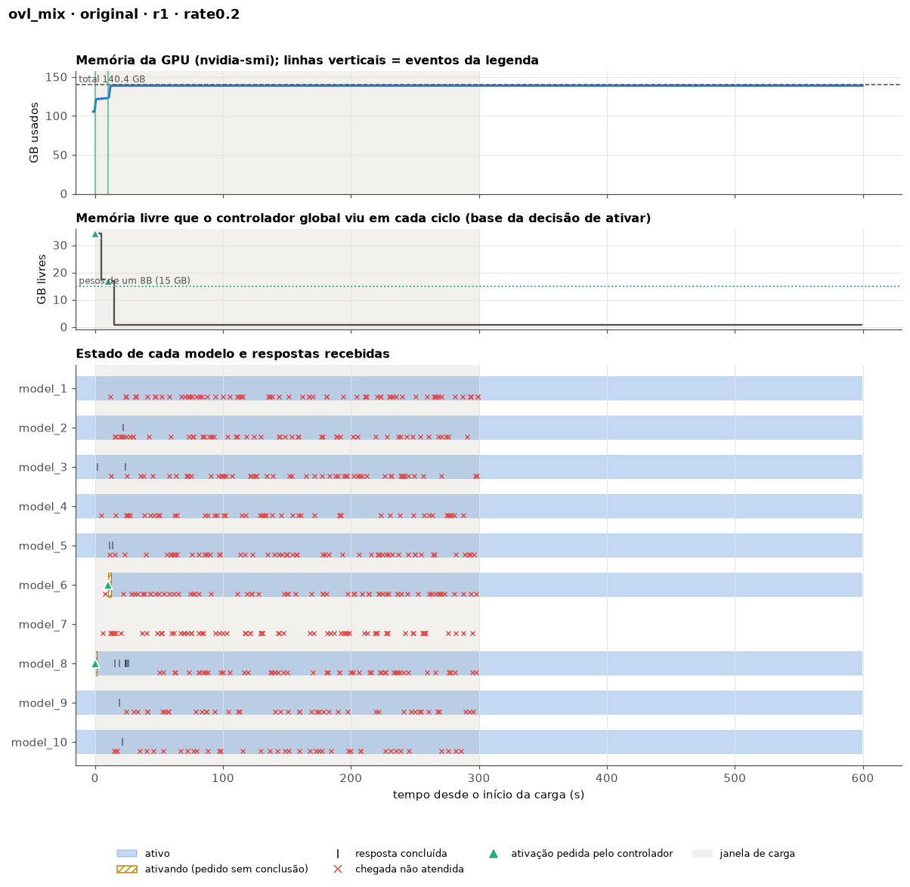
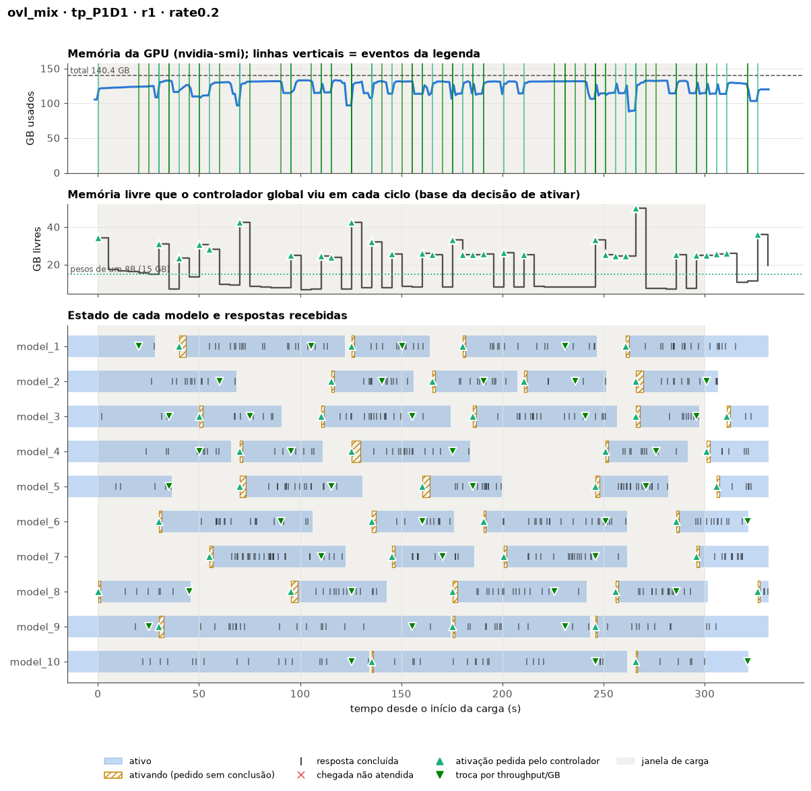

**Linhas do tempo: política original contra troca P0D1.** P0D1 é a variante que fica entre as melhores em todos os cenários. Nas figuras da troca, o triângulo verde para baixo marca o momento em que o controlador escolhe a vítima. Com drenagem, o modelo ainda atende a sua fila por até 15 s antes de sair, por isso a faixa azul continua um pouco depois do triângulo.

*`ovl_mem` a 0,2 req/s.* Na original, os modelos que começam ativos ficam na GPU durante toda a carga, e o `model_7`, o `model_9` e o `model_10` só respondem depois dos 350 s. Na troca, todos os modelos se revezam em turnos de 50–100 s, e cada um tem respostas espalhadas pela carga inteira.

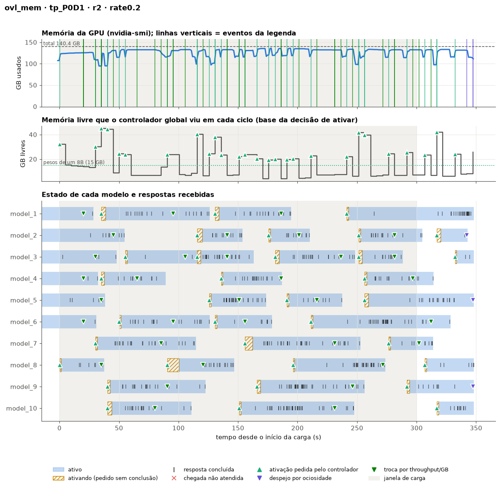

*`ovl_trace_big`, escala 1.* Na original, depois dos primeiros ~200 s, os mesmos modelos ficam ativos, e o `model_8` e o `model_12` só respondem depois dos 600 s. Na troca, os modelos de tráfego esparso (7 a 12) entram e saem em turnos curtos durante toda a carga. Os mais requisitados (`model_1` e, a partir de ~215 s, o `model_2`) ficam na GPU quase o tempo todo.

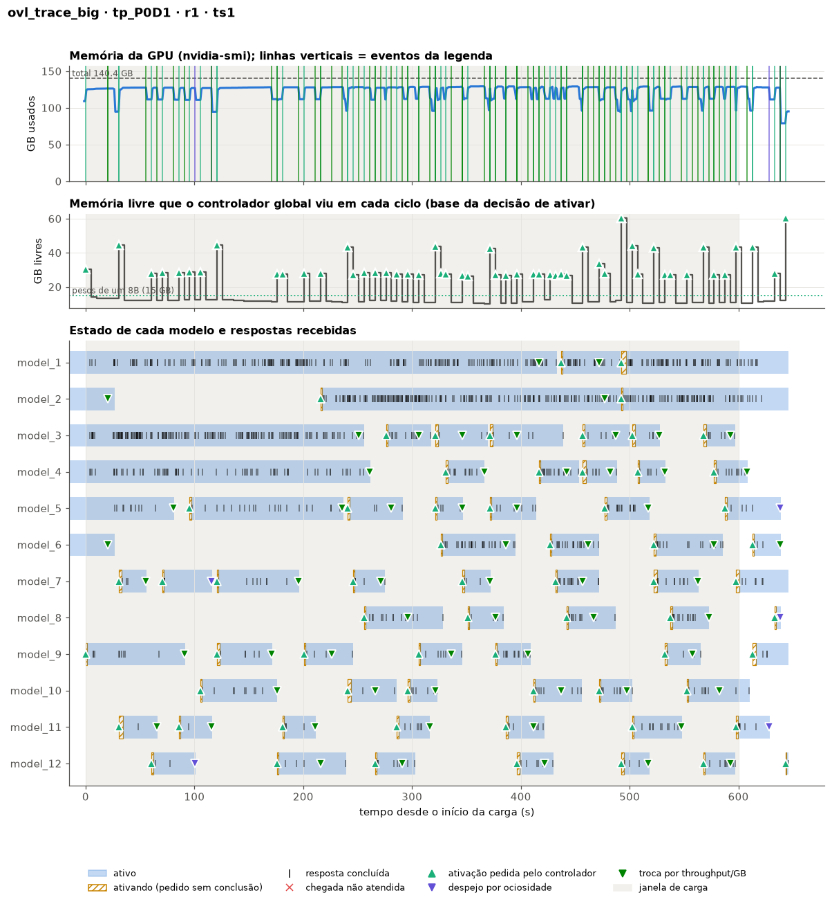

**O que os resultados mostram:**

- **A troca acaba com a fome em todos os cenários com pressão.** A pior espera pelo 1º token fica em 30–57 s no `ovl_mem`, no `ovl_mix` e no trace12, contra 352 s, "nunca" e 649 s na original.
- **No `ovl_mix`, a política original trava nas 3 repetições, mesmo com as correções.** A GPU passa de 135 GB aos 11–13 s, a última resposta sai entre 23 s e 33 s, e nenhum modelo volta a progredir. Não há worker morto nem queda: é a política que fica sem saída. A troca é a única configuração testada que funciona nesse cenário.
- **No `ovl_mem`, o custo continua alto:** o SLO cai de 62% para 17–25%. Com mais demanda do que memória, a troca divide a espera entre todos: ninguém espera 350 s, mas quase todos esperam dezenas de segundos.
- **No trace12 (escala 1), a troca P0D1 dá a melhor cauda** de todas as configurações: p99 de 71 s, contra 425 s na original e 247–343 s com os limiares. O SLO (72%) fica um pouco abaixo do limiar de 25 s (81%).
- **Com pressão contínua, preempção sem drenagem (P1D0) é a pior variante.** Com P1D0 o modelo sai imediatamente, então a troca fica "barata" e acontece mais (132 trocas no trace12, contra 62–72 nas outras). As 599 requisições retiradas por execução recomeçam do zero. O resultado é o menor SLO (55% no trace12, 17% no `ovl_mem`). Numa das repetições do trace12, 25 requisições se perderam (ver a [seção 4](#4-falhas-que-sobraram-e-as-correções-em-ação)). No `ovl_phases`, em que quase nada é retirado, ela é a melhor variante.
- **Com drenagem, preempção ou não dá quase no mesmo.** P0D1 e P1D1 empatam no `ovl_mem` e no `ovl_mix` (SLO de 24–25% e 51%). No trace12, P0D1 é um pouco melhor (72% contra 65%, com p99 de 71 s contra 105 s). A drenagem dá ao modelo que sai até 15 s para terminar, e quase nada sobra para ser retirado: 26–56 requisições por execução no P1D1, contra 158–599 no P1D0.
 
