# Janela de ociosidade e estratégias de troca no Prism, com as correções, SGLang (2026-10-28)

> **Estado: completo.** Todos os 150 níveis previstos (3 repetições por configuração; a política original tem de 3 a 6).

Este relatório **substitui a análise** de [Janela de ociosidade e estratégias de troca no Prism (2026-10-22)](2026-10-22%20Janela%20de%20ociosidade%20e%20estratégias%20de%20troca%20no%20Prism%20(SGLang).md). Aquela rodada ocorreu antes das correções de robustez, e boa parte das diferenças entre as estratégias vinha de quedas e de workers mortos. Aqui todas as configurações rodam com as correções descritas no [relatório de mudanças do Prism](2026-10-22%20Correções%20de%20robustez%20de%20memória%20no%20Prism%20(SGLang).md), com 3 repetições cada. O `ovl_trace` de 8 modelos saiu da análise; no lugar dele entra o trace real com 12 modelos (`ovl_trace_big`).

## Resumo

**Robustez.** Com as correções e a verificação de saúde do nó, a última rodada (`fix5`) teve **59 de 59 níveis limpos**: nenhum worker morto, nenhuma queda, nenhum abort do kvcached. A verificação de saúde nunca precisou esperar. Nos 150 níveis usados, 7 têm perdas:
- 4 vêm do comportamento da política (travamento e fome);
- 1 é um erro de medição do SGLang: a requisição foi atendida, mas a resposta saiu sem o horário de término;
- **2 são requisições realmente perdidas, ainda sem causa identificada:** 25 numa execução da troca P1D0 e 1 numa da troca P0D0 (ver a [seção 4](#4-falhas-que-sobraram-e-as-correções-em-ação)).

**O que encontramos:**

- **Troca de grupos (`ovl_phases`): um limiar curto resolve.** Com limiar entre 0,5 s e 10 s:
  - o SLO sobe de 71% para 87–91%;
  - o TTFT p90 cai de 34 s para 1–4 s;
  - a pior espera pelo primeiro token cai de 58 s para 17–22 s.
  
  Abaixo de 10 s, as diferenças entre limiares ficam dentro do ruído entre repetições. Sobra um piso de ~10 s de espera média na troca: o grupo que sai só é despejado quando terminam as requisições que ele ainda tem em andamento (6–25 s cada).
- **Trace real com 12 modelos (`ovl_trace_big`): a política original deixa modelos com fome.** Em todas as 5 repetições, o `model_12` só recebe o primeiro token depois de ~650 s, já fora da janela de carga, e o `model_8` espera ~420 s. Qualquer limiar curto ou a troca por throughput reduz a pior espera para 42–67 s, mas o SLO fica igual ao da original (~80%). A troca P0D1 dá a melhor cauda: TTFT p99 de 71 s, contra 425 s na original.
- **Todos os modelos com demanda (`ovl_mem`): o limiar não resolve, e a troca por throughput resolve a fome, mas piora o SLO.**
  - Na política original, 4 modelos esperam ~350 s, isto é, só são atendidos depois que a carga termina. O único limiar que muda isso é o de 1 s, e só a 0,2 req/s: a pior espera cai para 55 s.
  - A troca por throughput reduz a pior espera para 31–43 s, mas o SLO cai de 62% para 17–25%, porque a espera passa a ser dividida por todos os modelos.
- **Tamanhos misturados (`ovl_mix`): a política original trava nas 3 repetições** (2,6% atendidas, mesmo com as correções). A troca por throughput atende ~100% das requisições, com SLO de 44–51%.
- **Na troca de grupos, a troca por throughput fica entre a original e o limiar curto:** SLO de 78–82% e p90 de 7–11 s, contra 71% / 34 s na original e 87–91% / 1–4 s com limiar de até 10 s. Ela traz o grupo novo, mas o grupo antigo que sobra só sai pelo limiar de 50 s, que essas configurações mantêm.
- **Preempção e drenagem.**
  - **Preempção sem drenagem (P1D0) é a pior variante** nos cenários em que todos têm demanda (`ovl_mem` e trace12). Ela faz mais trocas e retira muitas requisições em execução (327 por execução no `ovl_mem`, 599 no trace12), e por isso tem o menor SLO. Foi também a única com uma perda grande (25 requisições numa repetição). Na troca de grupos, em que quase nada é retirado, ela empata com as outras.
  - As variantes com drenagem (P0D1 e P1D1) são as melhores ou empatam com as outras.

**Recomendação provisória:**
- Baixar o limiar de ociosidade padrão de 50 s para algo entre 1 e 10 s, o que resolve a troca de grupos e a fome do trace real.
- Usar a troca por throughput com drenagem (P0D1 ou P1D1) quando há mais demanda do que memória, como no `ovl_mem` e no `ovl_mix`.
- A combinação das duas (limiar curto + troca) ainda não foi testada e é o próximo passo natural (ver [Próximos passos](#próximos-passos)).

## O que mudou em relação a 22/10

| | Relatório de 22/10 | Este relatório |
| --- | --- | --- |
| Correções do Prism | nenhuma na primeira rodada; só as que agem em falha nas repetições | todas: contabilidade das ativações pendentes (R2.1), prefill sem KV volta para a fila e exceção encerra só o worker (R2.2), corrida de desativação (R2.3); ver o [relatório de mudanças](2026-10-22%20Correções%20de%20robustez%20de%20memória%20no%20Prism%20(SGLang).md#rodada-2-contabilidade-das-ativações-prefill-sem-kv-e-corrida-de-desativação) |
| Repetições | 1 por configuração (3 só em quatro configurações) | 3 por configuração; a política original tem de 3 a 6 |
| Trace real | 8 modelos, quase sem pressão de memória | 12 modelos, com pressão (`ovl_trace_big`) |
| Limiares no `ovl_phases` | 1, 5, 10, 25, 50 s | e também 0,5 s e 0,1 s |
| Execuções com perdas | 19 de 57, quase todas por falha do SGLang/kvcached | 7 de 150: 4 por comportamento da política, 1 por erro de medição, 2 com requisições perdidas sem causa identificada (25 e 1) |
| Comparação | dentro do mesmo job (mesmo nó) | média das repetições; o cluster tem **um único nó**, então todos os jobs rodam na mesma máquina |

## Como os testes foram feitos

| Item | O que foi usado |
| --- | --- |
| Onde | Polyaxon, projeto `kunumi/hpc4ai`, fila `axia/default`, 1 NVIDIA H200 por job. O cluster tem um só nó, e rodam no máximo 6 jobs ao mesmo tempo |
| Imagem | `gabrielliman/prism:sglang0.3.4-cu121` (o container do `install.md` + kvcached `prism/shm` + Redis) |
| Servidor | flags do exemplo 3 do README (kvcached, GPU scheduler, controlador `simple-global`, model service, worker pool), `--workers-per-gpu` = número de modelos |
| Memória | como no Prism publicado: árbitro desligado (`PRISM_MEMORY_ARBITER=0`), espaço virtual do kvcached de 25 GB. Correções ligadas: R2.1, R2.2, R2.3 e as que agem em falha (desfazer ativação sem memória, detectar workers mortos) |
| Carga | `polyaxon/overload_load.py`: chegadas abertas, saída de tamanho exato. A carga dura um tempo fixo, e depois o gerador espera mais 300 s pelas respostas. O que não foi respondido até lá conta como **não atendida**; erros de conexão contam como **falhas** |
| SLO | TTFT ≤ 1 s e TPOT ≤ 100 ms |
| Saúde do nó | antes de cada nível, 10 processos inicializam o kvcached ao mesmo tempo. Se algum falhar, o job espera e testa de novo (`health_gate` em `run_examples.sh`) |

**Cenários.**

| Cenário | Modelos | Carga | O que testa |
| --- | --- | --- | --- |
| `ovl_phases` | 10 × Llama-3.1-8B, 5 ativos | 2 grupos de 5 que se alternam a cada 150 s, 0,5 req/s por modelo, 600 s (1.564 requisições) | troca de grupos |
| `ovl_mem` | 10 × Llama-3.1-8B, 6 ativos | 0,2 ou 0,5 req/s por modelo, sempre, 300 s (599 ou 1.453 requisições) | todos com demanda, mais modelos do que memória |
| `ovl_trace_big` | 12 × Llama-3.1-8B, 6 ativos | o trace real do benchmark do Prism (`real_trace.pkl`), um adaptador por modelo (os 12 mais frequentes), 600 s (1.275 requisições), escala 1 (1×) e 0,5 (2×) | popularidade desigual: o `model_1` recebe 296 requisições e o `model_12` recebe 36 |
| `ovl_mix` | 8 × Llama-3.1-8B + 2 × Llama-3.2-3B, 5 + 2 ativos | 8B a 0,2 req/s, 3B a 0,12 req/s, 300 s (549 requisições) | tamanhos diferentes |

**Configurações.**

| Nome | O que muda | Variáveis |
| --- | --- | --- |
| original | a política do Prism: despeja depois de 50 s ocioso | — |
| limiar X s | despeja depois de X s ocioso; ciclo do controlador = min(5 s, X) | `PRISM_IDLE_THRESHOLD`, `PRISM_SCHEDULE_INTERVAL` |
| despejo sob pressão | se um modelo com fila não cabe, despeja o ocioso há mais tempo (≥ 2 s) | `PRISM_EVICTION=pressure` |
| ociosidade adaptativa | limiar de cada modelo = 3× o p90 dos intervalos entre as suas requisições (5–50 s) | `PRISM_EVICTION=adaptive` |
| só folga de 3 GB | exige 3 GB livres além dos pesos para ativar | `PRISM_ACTIVATION_HEADROOM_GB=3` |
| rodízio anti-fome | pressão + tira o modelo ativo há mais tempo se alguém espera ≥ 30 s | `PRISM_EVICTION=fair` |
| troca PxDy | troca por throughput por GB; P = preempção das requisições em execução, D = drenagem da fila de quem sai (até 15 s); desenho na [seção 3 do relatório de 22/10](2026-10-22%20Janela%20de%20ociosidade%20e%20estratégias%20de%20troca%20no%20Prism%20(SGLang).md#3-troca-por-throughput-por-gb) | `PRISM_EVICTION=throughput`, `PRISM_SWAP_PREEMPT`, `PRISM_SWAP_DRAIN` |

As estratégias e as trocas usam 3 GB de folga na ativação, como em 22/10.

### De onde vêm os dados

Os níveis vêm de três rodadas com as mesmas correções. Um nível só entra se estiver **limpo**: sem abort do kvcached (`cuMem*` no `server.log`), sem `torch.OutOfMemoryError`, sem o crash do `pretty_print` e sem worker morto. Cada configuração usa até 3 níveis limpos, de preferência das rodadas mais recentes. A política original é a mesma configuração em todas as suítes (`idle50` nas suítes de limiar, `base*` nas outras), então ela usa todos os níveis limpos que tiver.

| Rodada | Data | Correções | Níveis | Limpos | Por que os outros saíram | Usados aqui |
| --- | --- | --- | --- | --- | --- | --- |
| `fix2` | 2026-10-26/27 | só R2.1 | 64 | 55 | 5 com `pretty_print`; 4 com perdas (sem a R2.2 e a R2.3, as perdas podem vir de falhas que elas corrigem) | 49 |
| `fix3` | 2026-10-27 | R2.1–R2.3 | 84 | 42 | nó degradado entre ~12h e 17h UTC: 40 com abort do kvcached, 42 com worker morto, 3 com `torch` OOM (um nível pode ter mais de um motivo) | 42 |
| `fix5` | 2026-10-27/28 | R2.1–R2.3 + verificação de saúde do nó | 59 | **59** | — | 59 |

**Cuidado com a seleção.** Descartar níveis com falha poderia esconder falhas que uma estratégia provoca. Três fatos indicam que não foi o caso:
- as falhas da `fix3` se concentraram num intervalo de tempo, em todas as configurações que rodavam ao mesmo tempo, e não em configurações específicas;
- a verificação de saúde falhava com a GPU vazia nesse período;
- a `fix5`, com o nó saudável, não teve nenhuma falha.

O `manifest.csv` lista a origem de cada nível (rodada, job e caminho).

**Como ler as tabelas.**
- *Rep.*: quantas repetições a linha tem.
- *Perdas*: o total nas repetições e, entre parênteses, o de cada uma.
- *TTFT p90* e *SLO*: a média das repetições, com o mínimo e o máximo entre parênteses.
- *Pior espera pelo 1º token*: entre todos os modelos, o maior tempo da primeira requisição do modelo até o primeiro token dele. Mede a fome: um valor perto da duração da carga quer dizer que o modelo só foi atendido quando a carga acabou. "nunca" = algum modelo não foi atendido nem no prazo extra.
- *Ativações*: a média por execução.

## 1. Limiar de ociosidade

### `ovl_phases` (troca de grupos)

| Configuração | Rep. | Atendidas | Perdas | TTFT p50 / p99 (s) | TTFT p90 (s) | SLO (%) | Pior espera pelo 1º token (s) | Ativações |
| --- | --- | --- | --- | --- | --- | --- | --- | --- |
| original (50 s) | 4 | 100,0% | — | 0,15 / 54,5 | 33,6 (32,3–34,3) | 71 (69–73) | 58 (57–59) | 15 |
| limiar 25 s | 3 | 100,0% | — | 0,14 / 31,9 | 10,5 (7,5–16,1) | 82 (75–86) | 38 (34–48) | 15 |
| limiar 10 s | 3 | 100,0% | — | 0,13 / 20,8 | 2,4 (0,3–5,1) | 87 (81–90) | 22 (21–24) | 16 |
| limiar 5 s | 3 | 100,0% | — | 0,13 / 24,3 | 4,3 (1,7–9,0) | 88 (85–89) | 22 (21–23) | 16 |
| limiar 1 s | 3 | 100,0% | — | 0,13 / 20,4 | 2,7 (0,2–7,1) | 87 (78–93) | 17 (16–18) | 20 |
| limiar 0,5 s | 3 | 100,0% | — | 0,13 / 16,1 | 0,8 (0,3–1,4) | 91 (89–92) | 19 (18–20) | 20 |
| limiar 0,1 s | 3 | 100,0% | — | 0,13 / 16,9 | 1,7 (0,3–2,6) | 89 (86–93) | 18 (17–19) | 20 |

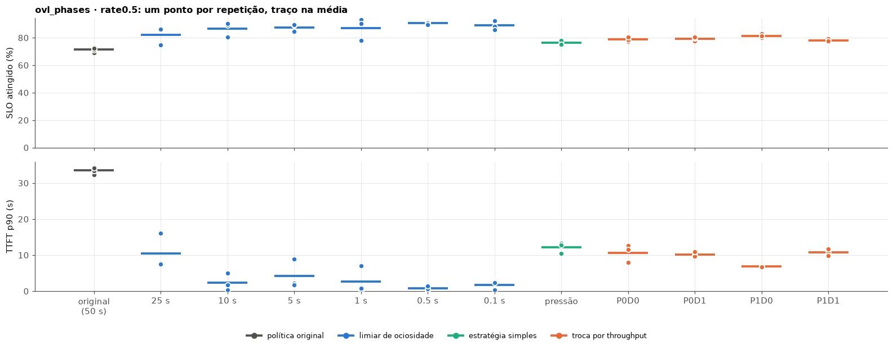

- **Nenhuma perda, em nenhum limiar.** Em 22/10, os limiares de 5 s e 10 s tinham perdido 94 e 1.196 requisições, por workers mortos e por uma queda com `torch.OutOfMemoryError`. Com a contabilidade das ativações pendentes, o controlador não ativa mais um modelo que não cabe, e essas falhas sumiram.
- **Qualquer limiar de até 10 s dá praticamente o mesmo resultado.** As faixas de SLO de 1 s, 5 s e 10 s se sobrepõem. O limiar de 0,5 s teve a menor variação (89–92%) e o melhor p90, mas a vantagem sobre 1–10 s é menor que o ruído entre repetições.
- **25 s já é um meio-termo ruim:** p90 de 10 s e pior espera de 38 s.

**Quanto o grupo novo espera em cada troca.** Para cada modelo em cada fase (menos a primeira), o tempo entre a primeira requisição da fase e o primeiro token:

| Configuração | Espera média na troca (s) | Pior espera na troca (s) | Despejos no meio da fase, por execução |
| --- | --- | --- | --- |
| original (50 s) | 37,7 | 62,1 | 0 |
| limiar 25 s | 23,7 | 38,3 | 0 |
| limiar 10 s | 14,9 | 27,3 | 0,7 |
| limiar 5 s | 17,2 | 31,4 | 0,7 |
| limiar 1 s | 12,6 | 27,9 | 1,3 |
| limiar 0,5 s | 10,4 | 21,1 | 1,3 |
| limiar 0,1 s | 11,2 | 22,8 | 1,3 |

- **O piso de ~10 s não vem do limiar.** Quando a fase troca, os modelos do grupo que sai ainda têm requisições em andamento (cada uma leva 6–25 s), e só ficam ociosos quando elas terminam. Na figura abaixo, o grupo A só sai entre 165 s e 175 s, 15–25 s depois do fim da fase. Até lá, só cabem os modelos do grupo B que encontram memória livre. Para baixar esse piso seria preciso tirar o modelo antes de ele ficar ocioso (preempção ou drenagem), que é o que a troca por throughput faz.
- **Limiar curto tem um custo pequeno: despejos no meio da fase.** Com limiar ≤ 10 s, cerca de 1 vez por execução um modelo é despejado durante a sua própria fase e reativado em seguida (uma partida a frio de alguns segundos).
- **Quanto um modelo fica ocioso dentro da fase:**
  - entre duas chegadas do mesmo modelo, o intervalo tem p50 de 1,3 s, p99 de 8,7 s e máximo de 14,8 s;
  - mas um modelo quase nunca fica **sem nada em andamento**, porque cada requisição dura mais que esse intervalo: são 1–3 janelas por execução, de no máximo 5,3 s.
  
  É por isso que limiares de 0,1 s a 10 s despejam quase igual: o modelo só fica ocioso, de fato, quando a fase acaba.

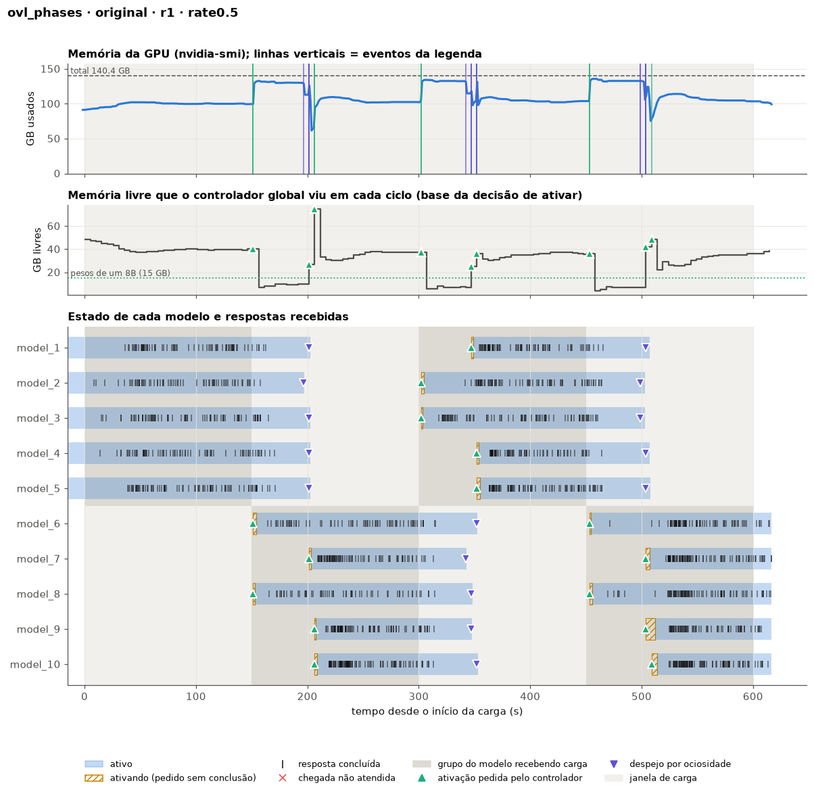
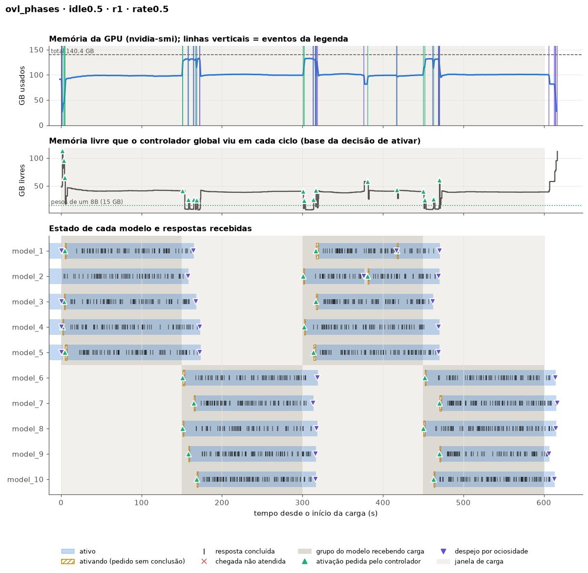

### `ovl_mem` (todos com demanda)

**A 0,2 req/s por modelo:**

| Configuração | Rep. | Atendidas | Perdas | TTFT p50 / p99 (s) | TTFT p90 (s) | SLO (%) | Pior espera pelo 1º token (s) | Ativações |
| --- | --- | --- | --- | --- | --- | --- | --- | --- |
| original (50 s) | 6 | 100,0% | — | 0,20 / 340,3 | 268,1 (266,0–270,0) | 62 (50–66) | 352 (350–355) | 4 |
| limiar 25 s | 3 | 100,0% | — | 2,78 / 313,8 | 225,9 (221,7–229,5) | 48 (20–67) | 327 (323–331) | 6 |
| limiar 10 s | 3 | 100,0% | — | 4,06 / 309,4 | 187,9 (171,3–199,2) | 51 (33–65) | 327 (324–330) | 11 |
| limiar 5 s | 3 | 100,0% | — | 0,19 / 305,7 | 199,5 (193,1–208,0) | 66 (65–67) | 325 (313–339) | 15 |
| limiar 1 s | 3 | 100,0% | — | 11,98 / 231,2 | 139,5 (89,9–169,8) | 36 (27–42) | 55 (33–80) | 19 |

**A 0,5 req/s por modelo:**

| Configuração | Rep. | Atendidas | Perdas | TTFT p50 / p99 (s) | TTFT p90 (s) | SLO (%) | Pior espera pelo 1º token (s) | Ativações |
| --- | --- | --- | --- | --- | --- | --- | --- | --- |
| original (50 s) | 3 | 100,0% | — | 88,02 / 381,1 | 312,9 (280,3–341,1) | 21 (15–29) | 373 (362–390) | 4 |
| limiar 25 s | 3 | 100,0% | — | 56,97 / 360,6 | 276,8 (269,3–283,1) | 19 (15–25) | 372 (365–379) | 4 |
| limiar 10 s | 3 | 100,0% | — | 80,51 / 356,9 | 278,5 (269,2–290,3) | 29 (27–33) | 368 (340–387) | 4 |
| limiar 5 s | 3 | 85,9% | 614 (0, 614, 0) | 90,32 / 346,4 | 291,8 (279,0–303,6) | 16 (0–31) | nunca (348–nunca) | 4 |
| limiar 1 s | 3 | 100,0% | — | 38,01 / 337,7 | 265,6 (252,6–276,3) | 13 (6–22) | 344 (336–357) | 7 |

- **"100% atendidas" esconde a fome.** A carga dura 300 s, e os modelos que começam inativos esperam ~350 s pelo primeiro token: só são atendidos no prazo extra, depois que a carga acabou e os ativos ficaram ociosos. A pior espera pelo 1º token é o que mostra isso.
- **O limiar só muda algo a 0,2 req/s e com 1 s.** A 0,2 req/s, cada modelo tem pausas curtas entre as requisições, e com 1 s o controlador aproveita essas pausas para revezar. A pior espera cai de 352 s para 55 s, mas o SLO cai de 62% para 36%. A 0,5 req/s nenhum modelo para, e todos os limiares se comportam como o original.
- **As 614 não atendidas do limiar de 5 s a 0,5 req/s** (1 de 3 repetições) não vêm de falha, e sim da fome levada ao extremo. Os 4 modelos que começaram inativos (6, 8, 9 e 10) não foram ativados nem durante o prazo extra, porque os ativos continuaram com fila. O primeiro deles só entrou aos 583 s, e o prazo acabou antes de as requisições serem respondidas.
- **Em 22/10, 4 das 10 execuções do `ovl_mem` caíram.** Agora nenhuma caiu.

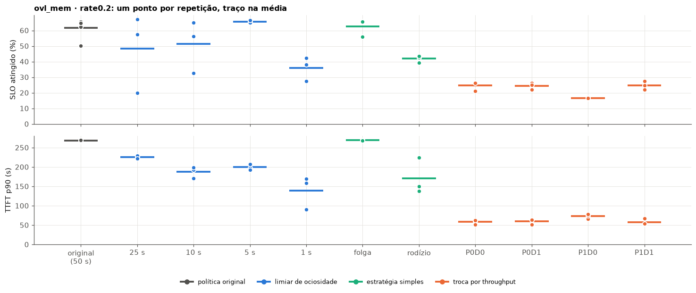

### `ovl_trace_big` (trace real com 12 modelos)

**Escala 1 (1×):**

| Configuração | Rep. | Atendidas | Perdas | TTFT p50 / p99 (s) | TTFT p90 (s) | SLO (%) | Pior espera pelo 1º token (s) | Ativações |
| --- | --- | --- | --- | --- | --- | --- | --- | --- |
| original (50 s) | 5 | 100,0% | — | 0,48 / 425,2 | 214,2 (162,2–276,5) | 69 (28–81) | 649 (648–650) | 12 |
| limiar 25 s | 3 | 100,0% | — | 0,11 / 343,1 | 50,2 (46,2–55,1) | 81 (80–83) | 54 (54–56) | 28 |
| limiar 10 s | 3 | 100,0% | — | 0,11 / 287,9 | 35,1 (29,8–41,6) | 77 (74–81) | 42 (30–62) | 52 |
| limiar 5 s | 3 | 100,0% | — | 0,12 / 266,7 | 36,1 (31,2–42,2) | 74 (64–81) | 47 (34–55) | 59 |
| limiar 1 s | 3 | 100,0% | — | 0,14 / 247,2 | 31,0 (19,6–50,6) | 69 (49–79) | 67 (27–94) | 68 |

**Escala 0,5 (2×):**

| Configuração | Rep. | Atendidas | Perdas | TTFT p50 / p99 (s) | TTFT p90 (s) | SLO (%) | Pior espera pelo 1º token (s) | Ativações |
| --- | --- | --- | --- | --- | --- | --- | --- | --- |
| original (50 s) | 3 | 100,0% | — | 0,16 / 247,7 | 205,1 (203,5–206,1) | 61 (56–64) | 355 (353–356) | 8 |
| limiar 25 s | 3 | 100,0% | — | 0,14 / 220,3 | 173,7 (170,6–175,3) | 64 (62–64) | 329 (329–330) | 11 |
| limiar 10 s | 3 | 100,0% | 1 (0, 1, 0) | 0,17 / 198,7 | 135,3 (106,5–152,3) | 57 (54–63) | 210 (203–220) | 18 |
| limiar 5 s | 3 | 100,0% | — | 12,02 / 253,4 | 177,8 (107,7–273,9) | 41 (13–59) | 248 (206–327) | 21 |
| limiar 1 s | 3 | 100,0% | — | 0,15 / 210,8 | 151,5 (143,2–165,4) | 62 (62–63) | 211 (208–213) | 32 |

A perda do limiar de 10 s é o erro de medição descrito na [seção 4](#4-falhas-que-sobraram-e-as-correções-em-ação): a requisição foi atendida.

**O que os resultados mostram:**

- **A política original deixa 4 modelos com fome por quase toda a carga.** Na escala 1, os modelos 7 a 12 começam inativos. No começo, alguns modelos ainda param por 50 s, e o controlador consegue revezar: o `model_7`, o `model_9`, o `model_10` e o `model_11` entram. Depois de ~200 s, os ativos recebem tráfego contínuo, nunca ficam 50 s ociosos, e ninguém mais entra. Na repetição da figura abaixo:
  - o `model_8` e o `model_12` só recebem o primeiro token depois de 600 s, quando a carga acaba;
  - o `model_10` e o `model_11`, que foram despejados cedo, ficam com 34 e 38 requisições sem resposta até o fim da carga.
  
  Isso se repetiu nas 5 repetições, sempre com o `model_12` em ~649 s.
- **Qualquer limiar até 25 s resolve a fome na escala 1:** a pior espera cai para 42–67 s e o p90 de 214 s para 31–50 s. O SLO, porém, fica igual ao da original: 74–81% contra 79–81% (sem a repetição atípica, ver abaixo). O ganho está na cauda e nos modelos pequenos, não na mediana.
- **Limiar de 25 s foi o melhor SLO na escala 1** (81%, com pouca variação). Limiares menores fazem 2× mais ativações, porque os modelos de tráfego esparso saem e voltam entre requisições, e cada volta custa uma partida a frio.
- **Na escala 0,5, o trace satura a GPU,** e nenhum limiar resolve: a pior espera fica em 212–330 s. É o mesmo quadro do `ovl_mem`, em que todos os modelos têm demanda.
- **Uma repetição da política original destoa** (SLO de 28%, contra 79–81% nas outras 4). Ela é da rodada `fix3` (job `8426cbcd`, suíte de estratégias), que rodou no fim do período em que o nó estava degradado. Não houve falha registrada nela, então ela fica, mas puxa a média para baixo.

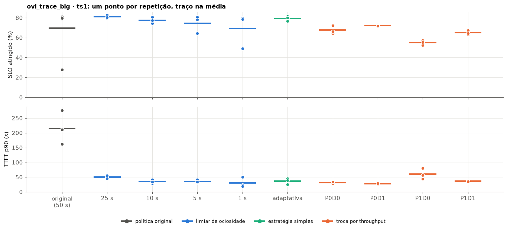
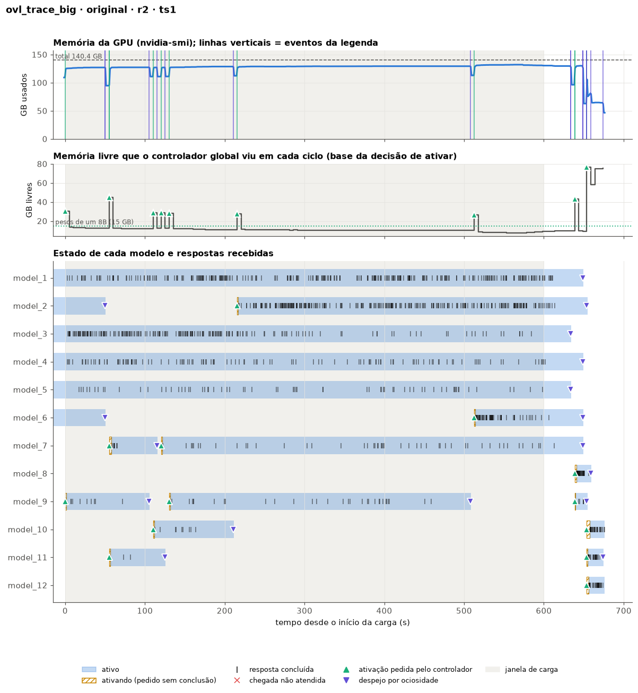
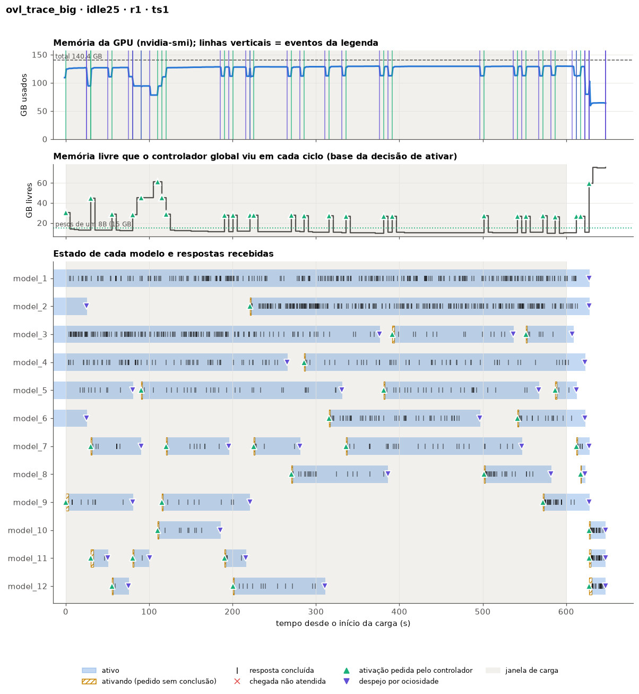

## 2. Estratégias simples

Cada uma no cenário que pretende resolver. A linha da política original é a mesma das tabelas da seção 1.

| Cenário | Configuração | Rep. | Atendidas | Perdas | TTFT p50 / p99 (s) | TTFT p90 (s) | SLO (%) | Pior espera pelo 1º token (s) | Ativações |
| --- | --- | --- | --- | --- | --- | --- | --- | --- | --- |
| `ovl_phases` | original | 4 | 100,0% | — | 0,15 / 54,5 | 33,6 (32,3–34,3) | 71 (69–73) | 58 (57–59) | 15 |
| | despejo sob pressão | 3 | 100,0% | — | 0,14 / 46,6 | 12,2 (10,5–13,3) | 76 (75–78) | 29 (21–33) | 15 |
| `ovl_trace_big` 1× | original | 5 | 100,0% | — | 0,48 / 425,2 | 214,2 (162,2–276,5) | 69 (28–81) | 649 (648–650) | 12 |
| | ociosidade adaptativa | 3 | 100,0% | — | 0,11 / 313,4 | 36,7 (25,1–45,5) | 79 (76–81) | 59 (35–86) | 51 |
| `ovl_mem` 0,2 | original | 6 | 100,0% | — | 0,20 / 340,3 | 268,1 (266,0–270,0) | 62 (50–66) | 352 (350–355) | 4 |
| | só folga de 3 GB | 3 | 100,0% | — | 0,20 / 343,0 | 269,3 (268,6–269,7) | 63 (56–66) | 354 (353–356) | 4 |
| | rodízio anti-fome | 3 | 100,0% | — | 6,74 / 303,5 | 170,7 (137,6–224,9) | 42 (39–44) | 320 (313–329) | 45 |

- **Despejo sob pressão** melhora a troca de grupos (p90 de 34 s para 12 s), mas menos que um limiar curto (1–4 s). Ele só despeja quem está ocioso há ≥ 2 s, e o grupo que sai continua ocupado até terminar as requisições em andamento. Em 22/10 ele perdeu 157 requisições por uma falha externa; agora não perde nada.
- **Ociosidade adaptativa** resolve a fome do trace (pior espera de 649 s para 59 s), com SLO de 79%. Fica no mesmo nível dos limiares fixos de 10–25 s, então não justifica a complexidade.
- **Só a folga de 3 GB** já não muda nada: com a contabilidade das ativações pendentes, o controlador não ativa mais sem espaço, que era o problema que a folga resolvia em 22/10.
- **Rodízio anti-fome** não resolve a fome (pior espera de 320 s) e derruba o SLO para 42%. Ele faz 45 ativações por execução, mas quem entra é escolhido pela ordem de violação de SLO, e não por quem espera há mais tempo. O `model_10` espera 313–329 s nas 3 repetições, e o `model_9` 317 s numa delas. Em 22/10 ele perdeu 154 requisições por um worker morto; agora não perde nada.

## 3. Troca por throughput por GB

Desenho igual ao de 22/10 (ver a [seção 3 daquele relatório](2026-10-22%20Janela%20de%20ociosidade%20e%20estratégias%20de%20troca%20no%20Prism%20(SGLang).md#3-troca-por-throughput-por-gb)). A coluna "Trocas / preemptadas" é a média, por execução, das trocas feitas e das requisições em execução retiradas.

### `ovl_mem` a 0,2 req/s

| Configuração | Rep. | Atendidas | Perdas | TTFT p50 / p99 (s) | TTFT p90 (s) | SLO (%) | Pior espera pelo 1º token (s) | Trocas / preemptadas |
| --- | --- | --- | --- | --- | --- | --- | --- | --- |
| original | 6 | 100,0% | — | 0,20 / 340,3 | 268,1 (266,0–270,0) | 62 (50–66) | 352 (350–355) | 0 / 0 |
| troca P0D0 | 3 | 100,0% | — | 15,75 / 102,8 | 58,3 (51,6–62,7) | 25 (21–27) | 43 (39–47) | 41 / 0 |
| troca P0D1 | 3 | 100,0% | — | 15,95 / 94,6 | 59,7 (52,0–63,9) | 24 (22–26) | 39 (38–41) | 37 / 0 |
| troca P1D0 | 3 | 100,0% | — | 20,41 / 149,3 | 73,3 (66,7–78,9) | 17 (16–17) | 31 (30–32) | 65 / 327 |
| troca P1D1 | 3 | 100,0% | — | 15,01 / 94,4 | 58,1 (52,7–67,5) | 25 (22–28) | 38 (37–39) | 45 / 51 |

### `ovl_mix`

| Configuração | Rep. | Atendidas | Perdas | TTFT p50 / p99 (s) | TTFT p90 (s) | SLO (%) | Pior espera pelo 1º token (s) | Trocas / preemptadas |
| --- | --- | --- | --- | --- | --- | --- | --- | --- |
| original | 3 | 2,6% | 1605 (536, 536, 533) | 0,12 / 9,4 | 2,1 (1,3–3,4) | 2 (2–2) | nunca | 0 / 0 |
| troca P0D0 | 3 | 99,9% | 1 (0, 0, 1) | 4,70 / 72,4 | 41,7 (31,8–57,6) | 44 (30–53) | 54 (47–64) | 38 / 0 |
| troca P0D1 | 3 | 100,0% | — | 1,14 / 58,2 | 36,1 (33,3–40,1) | 51 (46–56) | 53 (39–73) | 38 / 0 |
| troca P1D0 | 3 | 100,0% | — | 3,46 / 86,3 | 36,3 (30,1–45,0) | 46 (34–53) | 30 (24–33) | 51 / 158 |
| troca P1D1 | 3 | 100,0% | — | 1,00 / 57,7 | 34,5 (31,1–38,5) | 51 (48–55) | 44 (40–51) | 38 / 26 |

### `ovl_trace_big` escala 1

| Configuração | Rep. | Atendidas | Perdas | TTFT p50 / p99 (s) | TTFT p90 (s) | SLO (%) | Pior espera pelo 1º token (s) | Trocas / preemptadas |
| --- | --- | --- | --- | --- | --- | --- | --- | --- |
| original | 5 | 100,0% | — | 0,48 / 425,2 | 214,2 (162,2–276,5) | 69 (28–81) | 649 (648–650) | 0 / 0 |
| troca P0D0 | 3 | 100,0% | — | 0,13 / 79,3 | 32,0 (29,0–34,1) | 68 (64–72) | 57 (48–62) | 62 / 0 |
| troca P0D1 | 3 | 100,0% | — | 0,11 / 71,3 | 27,7 (26,4–28,7) | 72 (72–73) | 50 (48–54) | 62 / 0 |
| troca P1D0 | 3 | 99,3% | 25 (25, 0, 0) | 0,16 / 267,6 | 60,4 (44,5–80,1) | 55 (53–57) | 48 (48–49) | 132 / 599 |
| troca P1D1 | 3 | 100,0% | — | 0,12 / 105,4 | 36,5 (35,3–38,0) | 65 (63–68) | 48 (48–48) | 72 / 56 |

### `ovl_phases`

| Configuração | Rep. | Atendidas | Perdas | TTFT p50 / p99 (s) | TTFT p90 (s) | SLO (%) | Pior espera pelo 1º token (s) | Trocas / preemptadas |
| --- | --- | --- | --- | --- | --- | --- | --- | --- |
| original | 4 | 100,0% | — | 0,15 / 54,5 | 33,6 (32,3–34,3) | 71 (69–73) | 58 (57–59) | 0 / 0 |
| limiar 0,5 s (seção 1) | 3 | 100,0% | — | 0,13 / 16,1 | 0,8 (0,3–1,4) | 91 (89–92) | 19 (18–20) | 0 / 0 |
| troca P0D0 | 3 | 100,0% | — | 0,14 / 38,9 | 10,7 (8,0–12,6) | 79 (77–81) | 21 (21–21) | 9 / 0 |
| troca P0D1 | 3 | 100,0% | — | 0,13 / 41,0 | 10,2 (9,7–10,9) | 79 (78–81) | 23 (21–28) | 9 / 0 |
| troca P1D0 | 3 | 100,0% | — | 0,14 / 38,7 | 7,0 (6,8–7,2) | 82 (80–83) | 25 (21–27) | 12 / 3 |
| troca P1D1 | 3 | 100,0% | — | 0,14 / 41,4 | 10,8 (9,8–11,7) | 78 (77–79) | 25 (21–27) | 9 / 0 |

**Espera do grupo novo em cada troca de fase** (mesma medida da seção 1):

| Configuração | Espera média na troca (s) | Pior espera na troca (s) | Despejos no meio da fase, por execução |
| --- | --- | --- | --- |
| original (50 s) | 37,7 | 62,1 | 0 |
| limiar 0,5 s | 10,4 | 21,1 | 1,3 |
| troca P0D0 | 17,2 | 44,9 | 0 |
| troca P0D1 | 17,1 | 45,9 | 0 |
| troca P1D0 | 15,7 | 34,6 | 0 |
| troca P1D1 | 18,9 | 47,5 | 0 |

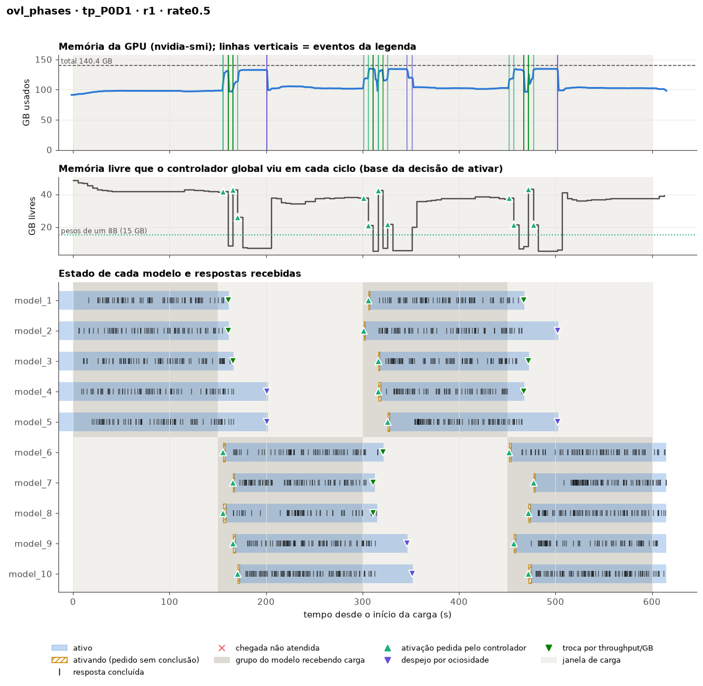

- **A troca melhora a troca de grupos, mas menos que um limiar curto.** O SLO sobe de 71% para 78–82% e o p90 cai de 34 s para 7–11 s. Fica no nível do despejo sob pressão (76%, 12 s) e abaixo do limiar de 0,5–10 s (87–91%, 1–4 s).
- **Por que fica atrás.** Na figura, a fase muda aos 150 s. A troca tira 3 modelos do grupo A entre 160 s e 167 s, e o grupo B entra escalonado entre 155 s e 172 s. Os outros 2 modelos do grupo A (`model_4` e `model_5`) não são escolhidos para a troca, porque já há memória para o grupo B. Eles só saem aos 200 s, pelo limiar de 50 s, que as configurações de troca mantêm. A espera média na troca (16–19 s) fica acima da do limiar curto (10 s), e a pior chega a 35–48 s.
- **A troca não despeja ninguém no meio da fase,** ao contrário do limiar curto (~1 vez por execução). Ela só tira um modelo quando há outro com fila esperando.
- **Aqui a preempção sem drenagem (P1D0) é a melhor variante** (82%, p90 de 7 s), ao contrário dos cenários com pressão contínua. Na troca de grupos, o modelo que sai está terminando a fase e quase não tem nada em execução (3 requisições retiradas por execução), então a preempção libera a memória mais cedo quase sem custo.
- **Isso reforça a combinação** limiar curto + troca: o limiar tira o grupo antigo assim que ele fica ocioso, e a troca resolve os casos em que ninguém fica ocioso (`ovl_mem`, `ovl_mix`, trace12).

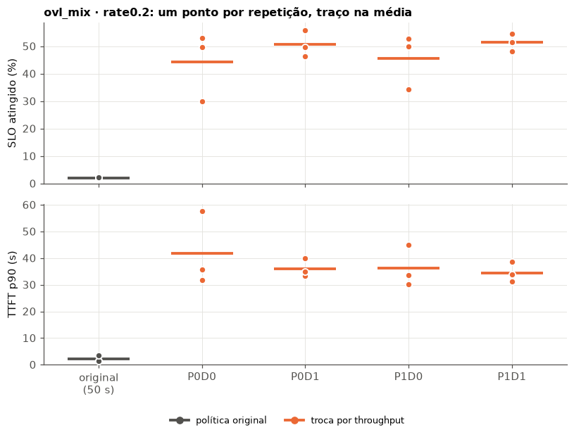
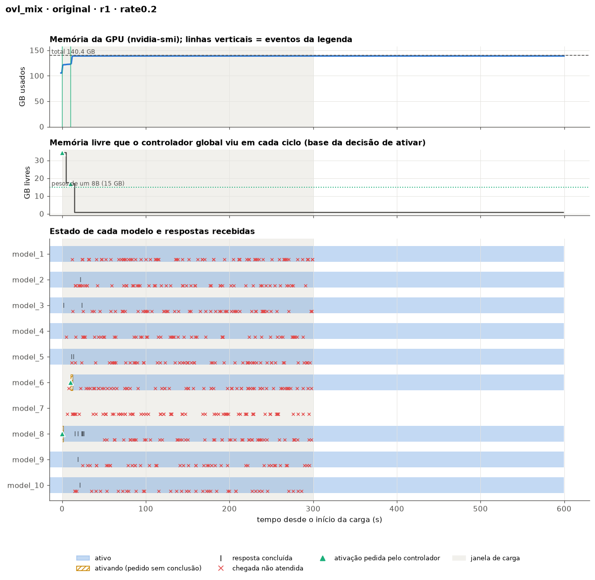
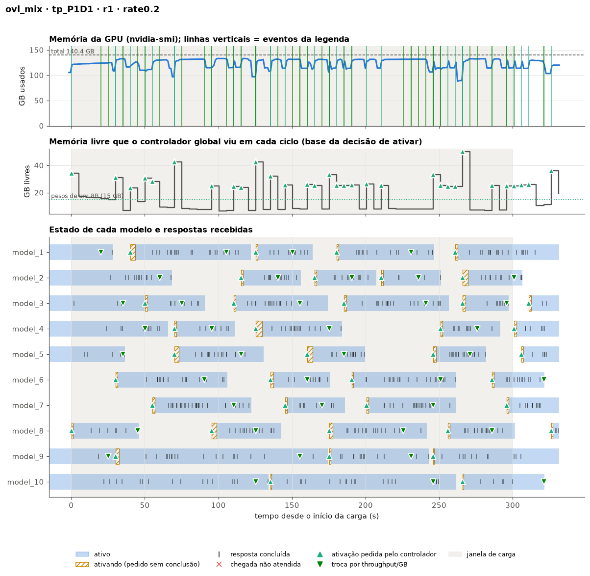

**O que os resultados mostram:**

- **A troca acaba com a fome em todos os cenários com pressão.** A pior espera pelo 1º token fica em 30–57 s no `ovl_mem`, no `ovl_mix` e no trace12, contra 352 s, "nunca" e 649 s na original.
- **No `ovl_mix`, a política original trava nas 3 repetições, mesmo com as correções.** A GPU passa de 135 GB aos 11–13 s, a última resposta sai entre 23 s e 33 s, e nenhum modelo volta a progredir. Não há worker morto nem queda: é a política que fica sem saída. A troca é a única configuração testada que funciona nesse cenário.
- **No `ovl_mem`, o custo continua alto:** o SLO cai de 62% para 17–25%. Com mais demanda do que memória, a troca divide a espera entre todos: ninguém espera 350 s, mas quase todos esperam dezenas de segundos.
- **No trace12 (escala 1), a troca P0D1 dá a melhor cauda** de todas as configurações: p99 de 71 s, contra 425 s na original e 247–343 s com os limiares. O SLO (72%) fica um pouco abaixo do limiar de 25 s (81%).
- **Com pressão contínua, preempção sem drenagem (P1D0) é a pior variante.** Com P1D0 o modelo sai imediatamente, então a troca fica "barata" e acontece mais (132 trocas no trace12, contra 62–72 nas outras). As 599 requisições retiradas por execução recomeçam do zero. O resultado é o menor SLO (55% no trace12, 17% no `ovl_mem`). Numa das repetições do trace12, 25 requisições se perderam (ver a [seção 4](#4-falhas-que-sobraram-e-as-correções-em-ação)). No `ovl_phases`, em que quase nada é retirado, ela é a melhor variante.
- **Com drenagem, preempção ou não dá quase no mesmo.** P0D1 e P1D1 empatam no `ovl_mem` e no `ovl_mix` (SLO de 24–25% e 51%). No trace12, P0D1 é um pouco melhor (72% contra 65%, com p99 de 71 s contra 105 s). A drenagem dá ao modelo que sai até 15 s para terminar, e quase nada sobra para ser retirado: 26–56 requisições por execução no P1D1, contra 158–599 no P1D0.
- **Em 22/10, P1D0 tinha caído no `ovl_mem` e perdido 174 requisições no `ovl_mix`,** e P0D1 tinha caído no `ovl_phases`. Agora nenhuma variante tem falha.

## 4. Falhas que sobraram e as correções em ação

**Perdas nos 150 níveis limpos.** Em 7 níveis:

| Nível | Perdas | Causa |
| --- | --- | --- |
| `ovl_mix`, original (3 de 3) | 533–536 cada | travamento da política (ver seção 3) |
| `ovl_mem` 0,5, limiar 5 s (1 de 3) | 614 | fome: 4 modelos não foram ativados nem no prazo extra (ver seção 1) |
| `ovl_trace_big` 1×, troca P1D0 (1 de 3, rodada `fix5`, job `4485f194`) | 25 | **requisições perdidas, sem causa identificada** (abaixo) |
| `ovl_mix`, troca P0D0 (1 de 3, rodada `fix3`, job `38c50954`) | 1 | **sem causa identificada.** Uma requisição do `model_9` chegou aos 144,6 s, pouco antes de uma troca que tirou o modelo, e nunca foi respondida. Nenhum evento de falha no nível |
| `ovl_trace_big` 2×, limiar 10 s (1 de 3, rodada `fix5`, job `d8b55e8a`) | 1 | **erro de medição do SGLang; a requisição foi atendida** (abaixo) |

**As 25 perdidas da troca P1D0 não estavam na fila.** Na versão parcial deste relatório, elas apareciam como requisições que ainda esperavam quando o prazo acabou. Os dados mostram outra coisa:
- elas chegaram entre 211 s e 579 s e são de 10 modelos diferentes, incluindo o `model_1`, o mais requisitado;
- requisições dos mesmos modelos que chegaram **depois** delas foram atendidas;
- a última resposta de cada um desses modelos saiu entre 604 s e 849 s, antes do fim do prazo (900 s).

Então elas se perderam dentro do sistema. Nessa execução, os workers devolveram 1.004 requisições ao Redis, em 156 devoluções (`Evicted N requests back to Redis`, o caminho que a preempção usa). A hipótese mais provável é que algumas se percam nesse caminho, mas os logs não registram o id de cada requisição, então isso ainda não foi confirmado. As outras 2 repetições de P1D0 no trace12 não perderam nada.

**O erro de medição.** A requisição 841 (`model_2`, chegada aos 200 s) foi respondida aos 328,7 s, mas o gerador de carga a contou como falha, com `TypeError` no cálculo do TPOT, porque `finish_timestamp` veio vazio. O worker do `model_2` tinha feito retiradas do batch por falta de KV (*decode retract*) entre 317 s e 327,0 s, a última 1,7 s antes da resposta. Os logs não trazem o id da requisição, então a ligação é pelo horário, mas o código só deixa esse campo vazio nesse caso. A causa está no SGLang 0.3.4:
- a retirada guarda os tokens já gerados, e a requisição volta a fazer prefill deles;
- quando falta só 1 token, ela termina no próprio prefill;
- o ramo de prefill (`process_batch_result_prefill` em `python/sglang/srt/managers/scheduler.py`) não chama `set_finish_time()`, ao contrário do ramo de decode.

O mesmo novo prefill também sobrescreve `prefill_finish_timestamp`. Por isso, o TTFT que o servidor informa para uma requisição retirada vai até o último prefill, e não até o primeiro token, que saiu no primeiro prefill: o TTFT medido sai **maior** que o real, e o TPOT sai menor. Isso afeta todas as configurações quando falta KV.

**Tamanho do efeito nestes dados.** Houve retiradas por falta de KV em 105 dos 150 níveis: 1.358 no total, ou 0,8% das 169.387 requisições. O teto por configuração é:
- 3,7–4,6% das requisições no `ovl_mem` 0,2 com troca (máximo de 6,7% num nível);
- ≤ 2,6% nos outros cenários;
- ≤ 0,7% no `ovl_phases`.

É um teto porque uma requisição pode ser retirada mais de uma vez. O SLO de uma configuração pode mudar no máximo nessa proporção, bem menos que as diferenças entre configurações discutidas aqui. Por isso, os níveis não foram refeitos.

**Corrigido depois desta rodada** (não vale para os 150 níveis acima). No ramo de prefill, o término passou a ser marcado, e o fim do prefill só é gravado na primeira vez. Ver R2.5 no [relatório de mudanças](2026-10-22%20Correções%20de%20robustez%20de%20memória%20no%20Prism%20(SGLang).md).

**As correções em ação nos níveis usados.** Contagem dos eventos que as correções registram:

| Evento | Total nos 150 níveis | O que teria acontecido sem a correção |
| --- | --- | --- |
| Confirmação de desativação atrasada ignorada (R2.3) | 100 | o modelo reativado seria marcado como inativo e ficaria sem atendimento até o fim |
| Prefill adiado por falta de KV (R2.2) | 8 | o worker cairia no `pretty_print` e derrubaria os outros workers da GPU |
| Ativação desfeita por falta de memória | 2 | o worker morreria pelo `abort()` do kvcached |

**A correção R2.3 foi conferida num caso real.** No `ovl_mix` com P0D0, o `model_9` foi desativado no worker 5 e reativado no worker 8 antes de o worker 5 terminar. Sem preempção, o worker 5 precisou de 34,6 s para concluir a requisição que estava rodando. A confirmação atrasada do worker 5 chegou depois da reativação e foi ignorada, como deveria. O modelo continuou ativo no worker 8.

## Próximos passos

1. **Investigar as 25 requisições perdidas da troca P1D0** (trace12). Primeiro passo: registrar o id das requisições devolvidas ao Redis e das que o controlador recoloca, para achar onde elas somem.
2. **Confirmar na próxima rodada a correção da medição** de término e TTFT das requisições retiradas (R2.5): nenhum `TypeError` no gerador de carga.
3. **Testar a combinação:** limiar curto (5 ou 10 s) + troca por throughput com drenagem (P0D1), no `ovl_phases`, no `ovl_mem`, no `ovl_mix` e no trace12. As duas atacam problemas diferentes (ociosos que demoram a sair e ocupados que nunca saem) e devem se complementar.
4. **Investigar o travamento da política original no `ovl_mix`.** Ele continua mesmo com a contabilidade das ativações, então a causa é outra.
5. **Investigar a requisição perdida no `ovl_mix` com P0D0,** provavelmente junto com o item 1.
6. **Controle de admissão** para o `ovl_mem`: nenhuma política de troca dá SLO bom quando a demanda passa da capacidade. A alternativa a dividir a espera é recusar ou adiar requisições.

## Limitações

- **Um único nó.** Todas as repetições rodaram na mesma máquina, em momentos diferentes. A variação entre repetições mede o ruído do mesmo nó, não entre GPUs.
- **Seleção dos níveis limpos.** Ver [De onde vêm os dados](#de-onde-vêm-os-dados). A rodada `fix5`, sem nenhuma exclusão, é a principal evidência de que as correções eliminaram as falhas.
- **Três repetições** ainda deixam faixas largas em algumas configurações (SLO de 20% a 67% no limiar de 25 s do `ovl_mem`).
- **TTFT de requisições retiradas por falta de KV.** Nestes níveis, o SGLang 0.3.4 mede o TTFT até o último prefill, e não até o primeiro token, então o TTFT dessas requisições sai maior do que o real. Isso atinge no máximo 0,8% das requisições no total e 4,6% na pior configuração (ver a [seção 4](#4-falhas-que-sobraram-e-as-correções-em-ação)). Já foi corrigido para as próximas rodadas.
- **O prazo extra de 300 s** transforma fome em "atendida tarde". Por isso a pior espera pelo 1º token é a medida certa para a fome, e não a porcentagem de atendidas.

## Como reproduzir

| O quê | Arquivo |
| --- | --- |
| Limiar, ciclo, estratégias e troca por throughput | `python/sglang/multi_model/scheduling/policy/simple_global.py`, `scheduling/controller_global.py` |
| Correções R2.1–R2.3 | ver [Arquivos alterados](2026-10-22%20Correções%20de%20robustez%20de%20memória%20no%20Prism%20(SGLang).md#arquivos-alterados) no relatório de mudanças |
| Cenários `ovl_*`, verificação de saúde | `polyaxon/run_examples.sh`, `polyaxon/kvcached_probe.py` |
| Gerador de carga | `polyaxon/overload_load.py` |
| Suítes completas | `polyaxon/configs/fix_{phases_idle,mem_idle,trace12,strategies}_suite.tsv`, `fix_throughput_{mem,mix,phases,trace12}_suite.tsv` |
| Suítes de preenchimento (só os níveis que faltavam) | `polyaxon/configs/fill_*_suite.tsv` |
| Juntar níveis limpos de várias rodadas | `polyaxon/collect_reps.py` (gera `manifest.csv`) |
| Métricas por nível e resumo por configuração | `polyaxon/summarize_reps.py` (`metricas.csv`, `resumo.csv`) |
| Figuras | `polyaxon/plot_suite.py` (linhas do tempo), `polyaxon/plot_reps.py` (resumo por configuração) |
| Extração dos logs | `polyaxon/extract_ovl.py` (eventos novos: `stale_deact`, `prefill_postponed`, `worker_exit`) |
| Dados e figuras | `reports/data/2026-10-28-ociosidade/`, `reports/figs/2026-10-28-ociosidade/` |

```bash
# uma suíte por job (SGLang), no máximo 6 jobs ao mesmo tempo; trocar o arquivo para as outras
PRISM_JOB_SUFFIX=-fix5-tp-mix-1 PRISM_JOB_ENV="PRISM_SUITE=polyaxon/configs/fill_tp_mix_1_suite.tsv PRISM_TIMEOUT=10800" polyaxon/submit.sh
# baixar cada job numa pasta própria, um de cada vez (downloads em paralelo misturam as saídas)
polyaxon ops artifacts -p kunumi/hpc4ai -uid <uuid> -d outputs --path <rodada>/<job>
# juntar as rodadas (a primeira tem preferência), resumir e gerar figuras; precisa de pandas e matplotlib
python3 polyaxon/collect_reps.py reports/data/2026-10-28-ociosidade fix5=<pasta fix5> fix3=<pasta fix3> fix2=<pasta fix2>:lossless
python3 polyaxon/summarize_reps.py reports/data/2026-10-28-ociosidade
python3 polyaxon/plot_suite.py reports/data/2026-10-28-ociosidade reports/figs/2026-10-28-ociosidade
python3 polyaxon/plot_reps.py reports/data/2026-10-28-ociosidade reports/figs/2026-10-28-ociosidade
```

**Jobs usados** (níveis aproveitados entre parênteses; a lista exata de cada nível está em `manifest.csv`):

| Rodada | Jobs |
| --- | --- |
| `fix2` | mem-idle-1 `32a26820` (7), mem-idle-2 `28c6be07` (7), phases-idle-2 `fbb97c7b` (7), strategies-1 `f1cb4580` (6), tp-mem-1 `385dbd75` (4), tp-mix-1 `68d4c549` (2), tp-phases-1 `52b6c5c5` (4), tp-trace12-1 `b43713ae` (4), trace12-1 `1c13e9b2` (8) |
| `fix3` | mem-idle-1 `7f161546` (10), mem-idle-3 `50962574` (3), phases-idle-1 `a8f9e7f4` (5), strategies-3 `8426cbcd` (2), tp-mem-1 `b71e3d7e` (2), tp-mix-1 `38c50954` (3), tp-mix-3 `042d7206` (1), tp-phases-3 `e249d431` (3), tp-trace12-3 `9bdd237c` (3), trace12-1 `005f776b` (8), trace12-3 `069bca56` (2) |
| `fix5` | mem-idle-1 `d25059eb` (3), phases-idle-1 `8a3c523e` (6), phases-idle-2 `09e74c3f` (2), strategies-1 `7adc95c6` (4), strategies-2 `77fd7bd7` (4), tp-mem-1 `ada87e24` (4), tp-mem-2 `ba11fedf` (4), tp-mix-1 `5a097dd9` (4), tp-mix-2 `79ee4e30` (4), tp-mix-3 `0418c74e` (1), tp-phases-1 `434a61e4` (4), tp-phases-2 `c8bfb90b` (2), tp-trace12-1 `4485f194` (4), tp-trace12-2 `b07f3366` (1), tp-trace12-3 `73a40bb7` (1), trace12-1 `9a90b17b` (8), trace12-2 `d8b55e8a` (3) |
