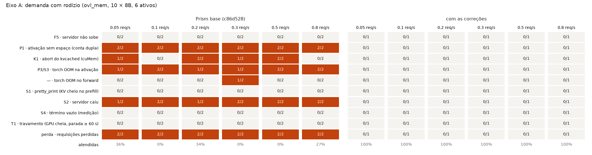
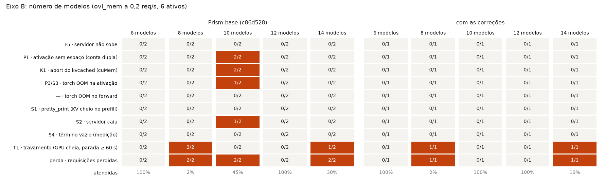
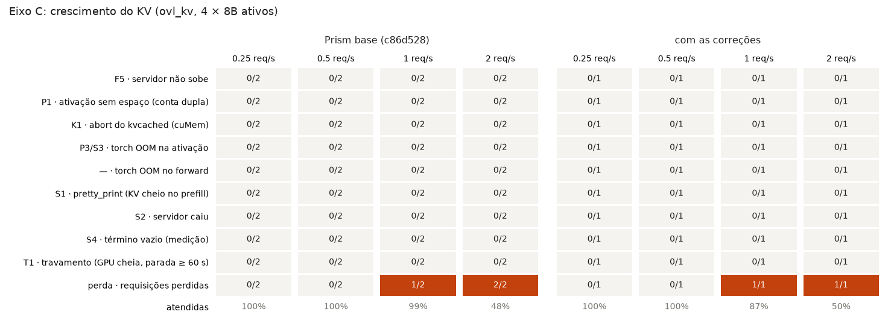
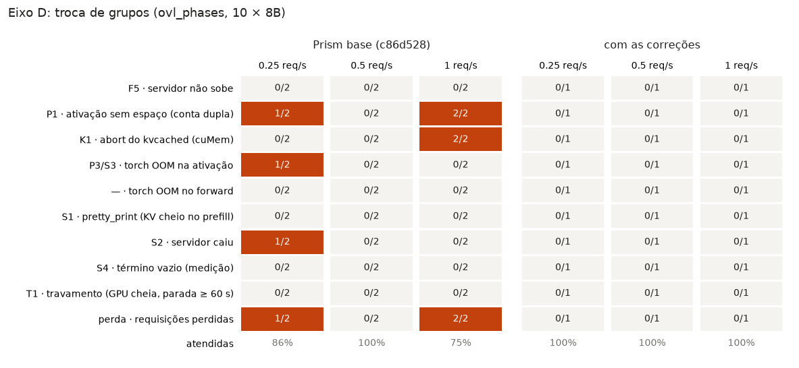
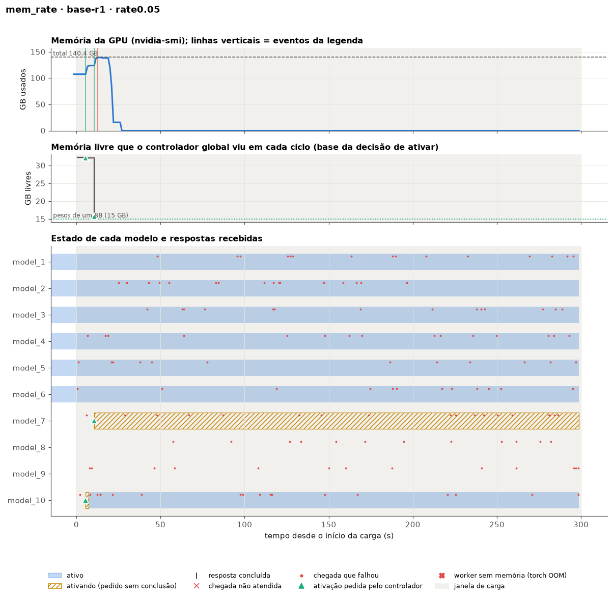
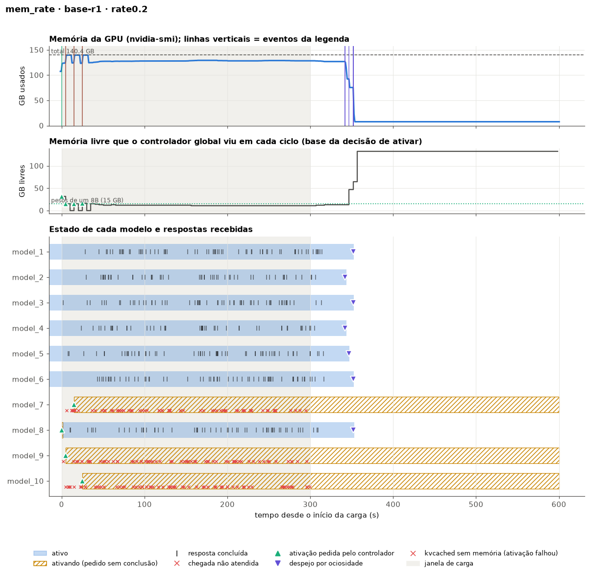
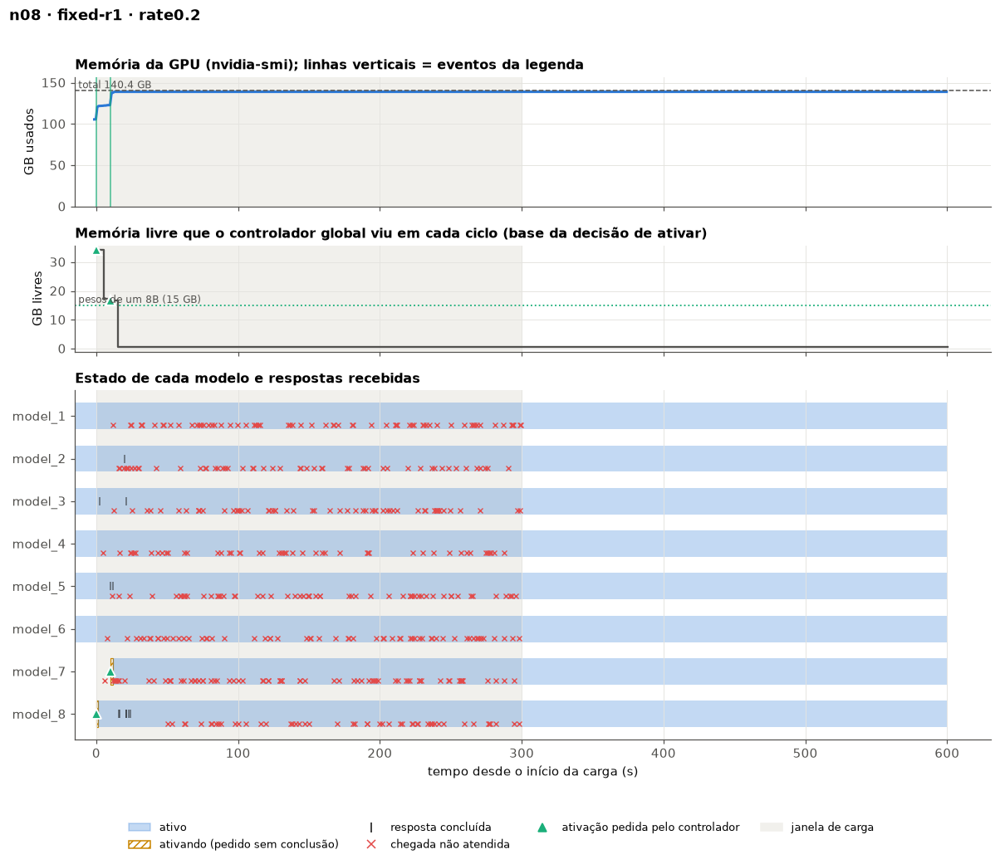

# Limites de carga do Prism base e correções por erro, SGLang (2026-10-28)

Para cada erro de memória da lista em [`erros.md`](../erros.md), este relatório responde três perguntas:
- até que carga o **Prism base**, sem nenhuma das nossas mudanças, funciona;
- a partir de onde o erro aparece;
- o que o resolveu e onde está a mudança no código.

A mesma varredura de carga rodou na base e na versão atual, com todas as correções.

## Resumo

**O Prism base quebra assim que precisa trocar modelos, já na menor carga testada.** No `ovl_mem` (10 modelos para 6 vagas), as **12 de 12** execuções da base perderam requisições, de 0,05 a 0,8 req/s por modelo:
- em 10 delas o servidor caiu;
- nas outras 2, workers morreram em silêncio.

O gatilho não é a taxa. É o controlador decidir uma segunda ativação enquanto a primeira ainda carrega, contando a mesma memória livre duas vezes (P1). Isso acontece no primeiro minuto, sempre que dois modelos inativos recebem requisições perto um do outro.

**Sem troca de modelos, a base aguenta até o limite da GPU.** Com todos os modelos ativos (6 modelos no eixo B, `ovl_kv` no eixo C), não houve nenhuma falha. As perdas no `ovl_kv` a partir de 1 req/s vêm da capacidade: a GPU ficou ocupada até o fim do prazo, em ambas as versões.

**Com as correções, nenhuma falha de memória em 18 níveis.** Foram zero mortes de worker, zero quedas e zero aborts do kvcached. O `ovl_mem` foi atendido 100% em todas as taxas, contra 0–36% na base.

**Sobrou um problema que as correções não resolvem: o travamento (T1).** Com 8 modelos, ou com 14, a GPU enche de pesos, o KV não tem para onde crescer e todos os workers param ao mesmo tempo. Isso ocorreu tanto na base quanto na versão corrigida. É o mesmo travamento que já víamos no `ovl_mix`, agora reproduzido no `ovl_mem`, e é o próximo problema a resolver.

| id | Erro | Onde a base quebra (nesta varredura) | Versão atual, mesmos níveis | O que resolveu | Onde está |
| --- | --- | --- | --- | --- | --- |
| P1 | Controlador conta duas vezes a mesma memória livre | `ovl_mem` em **todas** as taxas (12/12), `ovl_mem` com 10 modelos (2/2), `ovl_phases` a 0,25 e 1 req/s (3/6) | 0 em 18 níveis | R2.1 | [`simple_global.py`](../python/sglang/multi_model/scheduling/policy/simple_global.py#L364-L382), [`controller_global.py`](../python/sglang/multi_model/scheduling/controller_global.py#L312) |
| P3 / S3 | `torch` OOM ao ativar derruba o servidor | `ovl_mem` em todas as taxas (9/12), 10 modelos (1/2), `ovl_phases` 0,25 (1/2) | 0 | desfazer a ativação + R2.1 | [`worker_pool_model_runner.py`](../python/sglang/srt/model_executor/worker_pool_model_runner.py#L312-L390), [`scheduler.py`](../python/sglang/srt/managers/scheduler.py#L1618-L1670) |
| S2 | Uma exceção num worker derruba o servidor inteiro | sempre que houve um `torch` OOM: 10/12 no `ovl_mem`, 12 níveis no total; 10.318 requisições falharam por conexão | 0 | R2.2: só o worker sai | [`scheduler.py`](../python/sglang/srt/managers/scheduler.py#L2196-L2207) |
| K1 | `abort()` do kvcached mata o worker | `ovl_mem` a 0,05–0,5 req/s (6/12), 10 modelos (2/2), `ovl_phases` a 1 req/s (2/2); 26 aborts em 10 níveis | 0 | evitado pela R2.1; detectado pela detecção de mortes | idem P1 e P2 |
| P2 / P4 | Worker morto não detectado; o modelo fica "ativando" para sempre | toda morte por K1 sem queda do servidor: até 1.023 requisições presas num nível | nenhuma morte para detectar | detecção de workers mortos e aviso ao controlador | [`worker_pool.py`](../python/sglang/multi_model/scheduling/gpu/worker_pool.py#L88-L109), [`gpu_scheduler.py`](../python/sglang/multi_model/scheduling/gpu/gpu_scheduler.py#L200-L212), [`gpu_scheduler.py`](../python/sglang/multi_model/scheduling/gpu/gpu_scheduler.py#L318-L325) |
| S1 | Falta de KV no prefill → `pretty_print` → worker cai | não apareceu nesta varredura (dados anteriores abaixo) | 0 | R2.2: `PrefillKVFull`, o prefill espera | [`schedule_batch.py`](../python/sglang/srt/managers/schedule_batch.py#L549-L575), [`scheduler.py`](../python/sglang/srt/managers/scheduler.py#L965-L1085) |
| S4 | Término vazio e TTFT sobrescrito de uma requisição retirada | não apareceu (1 caso em 150 níveis em 28/10) | — | R2.5 (local, não commitada) | [`scheduler.py`](../python/sglang/srt/managers/scheduler.py#L1260-L1275) |
| P5 | Corrida desativar/reativar | não ocorre com a política base | — | R2.3 | [`gpu_scheduler.py`](../python/sglang/multi_model/scheduling/gpu/gpu_scheduler.py#L264-L315) |
| P6 | Requisições preemptadas perdidas na fila local | não ocorre com a política base | — | devolver ao Redis | [`scheduler.py`](../python/sglang/srt/managers/scheduler.py#L1731-L1810) |
| P10 | Model service carrega um modelo por vez | ativação de 1–2,5 s (mediana); a mais lenta, 21 s | igual | contornado pela R2.1 | — |
| F5 | Servidor não sobe com 14 workers | **não reproduziu**: 14 workers subiram nas 3 execuções | não reproduziu | verificação de saúde do nó (infraestrutura) | `polyaxon/run_examples.sh` (`health_gate`) |
| **T1** | **Travamento: GPU cheia, todos os workers parados** | 8 modelos (2/2), 14 modelos (1/2) | 8 modelos (1/1), 14 modelos (1/1) | **não resolvido** | — |

"(a/b)" = em quantas das b execuções do nível o erro apareceu.

## Como os testes foram feitos

| Item | O que foi usado |
| --- | --- |
| Base | commit `c86d528`, o último antes deste estudo. No caminho do SGLang ele é igual ao upstream ([Multi-LLM/prism-research](https://github.com/Multi-LLM/prism-research), `main`); as diferenças são o backend vLLM e um import do triton. Rodou de um `git worktree`, com `PRISM_PYTHON_SRC` no `polyaxon/submit.sh` |
| Versão atual | `HEAD` (`f8c6c9f`) + as mudanças locais (R2.5), com os padrões: R2.1, R2.2, R2.3 e detecção de mortes ligadas, árbitro desligado |
| Política | a original nas duas: despeja depois de 50 s ocioso; flags do exemplo 3 do README; espaço virtual do kvcached de 25 GB; um worker por modelo |
| Onde | Polyaxon `kunumi/hpc4ai`, 1 H200 por job, no máximo 6 jobs ao mesmo tempo, verificação de saúde do nó antes de cada nível (os mesmos scripts de teste nas duas versões) |
| Repetições | 2 da base e 1 da versão atual por nível: 54 níveis |
| Carga | `polyaxon/overload_load.py`, Llama-3.1-8B, prompts de 256–1024 e saídas de 128–512 tokens (`ovl_kv`: 2–4k e 1–2k) |

**Os quatro eixos.**

| Eixo | Cenário | O que varia | O que ele testa |
| --- | --- | --- | --- |
| A | `ovl_mem`: 10 modelos, 6 ativos; todos recebem carga por 300 s | 0,05 · 0,1 · 0,2 · 0,3 · 0,5 · 0,8 req/s por modelo | ativações sob pressão de memória |
| B | `ovl_mem` a 0,2 req/s, 6 ativos | 6, 8, 10, 12, 14 modelos (e workers) | quantos modelos esperam vaga; inicialização com muitos workers |
| C | `ovl_kv`: 4 modelos, todos ativos, prompts e saídas longos, 180 s | 0,25 · 0,5 · 1 · 2 req/s | crescimento do KV sem nenhuma troca |
| D | `ovl_phases`: 10 modelos, 5 ativos, dois grupos que se alternam a cada 150 s, 600 s | 0,25 · 0,5 · 1 req/s | troca de grupos |

**Como cada erro é reconhecido** (`polyaxon/classify_errors.py`, nos logs de cada nível):

| id | Sinal |
| --- | --- |
| P1 | ativação pedida quando a memória livre que o controlador viu, menos as outras ativações ainda em andamento (pesos + 1 GB cada), não cabia esta (15 GB + 1 GB) |
| K1 | `cuMem*(...) failed in CUDA driver ... out of memory` no log do servidor |
| P3/S3 | `torch.OutOfMemoryError` com uma ativação no traceback |
| S1 | `NotImplementedError` vindo de `tree_cache.pretty_print()` |
| S2 | requisições que falharam por erro de conexão (`Cannot connect`, `Server disconnected`) |
| S4 | requisições que falharam com `TypeError ... NoneType` no cálculo do TPOT |
| T1 | ≥ 60 s seguidos com a GPU acima de 100 GB, utilização 0% e requisições esperando resposta |
| F5 | servidor que não subiu em nenhuma das 3 tentativas |

## Onde cada eixo quebra









Cada célula diz em quantas execuções o erro apareceu. Na última linha está a fração de requisições atendidas.

**Atendidas, por nível** (base r1 / base r2 / atual):

| Eixo | Nível | Base r1 | Base r2 | Atual |
| --- | --- | --- | --- | --- |
| A | 0,05 req/s | 0% (caiu) | 72% (3 workers mortos) | 100% |
| A | 0,1 | 0% (caiu) | 0% (caiu) | 100% |
| A | 0,2 | 66% (3 workers mortos) | 1% (caiu) | 100% |
| A | 0,3 | 0% (caiu) | 1% (caiu) | 100% |
| A | 0,5 | 0% (caiu) | 0% (caiu) | 100% |
| A | 0,8 | 54% (caiu aos 589 s) | 0% (caiu) | 100% |
| B | 6 modelos | 100% | 100% | 100% |
| B | 8 modelos | 2% (travou) | 2% (travou) | 2% (travou) |
| B | 10 modelos | 1% (caiu) | 89% (1 worker morto) | 100% |
| B | 12 modelos | 100% | 100% | 100% |
| B | 14 modelos | 45% (fome; parada de 58 s) | 15% (travou) | 19% (travou) |
| C | 0,25 / 0,5 req/s | 100% | 100% | 100% |
| C | 1 req/s | 100% | 98% | 87% |
| C | 2 req/s | 45% | 52% | 50% |
| D | 0,25 req/s | 73% (caiu aos ~470 s) | 100% | 100% |
| D | 0,5 | 100% | 100% | 100% |
| D | 1 | 82% (4 workers mortos) | 67% (7 workers mortos) | 100% |

**O que isso diz sobre os limites da base:**
- **A falha da base não cresce com a carga; ela é disparada pelas ativações.** Mesmo a 0,05 req/s (uma requisição a cada 20 s por modelo), o controlador decide duas ou três ativações nos primeiros segundos, e uma delas não cabe. Por isso a base quebra igual em todas as taxas do eixo A.
- **Quantas ativações caem juntas é questão de sorte.** No eixo B, 10 modelos quebraram 2/2 e 12 modelos 0/2. No eixo D, 0,5 req/s passou 2/2 e 0,25 req/s quebrou 1/2. Depende de quantos modelos inativos recebem a primeira requisição dentro do mesmo ciclo de 5 s do controlador e de quanta memória está livre nesse momento. "Funcionou" num nível da base não quer dizer que ele seja seguro.
- **O único regime seguro da base é sem trocas:** todos os modelos cabem e estão ativos (eixo B com 6 modelos, eixo C).
- **Na versão atual, o limite passa a ser a capacidade e o travamento.** No eixo C, a 1–2 req/s, a GPU ficou ocupada até o fim do prazo, nas duas versões. As 91 não atendidas da versão atual a 1 req/s, contra 0 e 17 na base, estão dentro da variação desse regime de saturação: uma única execução.

## Erro por erro

### P1. O controlador conta duas vezes a mesma memória livre

**Sintoma.** Logo no começo da carga, dois ou três modelos inativos são ativados em sequência, e a soma dos pesos não cabe.

**Causa.** A cada ciclo de 5 s, o controlador lê a memória livre da GPU (`torch.cuda.mem_get_info`) e decide ativar um modelo se os pesos cabem. Uma ativação leva de 1 a 20 s, porque o model service carrega um modelo por vez (P10). No ciclo seguinte, os pesos da ativação anterior ainda não ocuparam a memória, e o controlador promete a mesma memória livre a outro modelo.

**Na base.** Foram 37 ativações nessas condições, em 17 dos 36 níveis da base. Na linha do tempo abaixo (eixo A, 0,05 req/s, base r1):
- o controlador ativa o `model_10` com 32 GB livres;
- 5 s depois, com o `model_10` ainda carregando, ativa o `model_7` vendo 16 GB livres;
- a cópia dos pesos do `model_7` levanta `torch.OutOfMemoryError` (P3), e o `kill_parent_process` derruba o servidor (S2) aos 13 s;
- as 145 requisições falharam.



**O que resolveu: R2.1, contabilidade das ativações pendentes** (commit `f8c6c9f`).
- [`simple_global.py:364-382`](../python/sglang/multi_model/scheduling/policy/simple_global.py#L364-L382) (`_add_pending_activation`, `activation_done`, `_pending_activation_gb`): cada ativação decidida reserva pesos + 1 GB de KV (`PRISM_ACTIVATION_KV_GB`) até o GPU scheduler confirmar. A reserva expira em 120 s.
- [`simple_global.py:1093-1095`](../python/sglang/multi_model/scheduling/policy/simple_global.py#L1093-L1095): a memória livre usada na decisão desconta essas reservas.
- [`gpu_scheduler.py:250-256`](../python/sglang/multi_model/scheduling/gpu/gpu_scheduler.py#L250-L256): ao terminar uma ativação, o GPU scheduler publica `model_activated` numa lista do Redis.
- [`controller_global.py:312-322`](../python/sglang/multi_model/scheduling/controller_global.py#L312-L322) (`handle_model_events`): o controlador consome esses eventos e libera a reserva.
- Pode ser desligada com `PRISM_ACTIVATION_ACCOUNTING=0`.

**Na versão atual.** 0 ativações sem espaço em 90, nos 18 níveis. Ainda há ativações em paralelo (26), mas só quando as duas cabem.

### P3 / S3. A ativação sem memória derruba o servidor (`torch` OOM)

**Sintoma.** `torch.OutOfMemoryError` na cópia dos pesos para a GPU, dentro de `handle_activate_request`.

**Na base.** 13 OOMs em ativações, em 11 níveis. Todos derrubaram o servidor (S2). Há ainda 1 OOM no forward de um modelo ativo (eixo A, 0,3 req/s, r2), que também derrubou o servidor.

**O que resolveu** (commit `7ab57d1`, rodada 1):
- [`worker_pool_model_runner.py:312-390`](../python/sglang/srt/model_executor/worker_pool_model_runner.py#L312-L390) (`activate`, `_rollback_activation`): um OOM durante a ativação devolve os pesos e o KV já alocados e levanta `ActivationOutOfMemory`, em vez de propagar o OOM.
- [`scheduler.py:1618-1670`](../python/sglang/srt/managers/scheduler.py#L1618-L1670) (`handle_activate_request`, função do Prism): responde `success=False` ao GPU scheduler, que avisa o controlador (`model_lost`). O controlador marca o modelo como inativo e tenta de novo depois.
- A R2.1 remove a principal causa: a ativação que não cabia.

**Na versão atual.** 0 OOMs e 0 ativações desfeitas nos 18 níveis. Nos 150 níveis do relatório de 28/10, o desfazer agiu 2 vezes.

### S2. Uma exceção num worker derruba todos

**Sintoma.** Depois de qualquer exceção num worker (P3, S1, OOM no forward), todo o servidor sai, e as requisições seguintes falham com `Cannot connect to host` ou `Server disconnected`.

**Causa.** No SGLang, `run_scheduler_process` chama `kill_parent_process()` em qualquer exceção. Com o worker pool, o "pai" é o servidor do Prism inteiro, com todos os modelos.

**Na base.** Em 12 dos 36 níveis, com 10.318 requisições perdidas por conexão. É o erro que mais causa perdas na base, mas é consequência de outro: sempre veio depois de um P3 ou de um OOM.

**O que resolveu: R2.2** (commit `f8c6c9f`), [`scheduler.py:2196-2207`](../python/sglang/srt/managers/scheduler.py#L2196-L2207). Com o worker pool e a detecção de mortes ligada, só aquele worker sai (`os._exit(1)`). O GPU scheduler percebe a morte (P2), e o controlador reativa o modelo em outro worker.

**Na versão atual.** 0 quedas. Nos 150 níveis de 28/10, também 0 workers saíram, porque não houve exceção.

### K1. O kvcached chama `abort()` quando o driver recusa uma página

**Sintoma.** `cuMemCreate`/`cuMemSetAccess ... out of memory` no log, e o processo do worker termina na hora, sem traceback Python.

**Causa.** O kvcached (`csrc/inc/cuda_utils.hpp`) trata qualquer falha do driver com `abort()`. Isso acontece quando a ativação mapeia páginas de KV ou quando o KV de um modelo ativo cresce, com a GPU já cheia por causa de P1.

**Na base.** 26 aborts em 10 níveis. No eixo A, a 0,2 req/s (r1), 3 ativações em sequência fazem os workers dos modelos 7, 9 e 10 abortarem logo na ativação. A GPU passa de 128 GB para 8 GB no fim da carga, quando os ativos são despejados, e os 3 modelos ficam em "ativando" até o fim, com 203 requisições sem resposta (ver P2).



No eixo D, a 1 req/s, são 4 e 7 aborts, com 546 e 1.023 requisições sem resposta.

**O que resolveu.** O repositório do kvcached **não foi alterado**. Na configuração padrão:
- a R2.1 evita a situação que leva ao abort;
- a detecção de mortes (P2) trata o worker que morre.

Existe uma correção do lado do kvcached, aplicada pelo Prism em tempo de execução ([`kvcached_patches.py`](../python/sglang/multi_model/kvcached_patches.py): a alocação recusada devolve `None` em vez de abortar). Ela fica junto com o árbitro de memória ([`memory_arbiter.py`](../python/sglang/multi_model/memory_arbiter.py)) e só vale com `PRISM_MEMORY_ARBITER=1`, desligado por padrão por custar até 16% do tempo dos workers (ver o [relatório de mudanças](2026-10-22%20Correções%20de%20robustez%20de%20memória%20no%20Prism%20(SGLang).md#custo-da-variante-com-o-árbitro)).

**Na versão atual.** 0 aborts nos 18 níveis. A situação é **mitigada, não eliminada**: com o nó degradado (rodada `fix3`, 27/10), ainda houve aborts com as correções.

### P2 / P4. Worker morto que ninguém percebe

**Sintoma.** Depois de um K1, o GPU scheduler e o controlador continuam achando que o modelo está ativo ou ativando. As requisições do modelo vão para um processo morto e ficam sem resposta até o fim do prazo. O worker morto também pode ser entregue a outro modelo como "livre" (P4).

**Na base.** Aconteceu em todo nível com K1 sem queda do servidor: 41, 203 e 65 requisições presas nos eixos A e B, e 546 e 1.023 no eixo D.

**O que resolveu** (commit `7ab57d1`):
- [`worker_pool.py:88-109`](../python/sglang/multi_model/scheduling/gpu/worker_pool.py#L88-L109) (`check_dead_workers`) e [`memory_arbiter.py:197`](../python/sglang/multi_model/memory_arbiter.py#L197) (`worker_alive`): verificação periódica do PID de cada worker, por `/proc/<pid>/stat`, que também reconhece zumbis. Um worker morto sai do pool de vez.
- [`gpu_scheduler.py:200-212`](../python/sglang/multi_model/scheduling/gpu/gpu_scheduler.py#L200-L212) e `_on_model_lost` ([`gpu_scheduler.py:349`](../python/sglang/multi_model/scheduling/gpu/gpu_scheduler.py#L349)): o modelo daquele worker vira `model_lost`, publicado ao controlador. Ligado por padrão (`PRISM_DETECT_DEAD_WORKERS=1`).
- [`controller_global.py:312-322`](../python/sglang/multi_model/scheduling/controller_global.py#L312-L322): o controlador marca o modelo como inativo e o reativa em outro worker.
- [`gpu_scheduler.py:318-325`](../python/sglang/multi_model/scheduling/gpu/gpu_scheduler.py#L318-L325) (P4): quando não há worker livre para uma ativação, o controlador também é avisado, em vez de achar que ativou.

**Na versão atual.** Nenhum worker morreu nesta varredura, então a detecção não foi exercitada aqui. A prova vem do teste com `kill -9` da rodada 1 ([relatório de mudanças](2026-10-22%20Correções%20de%20robustez%20de%20memória%20no%20Prism%20(SGLang).md#todas-as-execuções)): com a detecção, 171/184 atendidas, contra 140/184 sem; morte detectada em 1 s e modelo reativado em 3 s.

### S1. Falta de KV no prefill (`pretty_print`)

**Sintoma.** Quando o KV acaba no meio de um prefill, o SGLang chama `tree_cache.pretty_print()`, que não existe com o radix cache desligado (`NotImplementedError`). O worker cai e, na base, leva o servidor junto (S2).

**Nesta varredura** não apareceu em nenhum dos 54 níveis, nem na base. O cenário que o provoca é o KV acabar **durante um prefill**, com a GPU em 131–134 GB e vários modelos ativos crescendo ao mesmo tempo. Nos eixos A e D, a base caiu antes por P1/P3. No eixo C, com 4 modelos, a falta de KV foi absorvida pela retirada de requisições no decode. Nas rodadas anteriores, sem a R2.2, ele causou 6 das 42 mortes de worker e 68% das perdas da rodada `fix2` ([inventário](2026-10-22%20Correções%20de%20robustez%20de%20memória%20no%20Prism%20(SGLang).md#inventário-das-mortes-antes-da-rodada-2)).

**O que resolveu: R2.2** (commit `f8c6c9f`):
- [`schedule_batch.py:72`](../python/sglang/srt/managers/schedule_batch.py#L72) e [`schedule_batch.py:549-575`](../python/sglang/srt/managers/schedule_batch.py#L549-L575) (`alloc_token_slots`): num prefill sem KV, levanta a exceção nova `PrefillKVFull` em vez de chamar `pretty_print`.
- [`scheduler.py:965-1085`](../python/sglang/srt/managers/scheduler.py#L965-L1085) (`get_new_batch_prefill`): o batch é alocado antes de as requisições saírem da fila. Com `PrefillKVFull`, elas continuam na fila, e o prefill é tentado de novo depois de 50 ms.

**Na versão atual.** 0 `pretty_print` desde a R2.2. Nos 150 níveis de 28/10, o prefill foi adiado 8 vezes, e nenhum worker caiu.

### S4. Término vazio e TTFT sobrescrito (medição)

Uma requisição retirada no decode por falta de KV volta a fazer prefill:
- se falta só 1 token, ela termina no próprio prefill e sai sem `finish_timestamp`, e o cliente a conta como falha;
- em qualquer caso, o novo prefill sobrescreve o horário do primeiro token.

Não apareceu nesta varredura; houve 1 caso nos 150 níveis de 28/10.

**O que resolveu: R2.5** (2026-10-28, mudança local, ainda não commitada), [`scheduler.py:1260-1275`](../python/sglang/srt/managers/scheduler.py#L1260-L1275) (`process_batch_result_prefill`):
- grava `prefill_finish_timestamp` só no primeiro prefill;
- chama `set_finish_time()` quando a requisição termina no prefill.

### P5 e P6. Não ocorrem na configuração base

- **P5, corrida desativar/reativar.** Precisa que um modelo seja reativado enquanto a desativação anterior ainda termina, o que só acontece com limiar de ociosidade curto ou com trocas. Com o limiar de 50 s da base, não ocorreu.
  - **Onde apareceu:** nos testes de limiar e de troca, antes da R2.3: 137 requisições perdidas num `ovl_phases` e 37 num `ovl_mix`.
  - **Na versão atual:** 100 confirmações atrasadas ignoradas nos 150 níveis de 28/10, e um caso conferido em detalhe.
  - **Correção: R2.3** (commit `f8c6c9f`), [`gpu_scheduler.py:264-315`](../python/sglang/multi_model/scheduling/gpu/gpu_scheduler.py#L264-L315) (`_pending_deacts`, `_stale_deacts`). O GPU scheduler conta as desativações em andamento de cada modelo e ignora a confirmação que uma reativação já superou.
- **P6, preempção.** A política base nunca retira requisições em execução.
  - **Correção:** junto com a troca por throughput (commit `d1ef02b`), [`scheduler.py:1731-1810`](../python/sglang/srt/managers/scheduler.py#L1731-L1810) (`handle_deactivate_request`). As requisições retiradas na desativação voltam ao Redis (`_evict_all_waiting_requests`) e recomeçam do prompt.
  - **Em aberto:** as 25 requisições perdidas numa execução com P1D0 no trace12 ([relatório de 28/10](2026-10-28%20Janela%20de%20ociosidade%20e%20estratégias%20de%20troca%20no%20Prism,%20com%20as%20correções%20(SGLang).md#4-falhas-que-sobraram-e-as-correções-em-ação)) podem vir desse caminho.

### P10. O model service carrega um modelo por vez

Não é uma falha, mas alarga a janela do P1. A ativação de um 8B levou 1,5 s (mediana) na base e 1,7 s na versão atual. A mais lenta levou 21 s na base e 27 s na versão atual, quando várias ativações caem juntas na fila do model service. Não mudamos o model service; a R2.1 mantém a memória prometida reservada durante toda a ativação.

### F5. O servidor não sobe com 14 workers

**Não reproduziu.** Com 14 modelos, os 14 workers subiram nas 3 execuções, na primeira tentativa.
- Em 22/10, o mesmo número de workers não subia (`ovl_mix` de 14 modelos, duas tentativas).
- Na rodada `fix3` (27/10), o kvcached falhou 222 vezes na inicialização, com a GPU vazia, durante um período de nó degradado.

Isso reforça que a falha depende do estado do nó, e não do número de workers. A **verificação de saúde do nó** antes de cada nível ([`run_examples.sh`](../polyaxon/run_examples.sh), `health_gate`; [`kvcached_probe.py`](../polyaxon/kvcached_probe.py) `--parallel`) impede que um nível rode num nó que não consegue iniciar o kvcached. Ela é infraestrutura de teste, não uma correção do Prism.

### T1. Travamento: GPU cheia e todos os workers parados (não resolvido)

**Sintoma.**
- Com 8 modelos (eixo B), nas 3 execuções, base e versão atual: a GPU fica em 139–142 GB com utilização 0% dos ~25 s até o fim, e só 11 de 466 requisições são atendidas.
- Com 14 modelos: o mesmo na versão atual (parada de 324 s) e em 1 das 2 execuções da base.



**O que os logs mostram** (versão atual, 8 modelos):
1. Os 6 ativos começam a servir.
2. O controlador ativa o `model_8` (34 GB livres) e, depois que ele termina, o `model_7` (17 GB livres). As duas decisões estão corretas pela conta da R2.1: os pesos cabiam.
3. Com 8 × 15 GB = 120 GB de pesos, sobram **0,67 GB** para o KV de todos os modelos.
4. A partir dos ~25 s, os workers **param de registrar qualquer coisa** (o último log de batch é aos 06:22:37). O GPU scheduler para de admitir: cada modelo fica com 11 requisições na fila do worker.
5. Nenhum modelo fica ocioso por 50 s, então ninguém é despejado, e nada volta a andar.

**Causa provável.** Todos os workers ficam bloqueados ao mesmo tempo esperando páginas de KV que nenhum deles vai liberar. Nenhum worker morreu e nenhum abort foi registrado. É o mesmo travamento da política original no `ovl_mix`, que antes atribuíamos ao cenário de tamanhos misturados. Falta confirmar onde os workers estão parados, com um `py-spy dump` num travamento reproduzido.

**Por que as correções não resolvem.** A R2.1 reserva KV só **durante** a ativação (1 GB). Depois que a ativação termina, nada garante que os modelos ativos tenham espaço para o KV crescer.

**Candidatos a correção**, nenhum implementado:
- exigir folga de KV para ativar: `PRISM_ACTIVATION_HEADROOM_GB` já existe, com 3 GB nas estratégias de 22/10, mas a política original não a usa;
- despejar um modelo quando todos os ativos estão sem KV e nenhum progride;
- a troca por throughput, que no `ovl_mix` atendeu ~100%.

**Por que 8 e 14 travam, e 10 e 12 não.**
- **Com 8 modelos**, a explicação é direta: só há 2 inativos, os dois cabem um depois do outro, e a GPU fica com 0,67 GB livres.
- **Com 10 e 12**, o controlador para de ativar com 7–8 GB livres ("No suitable GPU found"), e esse espaço basta para o KV dos ativos.
- **Com 14**, a memória livre que o controlador viu também ficou em ~7 GB, igual à de 12, e mesmo assim travou em 2 das 3 execuções. **Ainda não sabemos por quê.** Uma hipótese é que os 2 workers a mais diminuam a memória que o KV consegue usar de fato, sem aparecer na leitura do controlador. Isso precisa ser verificado junto com o `py-spy`.

## Erros que ainda estão em aberto

| Erro | Situação | Próximo passo |
| --- | --- | --- |
| T1 travamento | reproduzido em base e atual | `py-spy` num travamento e testar folga de KV na ativação |
| 25 requisições perdidas com P1D0 (trace12) | 1 de 3 execuções, sem causa identificada | registrar o id das requisições devolvidas ao Redis |
| K1 com o nó degradado | mitigado, não eliminado | só o árbitro + `kvcached_patches.py` elimina, com custo |

## Limitações

- **Poucas repetições:** 2 da base e 1 da versão atual por nível. Na base, os erros dependem do momento das ativações, e um nível "sem erro" na base pode quebrar numa terceira execução (exemplos: 12 modelos, `ovl_phases` a 0,5).
- **S1, S4, P5 e P6 não apareceram nesta varredura.** A evidência para eles vem das rodadas anteriores.
- **Só a política original foi varrida.** As estratégias e os limiares curtos estão no [relatório de 28/10](2026-10-28%20Janela%20de%20ociosidade%20e%20estratégias%20de%20troca%20no%20Prism,%20com%20as%20correções%20(SGLang).md).
- **O sinal de P1 é uma estimativa:** usa 15 GB + 1 GB por ativação e a memória livre que o controlador registrou no ciclo.

## Como reproduzir

| O quê | Arquivo |
| --- | --- |
| Suítes (uma por eixo; as mesmas para base e atual) | `polyaxon/configs/limits_{A,B,C,D}_suite.tsv` |
| Escolher o código enviado ao job | `polyaxon/submit.sh` (`PRISM_PYTHON_SRC`) |
| Contar os erros por nível e extrair os níveis | `polyaxon/classify_errors.py` |
| Grades erro × carga | `polyaxon/plot_limits.py` |
| Linhas do tempo | `polyaxon/plot_suite.py` |
| Dados e figuras | `reports/data/2026-10-28-limites/` (`erros.csv` + níveis extraídos), `reports/figs/2026-10-28-limites/` |

```bash
# código base num worktree (não muda o branch atual)
git worktree add --detach ../prism-base c86d528
# um job por eixo e versão; trocar A por B, C, D; sem PRISM_PYTHON_SRC = versão atual
PRISM_PYTHON_SRC=../prism-base/python PRISM_JOB_SUFFIX=-limits-base-r1-A \
  PRISM_JOB_ENV="PRISM_SUITE=polyaxon/configs/limits_A_suite.tsv PRISM_TIMEOUT=10800" polyaxon/submit.sh
# baixar um job de cada vez
polyaxon ops artifacts -p kunumi/hpc4ai -uid <uuid> -d outputs --path limits/<job>
# classificar, extrair e desenhar (precisa de pandas e matplotlib)
python3 polyaxon/classify_errors.py reports/data/2026-10-28-limites/erros.csv --extract reports/data/2026-10-28-limites \
  base:1=limits/base-r1-A/outputs ... fixed:1=limits/fixed-r1-A/outputs ... base:2=limits/base-r2-A/outputs ...
python3 polyaxon/plot_limits.py reports/data/2026-10-28-limites/erros.csv reports/figs/2026-10-28-limites
python3 polyaxon/plot_suite.py reports/data/2026-10-28-limites reports/figs/2026-10-28-limites
```

**Jobs** (Polyaxon `kunumi/hpc4ai`, 2026-10-28):

| | A | B | C | D |
| --- | --- | --- | --- | --- |
| base r1 | `f5c511a7` | `e7298d4f` | `08fafa52` | `e2c81cf9` |
| base r2 | `213681a6` | `e2540048` | `2920abc2` | `6cd42716` |
| atual r1 | `65ba315d` | `0cd4900e` | `2a8dfb24` | `5edc3a7d` |

Teste rápido da base: `c8a536fa` (`ovl_mem` a 0,5 req/s, 120 s, 599/599).
