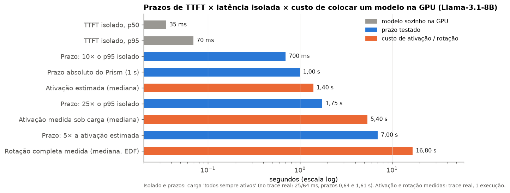
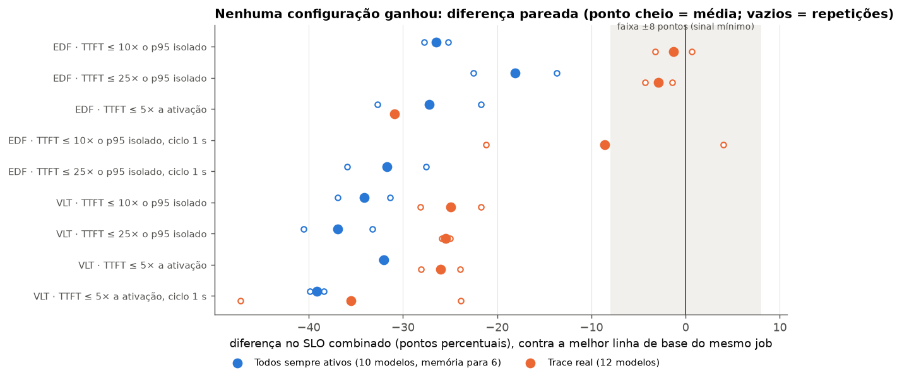
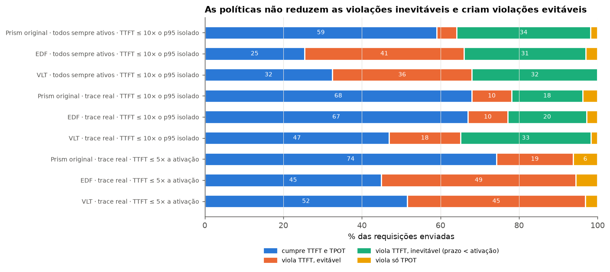
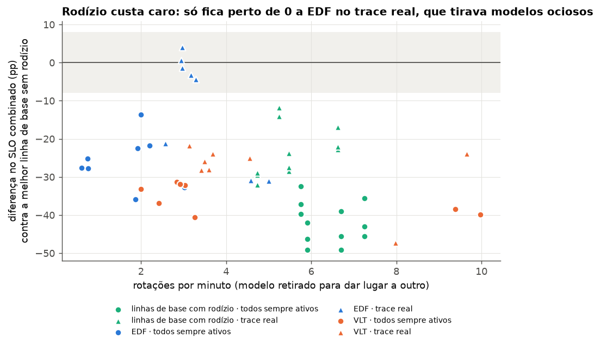
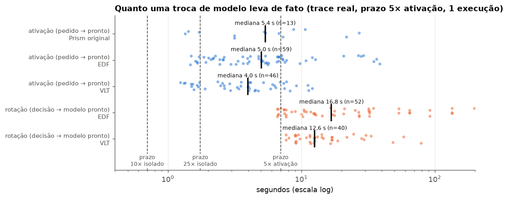
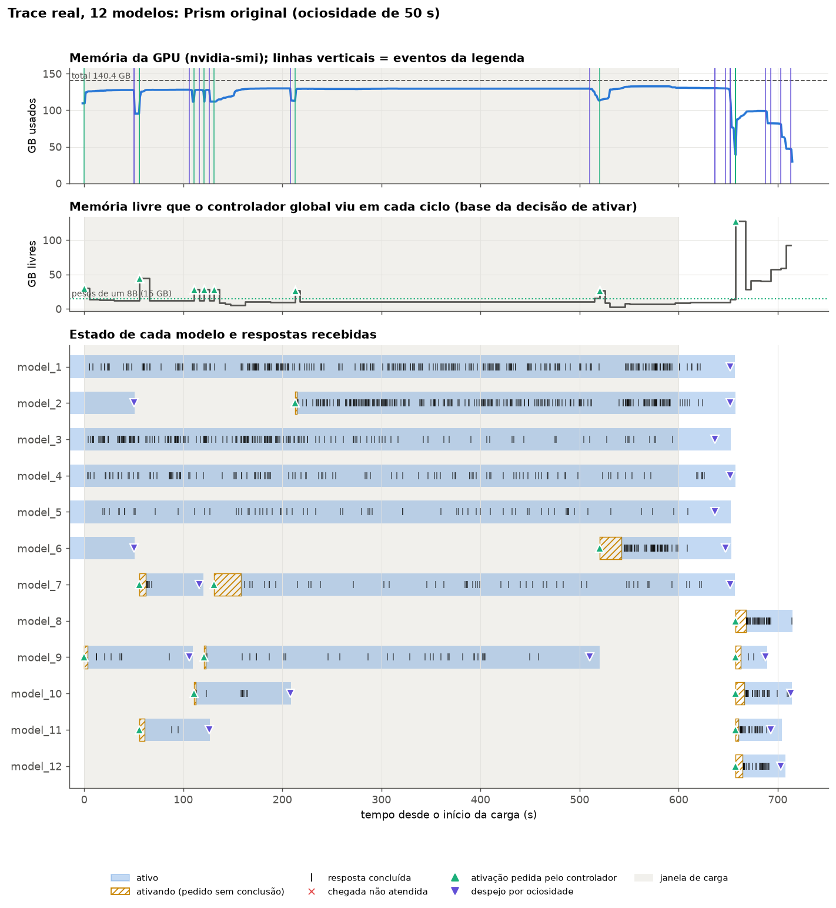
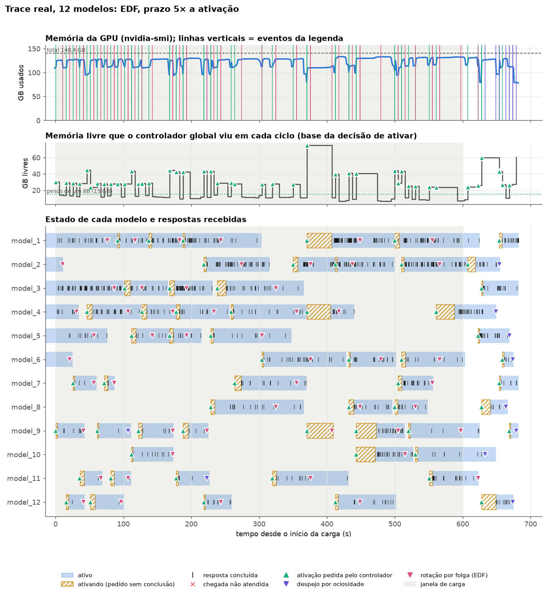

# Políticas por prazo no Prism (2026-11-05)

## 1. O problema

- No Prism, vários modelos dividem uma GPU. Quando a soma dos pesos não cabe, o controlador global decide **quem fica residente**, quem sai e quem entra.
- Colocar um modelo na GPU não é de graça. Ativar um Llama-3.1-8B leva **1,4 s na mediana** pelo estimador e **4–5 s** medidos sob carga. Uma troca completa (tirar um modelo e pôr outro) leva **13–17 s** (slide 13).
- As políticas que já existem decidem por **ociosidade** ou **throughput**. Nenhuma olha o **prazo** das requisições, embora o Prism meça o resultado justamente pelo SLO (TTFT e TPOT).
- **Pergunta desta rodada:** escolher quem entra na GPU pelo prazo das requisições melhora o SLO? Testamos duas ideias opostas:
  - **folga primeiro (EDF):** atender quem ainda dá tempo de salvar;
  - **atraso primeiro (VLT):** atender quem está mais atrasado.

---

## 2. Uma observação que condiciona tudo: violação evitável × inevitável

Uma requisição chega para um modelo **que não está na GPU**:

```
chegada        prazo de TTFT            modelo pronto
   |---------------|                          |
   |<------- custo de ativação (≥ 1,4 s) ---->|
```

- Se o prazo é menor que o custo de ativação, a requisição **já nasce violada**: nenhuma política consegue salvá-la reagindo à chegada.
- Por isso separamos, em todos os resultados:
  - **violação inevitável:** a requisição chegou a um modelo inativo com prazo menor que o custo mínimo de ativação;
  - **violação evitável:** todas as outras. É sobre elas que uma política pode agir.
- Consequência para os testes: o prazo precisa variar **em relação ao custo de ativação**. Com prazos curtos, uma política por prazo quase não tem o que fazer com modelos inativos. Com prazos longos, ela tem.

---

## 3. Os SLOs que usamos e como se comparam ao modelo sozinho na GPU

**Base: o desempenho isolado.** Cada modelo roda a **sua própria carga**, com as mesmas chegadas e tamanhos, sozinho numa GPU dedicada e sempre residente. É a estratégia do artigo do Prism (§7.1: P95 em GPU dedicada, escalado por um fator). O P95 é calculado sobre as requisições de **todos os modelos idênticos da carga juntas**, porque o P95 de cada modelo isolado oscilava muito com o ruído do nó (TPOT de 11 a 49 ms entre modelos iguais).

| Carga (Llama-3.1-8B) | TTFT isolado p50 / p95 | TPOT isolado p50 / p95 |
| --- | --- | --- |
| Todos sempre ativos | 35 / 70 ms | 10 / 26 ms |
| Trace real | 25 / 64 ms | 10 / 24 ms |

**Os três prazos testados** (o TPOT é sempre 5× o p95 isolado: 120–128 ms):

| Nome nesta apresentação | Regra | Prazo de TTFT | Relação com o isolado | Relação com a ativação (1,4 s) | Pergunta que responde |
| --- | --- | --- | --- | --- | --- |
| **10× isolado** | 10 × p95 isolado | 0,70 s / 0,64 s | 10× o p95, ~20× o p50 | **abaixo**: modelo inativo = violação inevitável | política por prazo com prazo estrito (o caso realista) |
| **25× isolado** | 25 × p95 isolado | 1,75 s / 1,61 s | 25× o p95 | **~0,3 s acima**: na prática ainda inviável (o ciclo do controlador é de 5 s) | um pouco mais de folga muda algo? |
| **5× ativação** | 5 × custo de ativação estimado | 7,0 s | ~100× o p95 | **5× acima**: ativar sob demanda cabe no prazo | quando a folga existe de fato, a política a usa bem? |

Para comparar: o SLO absoluto dos testes do Prism (TTFT < 1 s, TPOT < 100 ms) fica entre os dois primeiros.




---

## 4. Linhas de base

Todas rodam no mesmo job que as políticas novas, intercaladas. Nenhuma usa o prazo para decidir.

| Linha de base | Como decide quem sai | Por que está na comparação |
| --- | --- | --- |
| **Prism original** (ociosidade 50 s) | tira um modelo depois de 50 s sem requisições; só ativa quando há memória livre | a referência publicada |
| **Ociosidade curta** (10 s) | igual, com 10 s | a melhor configuração nos testes de troca de grupos de outubro |
| **Troca por throughput/GB** | se um modelo com fila não cabe, tira os ativos de menor throughput por GB, drenando a fila deles por até 15 s | a melhor estratégia de troca que tínhamos; usa a mesma mecânica de rotação das políticas novas |
| **Rodízio anti-fome** | se um modelo espera ≥ 30 s e ninguém está ocioso, tira o ativo há mais tempo, mesmo ocupado | um "VLT rudimentar", com quantum fixo no lugar do atraso relativo ao prazo |

**A comparação é sempre contra a melhor entre o Prism original e a ociosidade curta, no mesmo job.** Essas duas foram as melhores linhas de base nas duas cargas (66–69 % de SLO combinado em "todos sempre ativos" e 75–81 % no trace real). A troca por throughput/GB e o rodízio anti-fome ficaram em 19–31 % e 44–64 %.


---

## 5. EDF (earliest deadline first) entre modelos

**Ideia:** dar a GPU ao modelo cuja requisição mais urgente **ainda pode ser salva**, e não gastar trocas com filas já perdidas.

Para cada requisição `r` na fila de um modelo `m`:

```
folga(r) = prazo(r) − agora − término_estimado(r)

término_estimado(r) = custo de ativação de m      (se m está inativo; inclui ativações já na fila do carregador)
                    + prefill das requisições à frente de r
                    + prefill de r
```

- Uma requisição é **viável** se `folga ≥ 0` e **perdida** caso contrário.
- **Urgência do modelo** = a menor folga entre as suas requisições **viáveis**. Requisições perdidas não contam, para não premiar filas já perdidas.
- **Quem entra, em ordem:**
  1. modelos com requisição viável, da menor folga para a maior;
  2. depois, modelos só com requisições perdidas, pela requisição mais antiga (para ninguém passar fome).
- **Quem sai, se não houver memória:**
  - um modelo com requisição viável pode tirar um ativo **menos urgente**. Um ativo sem requisição viável conta como urgência infinita, ou seja, é o primeiro candidato;
  - um modelo só com requisições perdidas só pode tirar um ativo **sem nenhuma requisição** (nem na fila, nem rodando);
  - ordem das vítimas: primeiro as sem requisição viável (entre elas, primeiro as sem trabalho em execução, depois a ativa há mais tempo), depois as de prazo mais tardio.
- Os estimadores vêm de medições: custo de ativação = `a + b·(GB de pesos) + c·(ativações na frente)`, ajustado em 6.547 ativações (erro mediano de 12 %); o prefill é uma reta no tamanho do prompt, medida com o modelo sozinho na GPU.

> **Nota do apresentador.** O EDF clássico decide só a ordem de entrada. Aqui ele também escolhe vítimas, porque na carga "todos sempre ativos" ninguém fica ocioso, e sem despejo o EDF seria idêntico ao Prism original. A regra de vítima olha **só a urgência de quem sai**, e não quanto trabalho ele perde ao sair. Esse detalhe explica o resultado do slide 11.

---

## 6. EDF entre modelos: um exemplo

Instante `t = 100 s`, custo de ativação estimado de 1,4 s, prefill de ~0,05 s.

| Modelo | Estado | Requisição mais urgente | Folga | Classificação |
| --- | --- | --- | --- | --- |
| X | inativo | chegou em 99,5 s, prazo 7,0 s ("5× ativação") → vence em 106,5 s | 106,5 − 100 − 1,45 = **+5,05 s** | viável: candidato a entrar |
| Z | inativo | chegou em 99,9 s, prazo 0,70 s ("10× isolado") → vence em 100,6 s | 0,6 − 1,45 = **−0,85 s** | perdida: só entra se houver um ativo vazio |
| A | ativo | 3 requisições na fila, a mais urgente com folga de 6 s | 6 s | vítima possível de X (6 > 5,05) |
| B | ativo | fila vazia, nada rodando | +∞ | primeira vítima |

- Se B existe, X entra no lugar de B. É uma troca boa: B não perde nada.
- Se não existe nenhum B (a carga "todos sempre ativos" é assim), **X tira A**, embora A tenha 3 requisições na fila, que serão drenadas por até 15 s e depois devolvidas à fila global.

---

## 7. VLT ("atraso primeiro"): o Virtual Lag Time do SuperInfer

**Origem:** Yu et al., *SuperInfer: SLO-Aware Rotary Scheduling and Memory Management for LLM Inference on Superchips*, MLSys 2026, §4.2. No artigo, cada **requisição** está em espera, em execução ou "rotativa" (pausada, com o KV na CPU). O atraso virtual (VLT) mede quanto ela já passou do que o SLO permite:

```
VLT(r) =  α · ReLU(t − t_último_token − β_B · S_TPOT)    rotativa (foi interrompida)
          ReLU(t − chegada(r) − β_F · S_TTFT)            em espera
          −(t − início_da_execução(r))                    em execução
```

- **Em espera:** o atraso começa a contar quando a espera passa de `β_F` vezes o prazo de TTFT. Com `β_F = 0,5`, a requisição fica "atrasada" na metade do prazo.
- **Rotativa:** quem foi interrompido pesa `α` vezes mais. O sistema já gastou trabalho com ela, e ela está parada.
- **Em execução:** o valor é negativo e cresce em módulo com o tempo. Quem está rodando há mais tempo é o primeiro a ceder.
- **A cada iteração, o algoritmo:**
  1. se tudo cabe na memória, não troca nada;
  2. ordena por VLT decrescente;
  3. a partir do topo, admite os de VLT ≥ 0 até gastar a memória livre mais um orçamento de transferência;
  4. a partir do fim (VLT mais negativo), tira quem for preciso para abrir espaço.
- **Parâmetros do artigo:** `α = 3`, `β_F = 0,5`, `β_B = 0`.
- **Resultado do artigo:** até +74,7 pontos de TTFT dentro do SLO, mas com rotação de KV a ~200 GB/s pelo NVLink-C2C do GH200, em milissegundos.

---

## 8. VLT no Prism: do nível de requisição para o nível de modelo

| SuperInfer (requisição) | Prism, controlador global (modelo `m`) |
| --- | --- |
| requisição em espera | modelo inativo com fila: `VLT_m = max sobre a fila de ReLU(t − chegada − β_F · S_TTFT)` |
| requisição rotativa (KV na CPU) | modelo retirado com requisições interrompidas e devolvidas à fila global: `VLT_m = α · ReLU(t − t_interrupção − β_B · S_TPOT)` |
| requisição em execução | modelo ativo: `VLT_m = −(t − t_ativação)` |
| memória livre da HBM | memória livre da GPU menos as ativações em andamento |
| orçamento de transferência | 1 rotação em andamento por vez (o carregador ativa um modelo de cada vez) |
| "tudo cabe → FCFS" | se todos os modelos com fila cabem, ativa sem tirar ninguém |

**Exemplo** (`t = 100 s`, prazo de TTFT de 0,70 s, logo `β_F · S_TTFT = 0,35 s`):

| Modelo | Estado | VLT |
| --- | --- | --- |
| X | inativo; requisição mais antiga chegou em 92 s | 100 − 92 − 0,35 = **+7,65** |
| Y | retirado em 95 s com requisições interrompidas | 3 × (100 − 95) = **+15** → entra antes de X |
| A | ativo desde 40 s | **−60** → primeira vítima, **mesmo com fila cheia** |
| B | ativo desde 85 s | −15 |

- **Ressalva 1:** com prazo de 0,7 s, todo modelo inativo com fila passa a VLT > 0 quase na chegada. Entre modelos, o VLT vira "o mais antigo primeiro".
- **Ressalva 2:** a vítima é escolhida só pelo tempo de residência. O VLT não olha se o modelo está servindo.


---
 

---

## 10. As cargas e o desenho do teste

**Por que estas duas cargas:** uma política de residência só faz diferença onde **quem fica na GPU decide o resultado**. Nas duas cargas, os modelos não cabem todos, e a disputa é contínua.

| Carga | Composição | Disputa que cria | O que permite testar |
| --- | --- | --- | --- |
| **Todos sempre ativos** | 10 × Llama-3.1-8B, memória para 6; cada modelo recebe 0,2 req/s, sempre (Poisson); 300 s, 599 requisições | **fome sem ociosidade:** ninguém fica ocioso, então nenhuma vítima é "barata" | a regra de vítima, sem a saída fácil de tirar um ocioso |
| **Trace real** | 12 × Llama-3.1-8B, memória para 6; o trace do benchmark do Prism, um adaptador por modelo (os 12 mais pedidos); 600 s, 1.275 requisições | **popularidade desigual e rajadas:** o modelo mais pedido recebe 296 requisições e o menos pedido, 36 | uma situação realista, em que alguns modelos ficam ociosos e as escolhas importam |

**O desenho:**
- **Configurações:** 4 linhas de base + EDF e VLT × 3 prazos + ciclo de 1 s no melhor prazo de cada política.
- **Repetições:** 2 por configuração, as políticas intercaladas com as linhas de base no mesmo job.

**Hipóteses, uma por fator:**

| | Hipótese | Fator que a testa |
| --- | --- | --- |
| H1 | Com prazos curtos, a EDF quase não tem folga para usar e vira um despejo de ociosos | 10× e 25× isolado |
| H2 | Com prazo folgado, a EDF salva requisições de modelos inativos e ganha | 5× ativação |
| H3 | O VLT reduz a fome do pior modelo, à custa do total | VLT × linhas de base |
| H4 | O ciclo de 1 s ajuda, porque 5 s é mais que a folga | ciclo 1 s × 5 s |

**Métricas:** SLO combinado (TTFT e TPOT), só TTFT, só TPOT, o pior modelo, rotações por minuto e a decomposição em violação evitável e inevitável. **Toda diferença é pareada no mesmo job:** entre jobs, o Prism original variou de 48 % a 75 % de SLO com o mesmo código, por deriva do nó.

---

## 11. Resultado: nenhuma configuração ganhou



Diferença pareada em pontos percentuais (média de 2 repetições; entre parênteses, cada repetição quando relevante):

| Carga | Política · prazo | Combinado | Só TTFT | Só TPOT | Pior modelo | Rotações/min |
| --- | --- | --- | --- | --- | --- | --- |
| Todos sempre ativos | EDF · 10× isolado | −26,5 | −28,9 | −7,3 | +7,8 | 0,75 |
| | EDF · 25× isolado | −18,1 | −23,7 | +2,0 | +9,1 | 1,96 |
| | EDF · 5× ativação | −27,2 | −33,5 | +1,8 | +13,0 | 2,61 |
| | VLT · 10× isolado | −34,1 | −34,1 | −5,6 | +12,9 | 2,63 |
| | VLT · 25× isolado | −36,9 | −36,6 | −5,2 | +18,7 | 2,63 |
| | VLT · 5× ativação | −32,1 | −31,3 | −4,9 | +9,3 | 2,97 |
| | EDF · 25× isolado, ciclo 1 s | −31,7 | −26,1 | −11,4 | 0,0 | 1,24 |
| | VLT · 5× ativação, ciclo 1 s | −39,1 | −39,1 | −0,3 | +15,8 | 9,68 |
| Trace real | EDF · 10× isolado | **−1,3** (−3,2; +0,6) | −1,4 | −0,3 | +8,6 | 3,05 |
| | EDF · 25× isolado | **−2,9** (−4,3; −1,4) | −4,8 | 0,0 | +20,5 | 3,13 |
| | EDF · 5× ativação | −30,9 | −32,5 | −4,1 | +13,6 | 4,79 |
| | VLT · 10× isolado | −24,9 | −26,2 | −1,1 | +22,5 | 3,28 |
| | VLT · 25× isolado | −25,5 | −28,4 | +0,3 | +29,2 | 4,02 |
| | VLT · 5× ativação | −26,0 | −28,2 | −1,6 | +16,2 | 3,64 |
| | EDF · 10× isolado, ciclo 1 s | −8,6 (−21,2; +4,0) | −5,5 | −4,4 | +15,0 | 2,77 |
| | VLT · 5× ativação, ciclo 1 s | −35,5 | −43,7 | +1,7 | +11,9 | 8,81 |

- O melhor caso, a EDF com prazos curtos no trace real, **empata** com a melhor linha de base. Todo o resto perde de 18 a 39 pontos.
- As perdas estão quase todas no **TTFT**. O TPOT varia de −11 a +3 pontos.
- Comparadas às linhas de base que também rodam modelos (troca por throughput/GB e rodízio anti-fome), EDF e VLT ficam **acima** da troca por throughput/GB e no nível do rodízio.


---

## 12. Por que perderam (1): as políticas não tocam as violações inevitáveis e criam evitáveis



- **Prazos curtos ("10× isolado"), carga "todos sempre ativos":** dos 41 pontos de violação do Prism original, 34 são **inevitáveis** (a requisição chegou a um modelo inativo com prazo menor que a ativação). EDF e VLT não reduzem essa parte (31–32) e **acrescentam** 36–41 pontos de violação evitável. O prejuízo vem das rotações.
- **EDF com prazos curtos: H1 confirmada.** No trace real, das 33–36 rotações por repetição, só 0–4 foram para uma requisição viável. Na média, havia 0,0–0,04 modelos inativos com requisição viável por ciclo. A EDF vira um **despejo de ociosos** com residência mínima, e por isso empata no trace real, onde há ociosos para tirar. Na carga "todos sempre ativos" não há ociosos, e as poucas trocas custam caro.
- **EDF com prazo folgado ("5× ativação"): H2 refutada.** Agora a folga existe: 2,3–2,4 modelos inativos com requisição viável por ciclo, e 34–38 das 36–41 rotações foram para eles. Mas **39 vítimas por repetição estavam ocupadas**. A EDF decide pela folga de quem entra e não pesa o que a vítima perde. As violações evitáveis sobem de 19 para 49 pontos no trace real.


---

## 13. Por que perderam (2): o VLT tira modelos ocupados, e o ciclo de 1 s piora tudo



- **VLT: H3 confirmada.** As vítimas são escolhidas pelo tempo de residência: 70–75 % estavam ocupadas no trace real (2–5 requisições na fila) e quase todas na carga "todos sempre ativos" (5–8 requisições). O pior modelo melhora (+9 a +29 pontos), e o total perde de 25 a 37.
- **Ciclo de 1 s: H4 refutada.** Um ciclo mais curto só dá mais oportunidades de trocar. O VLT passa de ~3 para ~9–10 rotações por minuto, quase todas de modelos ocupados (78 de 88 no trace real, 53 de 54 na outra carga). A EDF no trace real varia de −21 a +4 entre as repetições.
- **Padrão geral:** quanto mais um algoritmo roda modelos ocupados, mais perde, e isso vale também para as linhas de base com rodízio. O único grupo perto de zero é a EDF no trace real com prazos curtos, que quase só tirava modelos ociosos.


---

## 14. Por que perderam (3): uma troca custa muito mais do que a política supõe



Medição preliminar (1 execução por política no trace real, prazo "5× ativação"; tempos dos eventos do controlador e do GPU scheduler):

| | Mediana | p90 |
| --- | --- | --- |
| Ativação, do pedido ao modelo pronto, Prism original (13 ativações) | 5,4 s | 19,5 s |
| Ativação, EDF (59) | 5,0 s | 22,0 s |
| Ativação, VLT (46) | 4,0 s | 8,0 s |
| **Rotação, da decisão ao modelo que entra pronto, EDF (52)** | **16,8 s** | 89 s |
| **Rotação, VLT (40)** | **12,6 s** | 31 s |

- A EDF calcula a folga com o custo de ativação estimado (~1,4 s). Uma rotação real leva **~10× mais**, porque soma:
  - a espera pelo próximo ciclo (até 5 s);
  - a drenagem da vítima: limitada a 15 s, mas chegou ao teto em quase todas as rotações (mediana de 15,0 s), porque a vítima continuava aceitando novos prefills da sua fila. Depois disso, ainda terminava o lote em execução: da decisão até a vítima sair passaram 22,7 s na mediana (EDF) e 16,5 s (VLT);
  - a ativação em dois ciclos;
  - a fila do carregador (um modelo por vez);
  - a própria ativação, que sob carga leva ~4–5 s, e não 1,4 s.
- Por isso, mesmo com prazo de 7 s, requisições que a EDF julgava viáveis viraram violações evitáveis.


---

## 15. A troca em ação: Prism original × EDF (trace real, prazo "5× ativação")





- **Painéis, de cima para baixo:** memória da GPU; memória livre vista pelo controlador; estado de cada modelo (azul = ativo, hachurado = ativando, traços = respostas concluídas, ▲ = ativação pedida, ▼ rosa = rotação por folga).
- **Prism original:** poucas ativações, modelos ficam residentes por longos períodos.
- **EDF:** rotações frequentes, muitas tirando modelos que ainda estavam respondendo (▼ no meio de traços), e ativações longas (hachurados de 30–40 s em torno de 370–470 s).


---

## 16. Observação: o pior modelo melhora

- Em quase todas as configurações, o **pior modelo** (o modelo com menor fração de SLO) melhora: +8 a +29 pontos.
- No melhor caso (EDF com prazos curtos no trace real), isso acontece **sem perda no total** (−1,3 e −2,9 pontos, dentro do ruído), nas duas repetições.
- Faz sentido: as duas políticas evitam que um modelo fique esquecido fora da GPU, e o VLT faz isso por construção.


---

## 18. Próximos passos

Ordenados pelo que a evidência pede primeiro.

### 1. Medir e reduzir o custo real de uma troca (lição 3)
- **O que é:** decompor cada rotação (espera pelo ciclo, saída da vítima, fila do carregador, ativação) em todas as execuções, comparar com o término estimado que a política usa e atacar as partes maiores:
  - **já decidido: a drenagem de 15 s foi removida.** A vítima agora só tem duas opções: **não preemptar** (devolve na hora as requisições que ainda não começaram e termina só o que já está em execução, sem limite de tempo) ou **preemptar** (o que está em execução também é interrompido e recomeça depois). Falta medir quanto isso encurta a saída da vítima;
  - ativar no mesmo ciclo em que a memória é liberada;
  - controlador orientado a evento em vez de ciclo fixo.
- **Por quê:** se uma troca leva 13–17 s, nenhum critério salva prazos de segundos. É pré-requisito de todos os outros passos.
- **Custo:** a medição é só análise dos dados que já existem. As mudanças de mecanismo são testadas com as linhas de base que fazem rodízio, que se beneficiam igualmente.

### 2. Despejo por perda esperada (lição 2)
- **O que é:** trocar só se o ganho de quem entra (requisições viáveis na fila) superar a **perda das vítimas** mais uma margem de histerese. A perda da vítima é a fila interrompida, mais as chegadas que ela perderia enquanto está fora, mais o custo de voltar. As vítimas são escolhidas pela menor perda por GB liberado.
- **Por quê:** ataca diretamente a EDF com prazo folgado, que tirou 39 modelos ocupados por repetição.
- **Expectativa honesta:** com prazos curtos, o ganho de quem entra é quase sempre zero, e a política tende a "não trocar", empatando com as de ociosidade. Ela **evita perder**, e o ganho, se vier, vem dos prazos folgados.

### 3. Residência preditiva (lição 1)
- **O que é:** decidir quem fica na GPU pela **taxa de chegada estimada** de cada modelo (média móvel com detecção de rajada) vezes um horizonte, e não pela fila do momento.
- **Por quê:** é a única resposta possível para prazos menores que a ativação. O ganho vem de ter o modelo certo residente **antes** da chegada.
- **Onde pode ganhar:** no trace real (popularidade desigual, rajadas). Na carga "todos sempre ativos" as taxas são iguais e não há o que prever.
- **A barra:** a ociosidade curta (10 s) já é um preditor rudimentar ("quem pediu agora há pouco vai pedir de novo"). A residência preditiva precisa superar **ela**, não só o Prism original.

### 4. Política combinada
- **O que é:** a residência preditiva decide quem **deveria** estar na GPU, o despejo por perda esperada decide se a troca **compensa**, e o despejo por ociosidade continua como caminho barato para modelos sem fila e sem chegadas previstas.
- **Por quê:** junta as lições 1 e 2. É a candidata principal.

### 5. Prazos diferentes na mesma carga (interativo + lote)
- **O que é:** requisições com prazos de classes diferentes, por exemplo interativas a 10× o isolado e de lote a dezenas de segundos, convivendo na mesma carga.
- **Por quê:** hoje todas as requisições de uma execução têm o mesmo tipo de prazo, e esse é o cenário em que ordenar por prazo tem menos efeito. Com classes, o lote dá a folga que a EDF precisa (como no "5× ativação"), e o interativo fica com os modelos residentes.

### 6. VLT com custo de troca (prioridade menor)
- **O que é:** o VLT só traz um modelo se o atraso dele superar o custo da troca, e a vítima passa a ser escolhida pelo valor (atraso × GB liberado), e não pela idade.
- **Por quê baixa prioridade:** com essas duas mudanças, fica muito parecido com o despejo por perda esperada. Vale como variante, depois que o passo 2 tiver resultado.
