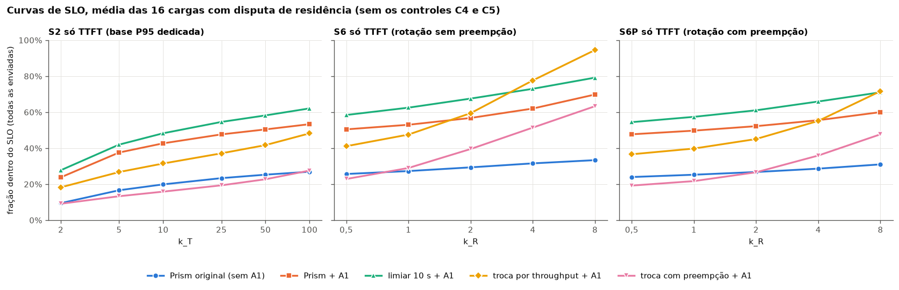
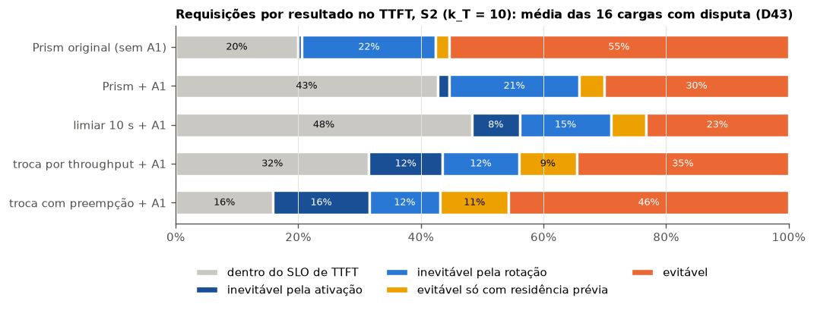
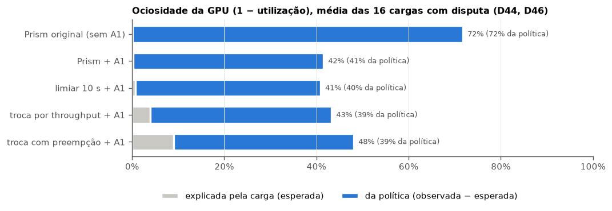
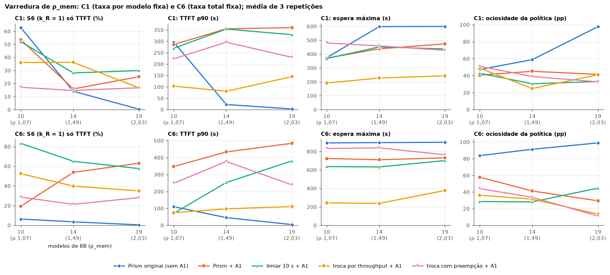

# F05 — Linhas de base sob a nova metodologia (2026-11-09)

Data de início: 2026-11-06 / fim da campanha: 2026-11-08 23:57 UTC / análise: 2026-11-09
Commits: `024e5cd`…`4599676` no worktree `f3-cargas` (nada enviado ao remoto). Código do servidor e da política de
todos os 270 níveis: `f279ced` (D45; `python/` não mudou depois). Durante a campanha mudaram só o driver e o harness
(orçamento de workers, D47; registro de mapas de memória, `712f194`; interrupção no K1, D48), nada que altere a
política.

## Objetivo

Medir as linhas de base (sem prazo) em todas as cargas aprovadas, com as restrições estruturais A1 da F4, nas métricas
novas da F5.0, para servir de referência às políticas por prazo (F6–F8) e de núcleo do artigo de resultados parciais.

## Hipóteses

- **H1.** A A1 elimina os impasses (T1) em todas as cargas, também com 14 e 19 modelos (ρ_mem 1,5 e 2,0), que a F4 não
  cobriu com 19.
- **H2.** Nenhuma linha de base vence em todos os critérios do objetivo (D33): a que mais atende o SLO não é a de menor
  cauda.
- **H3.** A troca por throughput com preempção (A0.4p) perde para a sem preempção (A0.4), porque o lote preemptado
  recomeça do prompt e as trocas ficam mais frequentes.
- **H4.** Boa parte das violações de TTFT é inevitável para qualquer política reativa (o prazo é menor que uma rotação
  real), o que mede o espaço que sobra para as políticas por prazo.

## Mudanças de código (F5.0 e campanha)

| Arquivo | Mudança | Decisão |
| --- | --- | --- |
| `polyaxon/swap_cost.py`, `polyaxon/f5_swap_census.sh` | custo real da rotação (7394 rotações): 8B 15,7 s sem preempção, 6,4 s com | F5.0a |
| `polyaxon/slo_metrics.py` | famílias S6 (rotação sem preempção) e S6P (com preempção); classificação nova das violações de TTFT; violações de TPOT durante transições; C9 usa a base do C1 ou do C6; modelos 11–19 usam a base de um modelo idêntico | D42, D43, D44 |
| `polyaxon/gpu_idle.py` (novo) | ociosidade da GPU: residência ociosa com demanda, esperada × observada (ρ_m pelo tempo de GPU ocupada), memória desperdiçada (R7), modelos ativos observados × esperados × residentes (R6), ociosidade por modelo (R1) | D44, D46 |
| `polyaxon/iso_dedicated.py`, `reports/registro/latencia_ded.json` | tempo de serviço e segundos de GPU por requisição na GPU dedicada (campos novos; os antigos idênticos) | D44 |
| `polyaxon/report_tables.py`, `ovl_plots.py` | TTFT p50/p90 e cauda de espera (D33) | F5.0e |
| `simple_global.py` | nota `reservation_lapsed` no log de decisões | F5.0f |
| `state.py`, `controller_global.py`, `gpu_scheduler.py`, `simple_global.py` | ciclo de vida explícito e fim da reserva de troca por evento (outra sessão, aprovado pelo Gabriel) | D45 |
| `polyaxon/f4_driver.py`, `f4_driver_start.sh` | orçamento de 36 workers no nó; C1 com 14 e 19 modelos sozinho no nó | D47, D48 |
| `polyaxon/run_examples.sh` | registro de mapas de memória por processo (`map_trace.log`); interrupção do job no primeiro erro do driver CUDA (K1) | D47, D48 |
| `polyaxon/validate_run.py` | aceita job interrompido antes de qualquer nível | — |
| `polyaxon/f5_suites.sh`, `f5_analysis.py`, `f5_report_tables.py`, `f5_figs.py` (novos) | suítes, análise, tabelas e figuras deste relatório | — |

Testes: `tests/metrics/test_slo_metrics.py`, `tests/metrics/test_gpu_idle.py`, `tests/controller/test_reservation_lapsed.py`,
`tests/controller/test_driver_budget.py` (novos) e os anteriores: 125 testes + `test/multi-model/test_memory_robustness.py`
(8), todos OK em 2026-11-07.

## Configurações executadas

Escopo da D39 (Gabriel), mantido na D46: 5 configurações × 18 cargas × 3 repetições = 270 níveis, 54 jobs. Cada job
roda uma carga com as 5 configurações na mesma janela (regra 3), em ordem que gira entre as repetições.

| Config. | O que é | Variáveis |
| --- | --- | --- |
| A0.1 | Prism publicado (despejo por ociosidade de 50 s), **sem** A1: referência do impasse | `PRISM_IDLE_THRESHOLD=50` |
| A0.1+A1 | o mesmo com as restrições estruturais (reserva de KV, detector de impasse, residência mínima) | + `PRISM_KV_RESERVE_REQS=4 PRISM_DEADLOCK_S=30 PRISM_MIN_RESIDENCY=10` |
| A0.2+A1 | limiar de ociosidade de 10 s + A1 | `PRISM_IDLE_THRESHOLD=10` + A1 |
| A0.4 | troca por throughput, sem preempção, sem folga fixa + A1 (D37, D38) | `PRISM_EVICTION=throughput PRISM_SWAP_PREEMPT=0 PRISM_ACTIVATION_HEADROOM_GB=0` + A1 |
| A0.4p | o mesmo com preempção (D39) | `PRISM_SWAP_PREEMPT=1` |

| Carga | Passo / nível | O que estressa |
| --- | --- | --- |
| C1 com 10 / 14 / 19 modelos (ρ_mem 1,07 / 1,49 / 2,03) | `ovl_mem` 0,2 req/s por modelo | fome sem ociosidade; a taxa total cresce com o número de modelos |
| C6 com 10 / 14 / 19 modelos | `ovl_zipf` 2 req/s no total, Zipf que gira | popularidade que muda; a taxa total é fixa |
| C2 | `ovl_phases` 0,5 | dois grupos que se alternam |
| C3 | `ovl_mix` 0,2 | 8B + 3B |
| T1 | `ovl_trace_big` ts1 | trace do Prism |
| C7 | `ovl_bursty` 0,2 | rajadas por modelo |
| C8 | `ovl_diurnal` 2 | curva diária comprimida |
| C9 sobre C1 / sobre C6 | `ovl_classes` | 30% de requisições de lote (TTFT 60 s, sem TPOT) |
| T3 | `ovl_tr_azfn` ts1 | trace Azure Functions |
| T2 | `ovl_tr_lmsys` ts1 | popularidade real do LMSYS |
| C10 | `ovl_sizes` 0,2 | 3B a 32B |
| C4, C5 (controles) | `ovl_kv` 0,5; `ovl_compute` 25 | KV e computação, sem disputa de residência |

Suítes: `polyaxon/configs/f5_camp_<carga>_o<rep>_suite.tsv` (geradas por `polyaxon/f5_suites.sh`). Smoke antes da
campanha: `f5-smoke-1` (`df35f4c0`, código anterior à D45) e `f5-smoke-2` (`2ca7b9e4`, D45), 3/3 VALIDA cada.

## Execuções

61 jobs (estado em `reports/data/F05/camp/jobs.tsv`, validador em `reports/data/F05/camp/validador/`). Usado um job
5/5 VALIDA por carga × repetição: **54 de 54, 270 níveis VALIDA**. Substituídos por refeitos (29 níveis, lista em
`reports/data/F05/campanha/descartados.csv`):

| Job | Válidos | Causa | Refeito |
| --- | --- | --- | --- |
| `f5-c1n10-1`, `f5-c1n14-1`, `f5-c1n19-1` | 2/5, 3/5, 0/5 | K1 (erro de memória do driver CUDA no kvcached) com 43 workers no nó (D47) | `-1b` |
| `f5-c1n14-1b`, `f5-c1n19-1b` | 2/5, 1/5 | K1 de novo com o orçamento de 36 workers: dois jobs do C1 com muitos modelos lado a lado (D48) | `-1c`, sozinhos no nó: 5/5 |
| `f5-c5-1` | 1/5 | checagem de saúde depois do nível falhou, ao lado dos dois jobs acima (INVALIDA_INFRA) | `-1b`: 5/5 |
| `f5-t3-1` | 0/0 | K1 na subida; interrompido em ~2 min pela D48 | `-1b`: 5/5 |

Os 6 jobs do C1 com 14 e 19 modelos rodaram sozinhos no nó (D48) e deram 6/6, ~55–60 min cada (contra ~80 min com
vizinhos).

## Resultados

Tabelas completas por carga e configuração: `reports/data/F05/campanha/tabelas.md` (gerado por
`polyaxon/f5_report_tables.py`): Tabela 1 (S1 e cauda, padrão do CLAUDE.md), 2 (S2/S6 e classificação das violações),
3 (ociosidade), 4 (diferença pareada contra A0.1+A1), 5 (SLO mínimo atingível), 6 (varredura de ρ_mem). Dados por
nível: `niveis.csv`; curvas: `curvas_niveis.csv`; pareado: `pareado.csv`. Os SLOs S2/S2M usam a base dedicada descrita
em `reports/registro/latencia_ref.md`. Toda fração é sobre todas as enviadas (não atendidas contam como violação).

### Resumo: média das 16 cargas com disputa de residência (sem os controles C4 e C5)

| Config. | atendidas | comb. S1 1 s | só TTFT S1 1 s | só TPOT 100 ms | S2 comb. (k_T 10, k_D 5) | S6 só TTFT (k_R 1) | TTFT p50 / p90 (s) | espera p99 / máx. (s) | > 10× mediana | impasses | ativações/min | ociosidade obs. (da política) |
| --- | --- | --- | --- | --- | --- | --- | --- | --- | --- | --- | --- | --- |
| A0.1 | 38,8% | 15,5% | 21,3% | 28,1% | 15,9% | 27,3% | 6,5 / 87 ¹ | 680 / 722 | 9,1% | 33 de 48 | 0,9 | 72% (72%) |
| A0.1+A1 | 99,0% | 34,7% | 43,1% | 67,9% | 36,3% | 53,0% | 48,3 / 322 | 522 / 587 | 21,0% | 0 | 1,5 | 42% (41%) |
| A0.2+A1 | **100%** | **36,1%** | **47,9%** | 68,5% | **40,4%** | **62,5%** | 31,7 / 203 | 462 / 532 | 23,4% | 0 | 2,8 | 41% (40%) |
| A0.4 | **100%** | 24,8% | 31,3% | **69,9%** | 27,0% | 47,6% | 25,5 / **98** | **179 / 236** | 8,6% | 0 | 5,5 | 43% (39%) |
| A0.4p | 81,6% | 13,7% | 15,9% | 69,3% | 13,6% | 29,0% | 46,9 / 263 | 575 / 689 | 3,9% | 0 | 8,2 | 48% (39%) |

¹ TTFT das atendidas: a A0.1 trava e atende 39%, quase só de modelos que nunca saíram; o p50/p90 baixo é efeito de
sobrevivência, não ganho. Por carga: Tabela 1 de `tabelas.md`.

**Diferença pareada contra A0.1+A1** (mesmo job; número de cargas, de 18, em que o IC 95% por bootstrap sobre os 3 jobs
exclui 0, melhora / piora):

| Config. − A0.1+A1 | S2 combinado | S6 só TTFT | TTFT p50 | TTFT p90 | espera máx. |
| --- | --- | --- | --- | --- | --- |
| A0.1 (sem A1) | 0 / 9 | 0 / 8 | 7 / 0 ¹ | 12 / 0 ¹ | 1 / 11 |
| A0.2+A1 | 5 / 4 | 7 / 2 | 3 / 4 | **12 / 0** | **9 / 0** |
| A0.4 | 1 / 8 | 2 / 7 | 4 / 8 | **16 / 0** | **15 / 0** |
| A0.4p | 0 / 11 | 0 / 10 | 5 / 7 | 10 / 2 | 1 / 7 |

Leitura pelo objetivo (D33: SLO, TTFT típico e nenhuma espera absurda, juntos):
- **A0.2+A1** é a melhor linha de base no SLO (S2 +4 pp e S6 +9,5 pp na média sobre A0.1+A1) e melhora o TTFT p90 e a
  espera máxima sem piorar nenhum dos três critérios na média; por carga, melhora o S2 em 7 de 18 (até +58 pp no C6 com 10 modelos) e piora em 4 (C9 sobre C1 −32 pp, C10 −19 pp,
  C6 com 19 modelos −12 pp, C7 −11 pp).
- **A0.4** tem a menor cauda de longe (espera máxima 236 s contra 587 s; melhor em 15 de 18 cargas) e o menor TTFT p90,
  mas perde ~9 pp de SLO (S2) para a A0.1+A1 e ~13 pp para a A0.2+A1: troca SLO por cauda.
- **A0.4p** é a pior em quase tudo: troca 8 vezes por minuto, deixa 18% sem resposta (fila, não perda; anomalia 2) e
  não ganha na cauda. H3 confirmada.
- **A0.1 sem A1** trava em 33 de 48 níveis com disputa (69%); com 14 e 19 modelos, em 100% (H1: a A1 zera os impasses,
  0 de 216 níveis com A1).



### Curvas de SLO e SLO mínimo atingível (F5.2a)

Média das 16 cargas com disputa (figura acima; por carga, Tabela 5 de `tabelas.md`):
- **Nenhuma linha de base chega a 90% na vista só TTFT do S2** em nenhuma carga com disputa, nem em k_T = 100. No S6,
  só a A0.4 passa de 90% na média, e só em k_R = 8 (8 rotações de prazo).
- No S6 (prazo = uma rotação real sem preempção), a ordem muda com o nível: até k_R = 2 a A0.2+A1 lidera; de k_R = 4 em
  diante a A0.4 passa à frente (ela atende quase todos, só que tarde).
- Vista só TPOT (100 ms): 68–70% para todas as configurações com A1; a diferença entre políticas está no TTFT.

### Classificação das violações de TTFT (F5.0c, D43)



No S2 (k_T = 10, prazo de ~0,5–5 s), 23–27% das requisições perdem o prazo de forma inevitável para qualquer política
reativa (o modelo estava fora e o prazo é menor que a ativação ou que uma rotação). A parte "evitável só com residência
prévia" (prazo cobre a troca, mas não a troca + um ciclo de 5 s) é de 2–11%: é o que uma política preditiva poderia
ganhar sobre uma reativa rápida. A parte evitável é de 23–55%: o espaço das políticas por prazo (F6). H4 confirmada,
com a fração inevitável maior nas políticas que trocam mais (a ativação deixa memória livre mais vezes, e o prazo S2
é menor que a ativação).

### Ociosidade da GPU (F5.0d, D44, D46)



- A carga sozinha explica quase nada da ociosidade (0–9%): com o ρ pelo tempo de GPU ocupada (D46), as cargas com
  disputa estão em sobrecarga de computação também. A ociosidade observada (41–48% com A1; 72% sem A1, pelo impasse)
  é quase toda da política: trocas, cargas de pesos e ociosidade de modelos residentes parados.
- Memória de modelos carregados e parados (R7, "memória desperdiçada"): 3–7% dos GB·s da GPU; enquanto há fila de
  outro modelo, 2–7%. É pequena: a ociosidade não vem de modelos parados ocupando memória, e sim de a GPU ficar parada
  durante as trocas.
- Modelos ativos (R6): no C1 com 19 modelos, 18,6 têm requisição no sistema em média (todas as configurações), contra
  10,5 esperados pela carga numa GPU dedicada e 4,5–7,0 residentes; a diferença entre 10,5 e 18,6 é fila criada pela
  falta de residência.

### Varredura de ρ_mem (10 / 14 / 19 modelos)



- No C1 (taxa total crescente), as configurações com A1 caem de 36–53% (S6 só TTFT, 10 modelos) para 17–30% (19
  modelos); a A0.4p fica em ~17% nas três intensidades; a A0.4 mantém a menor cauda (192–244 s de espera máxima).
- No C6 (taxa total fixa), a A0.2+A1 fica na frente nas três intensidades (83% → 58% no S6), e a A0.1+A1 sobe com o
  número de modelos (19% → 63%): com mais modelos na cauda de Zipf, cada modelo pouco popular tem menos requisições, e
  o limiar de 50 s deixa os populares residentes.
- A A0.1 sem A1 trava em todas as repetições com 14 e 19 modelos, nas duas bases.

### Controles (C4, C5)

Sem disputa de residência, as configurações quase não se separam no SLO; no C4, a A0.4p tem o maior SLO (23%) e a menor
cauda, porque a preempção libera KV que os 4 modelos disputam. Os controles não entram nas médias acima.

## Anomalias e investigações

1. **K1 (erro de memória do driver CUDA no kvcached) com 3 jobs no nó** (D47, D48). Com 43 workers no nó (C1 com 10,
   14 e 19 modelos lado a lado), 10 de 15 níveis falharam; com o orçamento de 36 workers, dois jobs do C1 com muitos
   modelos lado a lado ainda falharam (3 de 10 válidos) e quebraram a checagem de saúde de um vizinho. Sozinhos no nó,
   os mesmos jobs deram 30 de 30. O C6 com 19 modelos ao lado de outros 14 workers deu 5/5. **Leitura:** o que quebra o
   driver é a taxa de mapeamentos de memória do kvcached no nó (o C1 com 14–19 modelos troca 8–10 modelos por minuto),
   não o número de processos. **Descartado com dados:** o limite `vm.max_map_count` (no único K1 com o registro de
   mapas, o maior processo tinha 2739 mapeamentos de 65530; um nível válido do mesmo T3 tinha 2752) e o número de
   processos (680–1430 por nível nos válidos e no inválido). Fora dessas janelas, um único K1 (`f5-t3-1`, na subida), interrompido em 2 min. Correções: orçamento de workers (D47), C1 pesado sozinho no nó e interrupção imediata do job (D48).
2. **Não atendidas da A0.4p** (atendidas 40–99% por carga). No fim da janela, nos 54 níveis da A0.4p, 8977 requisições
   esperavam na fila do controlador: é fome por troca excessiva (2–5 modelos residentes de ~6 possíveis, com 7–10
   ativações por minuto), resultado da política. **Nova anomalia P16** (`reports/erros.md`): com preempção, algumas
   requisições ficam "rodando" num modelo já inativo no espelho do controlador (98 no último ciclo, em 16 de 54 níveis;
   0 em todas as configurações sem preempção). É ~1% das não atendidas da A0.4p e não muda as conclusões, mas é um
   defeito do caminho de preempção. Aberto; a investigar antes da F6.0.
3. **A0.1+A1 no C9 sobre C6 e no C5** atende 84% e 95%: também fila no fim da janela (o limiar de 50 s deixa modelos de
   lote e da cauda de Zipf sem vez), não perda.
4. **TTFT da A0.1 sem A1** parece bom (p50 6,5 s) só porque ela atende 39%: as tabelas mostram as não atendidas e a
   cauda ao lado (nota ¹).

## Critérios de aceitação

| Critério | Situação | Evidência |
| --- | --- | --- |
| C-V1: repetições válidas por configuração ≥ mínimo da fase (3, D39) | **OK** (3 em todas as 90 combinações) | `niveis.csv`; 54/54 jobs 5/5 |
| C-V2: CV entre repetições ≤ 15% na fração de SLO | **FALHOU** | abaixo |
| Todas as execuções válidas ou explicadas | **OK** | 270 VALIDA; 7 jobs substituídos, com causa (Execuções) |
| Tabelas, curvas e decomposição das violações nas três vistas (seção 7.1) | **OK** | `tabelas.md` (1–6), figuras, `curvas_niveis.csv` |

**C-V2 em detalhe.** CV entre as 3 repetições (desvio-padrão / média), por carga × configuração (90 células):
- S2 combinado: CV ≤ 15% em 10 de 90 (mediana 0,37); só TTFT S1 1 s: 22 de 90 (0,30); S6 só TTFT: 38 de 90 (0,18).
- Por configuração (mediana do CV, S2 combinado): A0.1 0,32, A0.1+A1 0,41, A0.2+A1 0,28, A0.4 0,47, A0.4p 0,52.
- 21 células têm média abaixo de 10% no S2 combinado, onde qualquer variação dá CV alto; sem elas, 9 de 69 passam.
- **Causa provável:** em sobrecarga, o resultado depende de quais modelos ficam residentes nos primeiros minutos e de
  quando cada troca acontece; pequenas diferenças de tempo mudam qual modelo passa fome. A comparação pareada no mesmo
  job (Tabela 4) é bem mais estável que os valores absolutos, e é ela que sustenta as conclusões acima.
- O critério não foi relaxado. Opções para o Gabriel no gate (abaixo).

## Decisão do gate: APROVADO (Gabriel, 2026-11-09, D49)

- C-V2: opção (c), aceito com a limitação declarada (conclusões só nas diferenças pareadas com IC).
- Artigo de resultados parciais: não fazer por enquanto; o foco é conseguir bons resultados.
- Níveis de SLO da F6: S6 `k_R` ∈ {1, 2, 4} e S3 `k_A` = 5; hipótese do Gabriel a testar na F6.0: o S3 `k_A` = 5 só faz
  sentido com preempção.
- P16 investigada e corrigida antes da F6.0.

Texto da revisão (como estava antes da decisão):

Decisões que cabem ao Gabriel:
1. **C-V2 falhou.** Opções: (a) mais repetições (as 5 do padrão do plano: +36 jobs, ~18 h com as regras atuais, C1
   pesado sozinho no nó); (b) janelas mais longas para as cargas de 300 s (C1, C3, C9 sobre C1), que somam a maior
   variação; (c) aceitar com a limitação declarada, apoiando as conclusões só nas diferenças pareadas com IC (Tabela 4)
   e nas vistas mais estáveis (S6). O agente recomenda (c) para a F5 e (a) só para as cargas e configurações que entram
   no artigo, se o Gabriel quiser valores absolutos.
2. **Conteúdo do artigo de resultados parciais** (ponto de decisão 4 do plano). Proposta: (i) a A1 elimina os impasses
   do Prism em todas as cargas, até ρ_mem 2,0; (ii) entre as linhas de base, nenhuma vence nos três critérios: limiar
   curto (A0.2+A1) no SLO, troca por throughput sem preempção (A0.4) na cauda; (iii) a preempção na troca por
   throughput piora tudo; (iv) a ociosidade da GPU em sobrecarga é quase toda da política (trocas), não da carga;
   (v) 23–27% das requisições perdem o TTFT do S2 de forma inevitável para políticas reativas.
3. **Níveis de SLO das políticas por prazo (F5.2b).** O plano pede um nível em que as linhas de base atendem > 90%, um no
   meio da queda e um baixo. Nenhum nível de S2 nem de S6 passa de 90% na média com as linhas de base; proposta: S6
   k_R ∈ {1, 2, 4} (média da melhor linha de base 63%, 68%, 78% só TTFT) e S3 k_A = 5 (continuidade com a F6a), em vez
   do "> 90%".
4. **P16** (preempção deixa requisições "rodando" num modelo inativo): investigar e corrigir antes da F6.0, que compara
   com e sem preempção. O agente recomenda sim.

## Pendências que passam para fases seguintes

- P16 aberto (acima).
- C1 com 14 e 19 modelos só sozinho no nó (D48); o orçamento de 36 workers continua para o resto. Qualquer campanha
  futura com essas cargas paga ~1 h por job sem paralelismo.
- A0.2+A1 é a linha de base a bater no SLO; A0.4, na cauda (regra 0.10 da F6).
- O CV alto pede comparações sempre pareadas no mesmo job.
- SLOs das classes do C9 (D19, provisórios): reavaliar com estes dados na F8.0.

## Reprodução

```bash
PY=/mnt/scratch/scheduler/opt-env/bin/python
# F5.0: censo do custo de rotação e bases dedicadas
bash polyaxon/f5_swap_census.sh
$PY polyaxon/iso_dedicated.py <dest> /mnt/scratch/scheduler/prism-raw/F2/f2-ded-{a,b,c}/outputs /mnt/scratch/scheduler/prism-raw/F5/ded/f5-ded-*/outputs
# suítes, smoke e campanha (driver retomável: orçamento de 36 workers, C1 com 14/19 modelos sozinho, interrupção no K1)
bash polyaxon/f5_suites.sh
bash polyaxon/f4_driver_start.sh f5smoke   # f5-smoke-1/2
bash polyaxon/f4_driver_start.sh f5        # 61 jobs; estado reports/data/F05/camp/jobs.tsv, log driver.log
# análise (só jobs 5/5 VALIDA por carga × repetição; os substituídos vão para descartados.csv)
$PY polyaxon/f5_analysis.py reports/data/F05/campanha reports/data/F05/camp/validador/f5-*.csv
$PY polyaxon/f5_report_tables.py reports/data/F05/campanha > reports/data/F05/campanha/tabelas.md
$PY polyaxon/f5_figs.py reports/data/F05/campanha reports/figs/F05
```

Dados brutos: `/mnt/scratch/scheduler/prism-raw/F5/camp/<job>/` (download sequencial pelo driver, uuid do pod
conferido). Run IDs: coluna `uuid` de `reports/data/F05/camp/jobs.tsv`. Decisões: D39–D48 em
`reports/registro/decisoes.md`; referências R1, R5–R7 em `reports/registro/referencias.md`.
