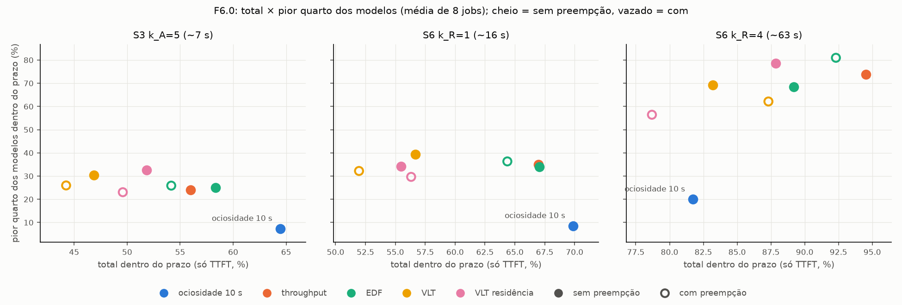

# F06.0 — Políticas por prazo sem drenagem, com A1, contra as linhas de base da F5 (2026-11-09)

Data de início: 2026-11-09 (F6.P16 e desenho) / campanha: 2026-11-09 10:17–22:53 UTC / análise: 2026-11-09
Branch `scheduling-research` (era `f3-cargas`; renomeada em 2026-11-09), commits `1bea0c8`…`fb9a934` e os desta
análise. Código do servidor e da política dos 160 níveis: `8f9c3f1` (P16 corrigida, A9.2 incluída; `python/` não mudou
durante a campanha). Durante a campanha mudou só o validador (V13 alinhado, D51), aplicado a todos os jobs.

Glossário rápido: **A0.2+A1** = despejo por ociosidade de 10 s com as restrições estruturais A1 (reserva de KV, quebra
de impasse em 30 s, residência mínima de 10 s); **A0.4** = troca por throughput/GB sem preempção + A1; **A2.1 EDF** =
ativa o modelo com a requisição de menor folga; **A9.1 VLT** = Virtual Lag Time do SuperInfer (atraso acumulado; vítima =
ativo há mais tempo); **A9.2 VLT residência** = variante nova (D50); **S3 `k_A`=5** = prazo de TTFT de 5× o custo de
ativação (~7 s num 8B); **S6 `k_R`** = prazo de `k_R` trocas reais sem preempção (~16 s e ~63 s num 8B; bases em
`reports/registro/latencia_ref.md` e `reports/registro/c_rot.json`); **p0/p1** = sem/com preempção (com preempção as
requisições em execução da vítima recomeçam do prompt; o que já foi gerado se perde).

## Objetivo

Responder, com a A1 ligada e sem a drenagem de 15 s (D30), se as políticas por prazo (A2.1, A9.1 e a nova A9.2) superam
as melhores linhas de base da F5 (A0.2+A1 no SLO, A0.4 na cauda), e testar a hipótese do Gabriel (D49): o prazo S3
`k_A`=5, menor que uma troca sem preempção, só faz sentido com preempção.

## Hipóteses

- H1 (plano): sem drenagem, a vítima sai em segundos e as políticas por prazo deixam de perder para as linhas de base
  (na F6a perderam 25–37 pontos).
- H2 (plano): a A2.1 com prazo folgado continua perdendo, porque não pesa a perda da vítima.
- H3 (plano): com preempção, quem entra espera menos, mas o trabalho descartado cresce; o saldo depende do prazo.
- H-S3 (Gabriel, D49): no S3 `k_A`=5, preempção ajuda (Δ com − sem > 0), e mais que no prazo folgado S6 `k_R`=4.
- H-A9.2 (D50): olhar o modelo ativo pela mesma medida de atraso e pesar o custo real da troca evita despejar modelos
  ocupados e melhora a A9.1.

## Mudanças de código (arquivo, função, variável de ambiente, padrão)

| Arquivo | Mudança | Variável / padrão |
| --- | --- | --- |
| `python/sglang/srt/managers/scheduler.py` (SGLang, R2.6) | P16: a desativação com preempção retira e devolve ao frontend a requisição no meio de um prefill em pedaços (`_take_inflight_req`; guarda no fim de toda desativação); passos de trace `worker_prefill`, `worker_retract`, `worker_retract_oom`, `worker_inflight_at_deactivate` | `PRISM_DEACTIVATE_REQUEUE_INFLIGHT` (1; 0 = antigo, só diagnóstico) |
| `python/sglang/multi_model/scheduling/policy/deadline.py` | A9.2 `_lvf_cost_aware`: `lag_at`, `rotation_gain` (G), `eviction_cost` (K) | `PRISM_LVF_COST_AWARE` (0), `PRISM_LVF_MARGIN` (0 s) |
| `python/sglang/multi_model/scheduling/estimators.py` | `rotation_cost`, `load_rotation_table` (Ĉ_rot medido da F5.0a, com ou sem preempção) | `PRISM_CROT_FILE` (padrão `reports/registro/c_rot.json`; ausente = erro) |
| `python/sglang/multi_model/scheduling/policy/simple_global.py` | liga A9.2 e a tabela de Ĉ_rot | — |
| `python/sglang/multi_model/scheduling/decision_log.py` | `running_rids` dos modelos não ativos (diagnóstico da P16) | — |
| `polyaxon/validate_run.py` | V13 alinha as séries de memória (−2…+2 s) antes de comparar (P17, D51) | `V13_LAGS_S` |
| `polyaxon/run_examples.sh` | tamanho do pedaço de prefill para testes de estresse | `PRISM_CHUNKED_PREFILL_SIZE` (vazio = 8192) |
| `polyaxon/f6_0_suites.sh`, `f4_driver_start.sh f60` | suítes e driver da F6.0 (sem orçamento de workers, D50) | `F60_REPS` (2), `F60_LEVELS`, `F60_BASE`, `F60_POLICIES` |
| `polyaxon/f60_analysis.py`, `f60_fairness.py`, `f60_report_tables.py` | análise pareada, justiça entre modelos, tabelas e figura | — |
| Testes | `tests/robustness/test_preempt_inflight.py` (5), `tests/policy/test_lvf_cost_aware.py` (19); 159 testes + 8 de memória passam | — |

## Configurações executadas (suíte, cenários, políticas, parâmetros, sementes)

Escopo (D49, D50): 4 cargas × 2 repetições = 8 jobs; por job 20 níveis na mesma janela (regra 3): A0.2+A1 e A0.4 como
referência pareada (A0.4p fora: código mudou com a P16 e já foi a pior na F5) + {A2.1, A9.1, A9.2} × {S3 `k_A`=5,
S6 `k_R`=1, S6 `k_R`=4} × {p0, p1}. Os braços por prazo recebem o prazo de TTFT de cada requisição
(`PRISM_OVL_SLO_SPEC`); `k_D` = 5 só entra nas métricas. Parâmetros: A1 (`PRISM_KV_RESERVE_REQS=4 PRISM_DEADLOCK_S=30
PRISM_MIN_RESIDENCY=10`), folga de ativação 0 (D37), orçamento de 1 rotação em voo, ciclo de 5 s, sem drenagem (D30);
VLT com α = 3, β_F = 0,5, β_B = 0. A ordem dos braços gira entre repetições; os pares p0/p1 rodam lado a lado.
Suítes: `polyaxon/configs/f60_<carga>_o<rep>_suite.tsv`; smoke `f60_smoke_suite.tsv`.

**Relevância das cargas (seção 0.9), pelos dados da F5:** todas têm mais modelos que a GPU comporta (disputa de
residência, onde a escolha de quem fica importa).

| Carga | O que é | Por que entra |
| --- | --- | --- |
| C1, 10 modelos (`ovl_mem` 0,2) | 10 × Llama-3.1-8B, ~6 cabem, 0,2 req/s cada | todo modelo tem tráfego: toda troca despeja um modelo ocupado (onde a A2.1 perdeu na F6a e a A9.1 escolheu vítimas ocupadas); 47–48% das violações evitáveis na F5 |
| T1 (`ovl_trace_big` ts1) | trace real do Prism em 12 modelos | continuidade com a F6a; tráfego realista; pouco espaço (~80% na F5) |
| C6, 14 modelos (`ovl_zipf` 2) | 2 req/s no total, Zipf que gira a cada 60 s | quem merece ficar residente muda; maior diferença entre linhas de base na F5 |
| T3 (`ovl_tr_azfn` ts1) | trace Azure Functions em 12 modelos | pedido do Gabriel (D50): segundo trace real, rajadas e cauda longa; 29–54% evitáveis na F5 |

## Execuções (tabela: run_id, status do validador, observação)

| Job | uuid | Validador | Observação |
| --- | --- | --- | --- |
| `f6-p16-1` | `81b479c8` | 2/2 VALIDA | P16, C8 600 s: leve demais, 0 eventos |
| `f6-p16-2` | `21479a70` | 2/2 VALIDA | P16, C8 completo: antigo 1 resposta pelo modelo errado, corrigido 0 |
| `f6-p16-3` | `058242be` | 0/2 (INVALIDA_SISTEMA) | pedaços de 1024 tokens: asserção do SGLang 0.3.4 em workers recém-ativados, não ligada à P16; descartado |
| `f6-p16-4` | `9688fa3d` | 2/2 VALIDA | pedaços de 4096: antigo 8 respostas pelo modelo errado, corrigido 0 |
| `f6-p16-5` | `cd079263` | 1/2 VALIDA | controle positivo: 64 retiradas no meio do prefill, todas devolvidas; o nível inválido é fome por preempção sob taxa 3 (V7) |
| `f60-smoke` | `49b56de0` | 4/4 VALIDA | A2.1, A9.1 e A9.2 (p0/p1) no C1 |
| `f60-c1n10-1` | `9dea206c` | 20/20 VALIDA | 18/20 antes de D51 (V13, P17); revalidado sem reexecução |
| `f60-t1-1` | `e76d8f6f` | 20/20 VALIDA | |
| `f60-c6n14-1` | `8fddfa0e` | 20/20 VALIDA | |
| `f60-t3-1` | `94336234` | 20/20 VALIDA | |
| `f60-c1n10-2` | `7db761f4` | 20/20 VALIDA | |
| `f60-t1-2` | `e55ad2f3` | 20/20 VALIDA | |
| `f60-c6n14-2` | `44389422` | 20/20 VALIDA | |
| `f60-t3-2` | `ef7ff04e` | 20/20 VALIDA | |

Campanha: 160/160 níveis VALIDA, nenhuma reexecução. Validador: `reports/data/F06/f60/validador/`; P16:
`reports/data/F06/p16/`; brutos em `/mnt/scratch/scheduler/prism-raw/F6/`.

## Resultados (tabelas e figuras com caminho; só execuções VALIDAS)

Todas as tabelas completas em `reports/data/F06/f60/analise/tabelas.md` (Tabela 1, padrão do CLAUDE.md: TTFT só 1/2/5 s,
TPOT só 100 ms, combinado; Tabela 2, as três vistas no nível de cada braço; Tabela 3, por carga; Tabelas 4a/4b, pareado
contra cada linha de base; Tabela 5, preempção; Tabelas 6, 7a, 7b, justiça entre modelos). Frações sobre todas as
enviadas (não atendidas contam como violação). Diferenças pareadas no mesmo job, IC 95% por bootstrap sobre os 8 jobs
(`*` = IC exclui 0). Com 2 repetições, o IC por carga é só o intervalo entre os 2 valores: resultado de triagem (D50).

### 1. SLO total: nenhuma política por prazo supera a A0.2+A1 nos prazos curtos

Só TTFT dentro do prazo, no nível de cada braço (média dos 8 jobs; as linhas de base avaliadas no mesmo nível):

| Nível | A0.2+A1 | A0.4 | A2.1 EDF sem / com | A9.1 VLT sem / com | A9.2 VLT residência sem / com |
| --- | --- | --- | --- | --- | --- |
| S3 `k_A`=5 (~7 s) | **64%** | 56% | 58 / 54 | 47 / 44 | 52 / 50 |
| S6 `k_R`=1 (~16 s) | **70%** | 67% | 67 / 64 | 57 / 52 | 55 / 56 |
| S6 `k_R`=4 (~63 s) | 82% | **95%** | 89 / 92 | 83 / 87 | 88 / 79 |

- Contra a A0.2+A1, a A2.1 sem preempção perde −6,1 [−16,5; +6,1] no S3 e −2,8 [−11,5; +7,9] no S6 `k_R`=1 (IC
  inclui 0); a A9.1 perde 13–18 pontos e a A9.2 12–14, com IC que exclui 0 (ou quase) (Tabela 4a).
- Contra a A0.4, a A2.1 sem preempção ganha +2,3 [+0,4; +4,4] * no S3; as variantes do VLT perdem 4–16 pontos (Tabela 4b).
- No prazo folgado (S6 `k_R`=4), a A2.1 com preempção ganha da A0.2+A1 +10,6 [+2,3; +19,9] * e empata com a A0.4
  (−2,2 [−7,1; +2,3]).
- Comparado à F6a (só pela diferença pareada contra a ociosidade do mesmo job; regra 3): a A9.1 passou de −25 a −37
  pontos (combinado, S2/S3, com drenagem) para −13 a −18 (só TTFT, S3/S6). **H1 confirmada em parte**: sem drenagem e com
  A1 a perda caiu, mas não sumiu.

### 2. TTFT e cauda: todas as políticas por prazo são muito melhores que a A0.2+A1

Contra a A0.2+A1, toda política em todo nível reduz o TTFT p90 em 40–80 s e a maior espera em 200–380 s, com IC que
exclui 0 (Tabela 4a). TTFT p50/p90 (s), no nível S3: A0.2+A1 5/136, A0.4 4/49, A2.1 sem preempção 3/80, A9.1 12/76,
A9.2 sem preempção 6/69; maior espera média: A0.2+A1 492 s, A0.4 142 s, A2.1 290 s, A9.1 139 s, A9.2 131 s. A A0.4
continua com a menor cauda; a A9.2 sem preempção a iguala no S3/S6 `k_R`=1 e a supera no S6 `k_R`=4 (maior espera −26
[−49; −6] *, p90 do pior modelo −21 [−36; −6] *).

### 3. Justiça entre modelos: a A0.2+A1 ganha no total deixando modelos sem serviço



Por modelo (só TTFT, nível próprio, modelos com ≥ 10 requisições; Tabela 6), no S3 `k_A`=5:

| | A0.2+A1 | A0.4 | A2.1 sem / com | A9.1 sem / com | **A9.2 sem** / com |
| --- | --- | --- | --- | --- | --- |
| pior modelo | 2% | 19% | 19 / 21 | 27 / 21 | **26%** / 19 |
| pior quarto dos modelos | 7% | 24% | 25 / 26 | 30 / 26 | **33%** / 23 |
| índice de Jain (1 = todos iguais) | 0,686 | 0,844 | 0,855 / 0,878 | 0,910 / 0,911 | **0,921** / 0,844 |
| TTFT p90 do pior modelo (s) | 448 | 110 | 257 / 228 | 113 / 126 | **105** / 163 |

- **Mecanismo (diferença > 2×):** a A0.2+A1 só tira um modelo da GPU depois de 10 s sem requisições. Nas cargas com
  tráfego contínuo, os modelos residentes nunca ficam ociosos, e os que começaram fora só entram quando o tráfego para.
  No S3, 20 dos 96 pares modelo × job da A0.2+A1 ficam abaixo de 10% no prazo (C1 5, C6 10, T3 4, T1 1), com esperas de
  até 623 s (a janela inteira). Exemplo, `f60-c1n10-1` (os 10 modelos com a mesma taxa): 3 modelos com 0–3% no prazo e
  esperas de 214–340 s. Com a A9.2 sem preempção, 0 dos 96 pares fica abaixo de 10%, em todos os níveis, e a maior
  espera de um modelo é 207 s (`modelos.csv`). O total alto da A0.2+A1 vem de servir bem os modelos que ficam
  residentes, à custa dos outros.
- Contra a A0.2+A1, toda política por prazo, em todo nível, melhora o pior quarto em +16 a +61 pontos, o índice de Jain
  em +14 a +24 e o p90 do pior modelo em 190–360 s, todos com IC que exclui 0 (Tabela 7a).
- Contra a A0.4 (a linha de base mais justa), a **A9.2 sem preempção** é a única que ganha nas duas medidas no S3:
  pior quarto +8,5 [+4,9; +12,3] *, Jain +7,7 [+3,0; +11,6] *, com perda no total de −4,2 [−10,5; +3,4] (IC inclui 0).
  No S6 `k_R`=4: Jain +1,1 [+0,3; +2,0] *, pior quarto +4,9 [−1,9; +12,6] (Tabela 7b). A A9.1 sem preempção também ganha
  em justiça no S3 (pior quarto +6,5 *, Jain +6,6 *), mas perde 9 pontos no total.
- **H-A9.2:** contra a A9.1, a A9.2 sem preempção tem total maior no S3 (52% × 47%), TTFT p50 menor (6 s × 12 s), maior
  espera menor e justiça igual ou melhor; no S6 `k_R`=1 o total é um pouco menor (55% × 57%). Confirmada em parte.

### 4. Preempção e a hipótese do S3

Efeito da preempção (com − sem, no mesmo job, só TTFT no nível próprio; Tabela 5):

| Política | S3 `k_A`=5 | S6 `k_R`=1 | S6 `k_R`=4 | interação Δ(S3) − Δ(S6 `k_R`=4) |
| --- | --- | --- | --- | --- |
| A2.1 EDF | −4,2 [−8,6; −0,9] * | −2,7 [−4,8; −0,7] * | +3,1 [−1,7; +8,2] | −7,3 [−16,4; −0,0] |
| A9.1 VLT | −2,6 [−6,8; +0,9] | −4,7 [−9,2; −0,9] * | +4,1 [−0,1; +8,8] | −6,8 [−11,0; −3,1] * |
| A9.2 VLT residência | −2,2 [−7,2; +2,9] | +0,8 [−1,7; +3,8] | −9,2 [−17,4; −1,1] * | +6,9 [+1,5; +11,7] * |

- **H-S3 não confirmada.** No S3, a preempção não ajuda nenhuma política (piora a A2.1). Para a A2.1 e a A9.1, o efeito é
  o oposto do previsto: a preempção ajuda mais no prazo folgado. A interação positiva da A9.2 vem de a preempção
  piorar o S6 `k_R`=4 (−9,2), não de ajudar no S3.
- **H3 confirmada:** o saldo da preempção depende do prazo e da política. A A2.1 com preempção é a melhor configuração no
  S6 `k_R`=4 em justiça (pior modelo 77%, Jain 0,989, p90 do pior modelo 99 s), mas a preempção piora a A9.2 em todos os
  níveis e em justiça.
- **Mecanismo:** a preempção do Prism é por recomputação: a requisição retirada volta à fila só com o prompt e perde todo
  o decode já feito; com trocas de 6–16 s (F5.0a), o trabalho descartado custa mais que o tempo ganho na saída da vítima.
  O Aegaeon (R6) só ganha com preempção porque guarda o KV na CPU e reduziu o custo da troca em 97%.
- **H2:** a A2.1 sem preempção perde no prazo folgado (S6 `k_R`=4) para a A0.4 (−5,3 [−11,2; +0,1]) e fica atrás da A0.4 em
  cauda em todos os níveis (maior espera +65 a +158 s). Confirmada.

## Anomalias e investigações (cada uma com causa, correção e verificação)

1. **P16 (preempção deixava requisições "rodando" num modelo inativo).** Causa: a desativação com preempção descartava a
   requisição no meio de um prefill em pedaços; ela ficava presa no controlador e era terminada depois pelo mesmo worker
   já ativado como **outro modelo** (resposta gerada pelo modelo errado, contada como atendida). Evidência nos logs da
   F5 (todo nível com presas teve desativações logo depois de um prefill de 8192 tokens; 27 níveis sem esse evento, 0
   presas). Correção R2.6; verificação nos jobs `f6-p16-2/4/5` (antigo: 9 respostas pelo modelo errado em 4714
   requisições; corrigido: 0; controle positivo: 64 retiradas no meio do prefill, todas devolvidas). Afeta a A0.4p da
   F5 (algumas "atendidas" eram respostas do modelo errado); as conclusões da F5 não mudam. `reports/erros.md` P16.
2. **P17 (V13 reprovava níveis que trocam muito).** Dois níveis com preempção do `f60-c1n10-1` reprovaram só no V13
   (mediana de |memória livre do controlador − nvidia-smi| 2,18 GB > 2 GB). Causa: as duas séries estão 1–2 s defasadas e,
   em níveis com trocas a cada poucos segundos, metade dos pares cai no meio de uma troca. Correção (D51): V13 alinha as
   séries (−2…+2 s); revalidado 20/20, todos a 0,68 GB. `reports/erros.md` P17.
3. **Asserção do SGLang 0.3.4 com pedaços de prefill pequenos** (`f6-p16-3`): com pedaços de 1024 tokens (menores que o
   maior prompt de 4096), `assert self.current_inflight_req is None` em workers recém-ativados. Não ocorre com 8192
   (0 em 270 níveis da F5) nem com 4096. Registrado em `docs/agent/pitfalls.md`; nenhuma correção (só testes de estresse).

## Critérios de aceitação (cada critério: OK/FALHOU + evidência)

| Critério (seção F6 do plano) | Situação |
| --- | --- |
| Testes unitários passando | **OK**: 159 testes + 8 de memória (incluídos os 5 da P16 e os 19 da A9.2) |
| Linhas de base reproduzidas na mesma campanha (C-V3) | **OK**: A0.2+A1 e A0.4 em todo job, pareadas |
| Resultado honesto com IC 95% pareado nas três vistas e decomposição das violações | **OK em parte**: IC pareado nas vistas só TTFT e combinada (e TPOT nas tabelas); a decomposição das violações (inevitável/evitável) não foi recalculada para os níveis S3/S6 desta fase |
| Toda diferença > 2× com explicação mecânica | **OK**: justiça da A0.2+A1 (modelos que começam fora nunca entram enquanto há tráfego); preempção (recomputação) |
| Sinal para a confirmação (> ~8 pontos sobre a melhor linha de base, ou melhora clara no TTFT p50/p90 sem piorar SLO nem cauda) | **Depende da leitura (decisão do Gabriel)**: nenhuma política ganha 8 pontos de SLO total. Contra a A0.2+A1, todas melhoram muito o p90 e a cauda, mas o SLO total cai (A2.1 e A9.2 sem preempção: IC inclui 0). Contra a A0.4, a A9.2 sem preempção ganha em justiça (pior quarto +8,5 *) sem perda significativa de total, e empata na cauda |

## Decisão do gate: APROVADO (Gabriel, 2026-11-10, D52)

Objetivo passa a ser justiça entre modelos sem grande perda de SLO; preempção só por troca (nova A9.4), padrão sem preempção; confirmação com A9.2, A2.1 (sem preempção), A9.4 e A2.1 com preempção só no S6 `k_R`=4. As questões abaixo foram as apresentadas ao gate.

Questões para o Gabriel:

1. **Justiça entre modelos como objetivo.** Na D31 o pior modelo ficou como observação, não objetivo. Os resultados
   mostram que o SLO total premia a A0.2+A1 por deixar 2–5 modelos sem serviço. Proposta do agente: adotar como objetivo
   conjunto (seção 7 do plano) o SLO total **e** o pior quarto dos modelos (ou o índice de Jain), com a cauda de espera
   (D33). Com esse critério, a **A9.2 sem preempção** é a candidata (melhor justiça de todas, cauda igual à A0.4, total
   −4 pontos sem significância contra a A0.4 e −13 contra a A0.2+A1).
2. **O que vai para a confirmação** (5 repetições, IC 95%): proposta, A9.2 sem preempção e A2.1 sem preempção, contra
   A0.2+A1 e A0.4, nos níveis S3 `k_A`=5 e S6 `k_R`=1; A2.1 com preempção só no S6 `k_R`=4, onde foi a melhor.
3. **Preempção.** Como chave liga/desliga, não compensa (piora ou empata nos prazos curtos; H-S3 não confirmada).
   Proposta: deixar de rodar p1 como braço geral e avaliá-la em duas formas: (a) **por troca** (A3 do plano): preemptar
   só quando as requisições da vítima perderiam pouco trabalho (a A9.2 já mede essa perda, `α·Ĉ_rot`); (b) **preempção
   que guarda o KV** (para a CPU, como o Aegaeon, R6): exige mudar o SGLang, decisão à parte.
4. **Próximo passo da F6** pela lista de prioridades (D31, D32): A3.1 (despejo por perda esperada, com preemptar ou não
   por troca) e A10 (throughput × prazo × fila), comparando com a A9.2.

## Pendências que passam para fases seguintes

- Decomposição das violações (inevitável / evitável) nos níveis S3/S6 desta campanha (`f5_analysis` faz para S2/S6
  `k_R`=1; falta para os níveis próprios).
- 2 repetições: IC por carga não informativo; a confirmação precisa de 5.
- Sensibilidade da A9.2 (`PRISM_LVF_MARGIN`, α) não testada.
- O envio da branch `scheduling-research` ao fork é do Gabriel (sem credenciais do GitHub na máquina).

## Reprodução

```bash
# P16: correção, teste e verificação
PY=/mnt/scratch/scheduler/opt-env/bin/python
$PY -m unittest tests/robustness/test_preempt_inflight.py tests/policy/test_lvf_cost_aware.py
PRISM_JOB_SUFFIX=-f6-p16-2 PRISM_JOB_ENV="PRISM_SUITE=polyaxon/configs/f6_p16_suite.tsv PRISM_TIMEOUT=7200" polyaxon/submit.sh
PRISM_JOB_SUFFIX=-f6-p16-4 PRISM_JOB_ENV="PRISM_SUITE=polyaxon/configs/f6_p16_stress_suite.tsv PRISM_TIMEOUT=7200" polyaxon/submit.sh
PRISM_JOB_SUFFIX=-f6-p16-5 PRISM_JOB_ENV="PRISM_SUITE=polyaxon/configs/f6_p16_posctl_suite.tsv PRISM_TIMEOUT=7200" polyaxon/submit.sh

# F6.0: suítes, smoke e campanha (driver retomável, no máximo 3 jobs, interrupção no K1)
bash polyaxon/f6_0_suites.sh            # F60_REPS=2, níveis S3k5 S6k1 S6k4, A0.2_A1 e A0.4
PRISM_JOB_SUFFIX=-f60-smoke PRISM_JOB_ENV="PRISM_SUITE=polyaxon/configs/f60_smoke_suite.tsv PRISM_TIMEOUT=5400" polyaxon/submit.sh
bash polyaxon/f4_driver_start.sh f60    # estado reports/data/F06/f60/jobs.tsv, brutos /mnt/scratch/scheduler/prism-raw/F6/f60

# análise (só jobs com todos os níveis VALIDA)
$PY polyaxon/f60_analysis.py reports/data/F06/f60/analise reports/data/F06/f60/validador/f60-*.csv
$PY polyaxon/f60_fairness.py reports/data/F06/f60/analise
$PY polyaxon/f60_report_tables.py reports/data/F06/f60/analise reports/figs/F06/f60_total_x_pior_quarto.png
```
