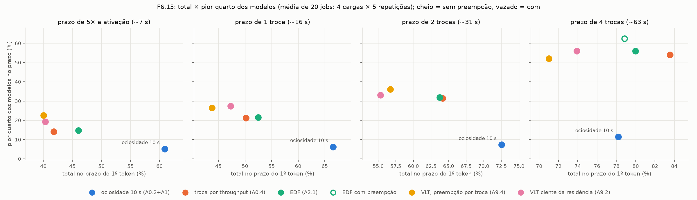

# F06 — Políticas por prazo e por atraso virtual no Prism (SGLang): relatório da fase (2026-11-11)

Período: 2026-11-04 (F6a) a 2026-11-11 (fim da confirmação F6.15). Branch `scheduling-research` (antes `f6a-deadline`,
`f3-cargas`). Gate da F6 **APROVADO** pelo Gabriel em 2026-11-11 (D60).

Este relatório resume a fase. Os detalhes, tabelas completas e comandos de cada rodada estão nos relatórios parciais:
- F6a: `reports/fases/F06a_prazo_primeira_rodada.md`;
- F6.0: `reports/fases/F06_0_repeticao_sem_drenagem.md`;
- F6.16: `reports/fases/F06_16_triagem_politicas_novas.md`;
- F6.15: `reports/fases/F06_15_confirmacao.md`.

## Glossário

Políticas (todas, desde a F6.0, com as restrições estruturais **A1**: reserva de KV, quebra de impasse em 30 s,
residência mínima de 10 s):
- **A0.2+A1:** despejo por ociosidade de 10 s, a linha de base de maior SLO total da F5;
- **A0.4:** troca por throughput/GB, sem preempção, a linha de base de menor cauda da F5;
- **A2.1 (EDF):** entra o modelo com o prazo viável mais cedo;
- **A9.1 (VLT):** o Virtual Lag Time do SuperInfer, fiel ao artigo (entra quem acumulou mais atraso; sai quem está ativo
  há mais tempo);
- **A9.2 (VLT ciente da residência):** o mesmo atraso para modelos ativos e inativos, descontado o custo medido da
  troca; só troca quando o atraso de quem entra supera o que as vítimas perderiam;
- **A9.4:** a A9.2 decidindo a cada troca se preempta a vítima ocupada (λ);
- **A2.3:** a A9.2 com residência preditiva (protege modelos com chegada esperada);
- **A3.1:** despejo pela perda esperada de prazos;
- **A10.1:** troca por throughput só para modelos com requisição viável.

Prazos:
- **S2 `k_T`:** `k_T` × P95 do TTFT dedicado (só na F6a);
- **S3 `k_A`=5:** 5× o custo de ativação, ~7 s num 8B;
- **S6 `k_R`:** `k_R` trocas reais sem preempção, ~16, ~31 e ~63 s num 8B (`reports/registro/latencia_ref.md`,
  `c_rot.json`).

Medidas:
- **pior quarto:** fração no prazo dos 25% piores modelos;
- **Jain:** índice de justiça entre modelos (1 = todos iguais).

## A pergunta da fase e como ela mudou

A F6 começou perguntando se escolher o modelo que entra na GPU pela **folga do prazo** (A2.1) ou pelo **atraso acumulado**
(A9) melhora o **SLO total** em relação às linhas de base (D24). O critério mudou duas vezes, pelos próprios resultados:

1. **D33 (2026-11-05):** o objetivo passou a ser SLO total, TTFT típico (p50/p90) e cauda de espera. Um ganho comprado
   com esperas absurdas não conta.
2. **D52 (2026-11-10), depois da F6.0:** o SLO total premiava a A0.2+A1 por deixar 2–5 modelos por carga sem serviço.
   O objetivo passou a ser **justiça entre modelos** (pior quarto, Jain, p90 do pior modelo, maior espera) **sem grande
   perda de SLO total**. A D60 decidiu que não há limiar fixo para "grande perda": a diferença de total aparece com IC
   95% ao lado do ganho de justiça e é lida no gate.

## Linha do tempo

| Rodada | Data | O que rodou | Resultado | Decisão |
| --- | --- | --- | --- | --- |
| F6a, triagem | 11-04/05 | A2.1 e A9.1 contra A0.1/A0.2; C1 e T1; 2 rep.; S2/S3; ciclo de 5 s e 1 s; 74 níveis (73 válidos) | nenhuma passou o sinal de +8 pontos; A9.1 −25 a −37 pontos; A2.1 com S3 −27 a −31; ciclo de 1 s piora | D27: fechada negativa, sem confirmação |
| Drenagem | 11-05 | — | a drenagem de 15 s na desativação foi retirada do código | D30 |
| F5.0 (ex-F6b) | 11-05/07 | custo real da troca, família S6, decomposição das violações | `Ĉ_rot` 8B: 15,7 s sem preempção, 6,4 s com | D31, D32, D42, D43 |
| F6.P16 | 11-09 | correção da preempção no meio de um prefill em pedaços | 9 respostas pelo modelo errado em 4714 → 0 | R2.6 |
| F6.0 | 11-09 | A2.1, A9.1, A9.2 × {S3 `k_A`=5, S6 `k_R` 1, 4} × {sem, com preempção}; 4 cargas; 2 rep.; 160 níveis | nenhuma supera a A0.2+A1 no total nos prazos curtos; todas cortam o p90 em 40–80 s e a maior espera em 200–380 s; A9.2 a mais justa; a preempção não ajuda | D52: objetivo = justiça; sem preempção global |
| F6.16, triagem | 11-10 | A9.4 (λ = 3), A2.3, A3.1, A10.1; 2 rep.; 88 níveis | nenhuma melhora as anteriores | D53, D54 |
| F6.15, confirmação | 11-10/11 | A9.2, A2.1, A9.4 (λ = 1) × {S3 `k_A`=5, S6 `k_R` 1, 2, 4}, A2.1 com preempção no S6 `k_R`=4; 4 cargas; 5 rep.; 300 níveis | A9.2 mais justa que a A0.4 com prazo ≤ 1 troca, sem perda significativa de total; A0.4 a melhor com prazo ≥ 2 trocas | D60: gate aprovado, vencedora A9.2 |

No total, a fase rodou 622 níveis de política nos relatórios (74 + 160 + 88 + 300), mais smokes e verificações. Todos
os usados nas conclusões passaram no validador. Houve uma única reexecução por falha (P13, F6a).

## Resultado principal

**Não há uma política que ganhe em tudo.** O que a fase estabeleceu, com 5 repetições e IC 95% pareado (F6.15):

1. **A0.2+A1 (ociosidade):** tem o maior SLO total nos prazos curtos (61–73%) porque deixa modelos sem serviço: pior
   quarto de 5–11%, maior espera de 520 s, p90 do pior modelo de 477 s. Sob o objetivo da D52 é inaceitável.
2. **A9.2 (VLT ciente da residência), a vencedora (D60):** com prazos de até 1 troca é a única política que melhora a
   justiça com significância contra a A0.4 sem perda significativa de total.
   - No S3 `k_A`=5: pior quarto +5,2\*, Jain +5,4\*, maior espera −28 s\*, total −1,4 n.s.
   - O ganho de justiça aparece nas 4 cargas.
   - O preço é a requisição típica: TTFT p50 de 24 × 18 s.
3. **A0.4 (troca por throughput):** com prazos de ≥ 2 trocas é tão justa quanto as variantes do VLT e tem 7–13 pontos a
   mais de total. É a referência que qualquer política nova precisa bater.
4. **A2.1 (EDF):** ganha total (+4,3\* contra a A0.4 no S3 `k_A`=5), mas a cauda é ~2×. Por desenho, as filas já
   "perdidas" vão para o fim, e um modelo que fica para trás continua para trás.



*Figura: total no prazo × pior quarto dos modelos, por nível de prazo, média dos 20 jobs da F6.15
(`polyaxon/f6_resumo_fig.py`). A A0.2+A1 fica embaixo à direita (total alto, modelos com fome) em todos os prazos; a A9.2
e a A9.4 ficam no alto dos prazos curtos; a A0.4 fica à direita e no alto do prazo de 4 trocas.*

### O efeito central se manteve, menor, com mais repetições

A9.2 − A0.4 no S3 `k_A`=5, pareado no mesmo job (`*` = IC 95% exclui 0):

| Rodada | Jobs | Pior quarto (pontos) | Jain ×100 | Total só TTFT (pontos) |
| --- | --- | --- | --- | --- |
| F6.0 | 8 (4 cargas × 2) | +8,5 [+4,9; +12,3]\* | +7,7 [+3,0; +11,6]\* | −4,2 [−10,5; +3,4] |
| F6.16 | 8 (4 cargas × 2) | +5,5\* | +5,3\* | −6,0 n.s. |
| F6.15 | 20 (4 cargas × 5) | +5,2 [+2,7; +7,5]\* | +5,4 [+3,1; +7,5]\* | −1,4 [−5,9; +3,4] |

Os três experimentos rodaram em janelas diferentes; as diferenças são todas pareadas no mesmo job, e só elas são
comparáveis entre rodadas (regra 3).

### Tabela padrão da F6.15 (CLAUDE.md regra 7)

TTFT só 1/2/5 s (estrito); TPOT só como no artigo do Prism, `k_D` × P95 dedicado com `k_D` = 2 e 5 (S1D); combinado TTFT < 1 s e TPOT ≤ 5×P95; TPOT 100 ms como referência secundária. Gerada por `polyaxon/f615_compare.py` (`tabela_padrao.md`).

| Configuração | jobs | servidas | TTFT 1 s | TTFT 2 s | TTFT 5 s | TPOT 2×P95 | TPOT 5×P95 | combinado 1 s + 5×P95 | TPOT 100 ms | TTFT p50 / p90 (s) | espera p99 / máx. (s) |
| --- | --- | --- | --- | --- | --- | --- | --- | --- | --- | --- | --- |
| A0.2+A1 (ociosidade 10 s) | 20 | 100% | 49% | 54% | 58% | 25% | 87% | 44% | 77% | 5 / 188 | 447 / 520 |
| A0.4 (troca por throughput) | 20 | 100% | 33% | 36% | 40% | 28% | 85% | 29% | 76% | 18 / 79 | 152 / 210 |
| A9.2 (VLT residência) — S3 `k_A`=5 (~7 s) | 20 | 100% | 32% | 35% | 39% | 28% | 83% | 29% | 74% | 24 / 107 | 159 / 181 |
| A2.1 (EDF) — S3 `k_A`=5 (~7 s) | 20 | 100% | 36% | 39% | 44% | 28% | 84% | 32% | 75% | 12 / 117 | 311 / 368 |
| A9.4 (VLT, preempção por troca, λ=1) — S3 `k_A`=5 (~7 s) | 20 | 100% | 31% | 34% | 38% | 29% | 82% | 27% | 73% | 30 / 115 | 174 / 198 |
| A9.2 (VLT residência) — S6 `k_R`=1 (~16 s) | 20 | 100% | 32% | 35% | 38% | 29% | 81% | 30% | 73% | 25 / 111 | 164 / 186 |
| A2.1 (EDF) — S6 `k_R`=1 (~16 s) | 20 | 100% | 34% | 38% | 42% | 25% | 82% | 31% | 73% | 14 / 117 | 267 / 363 |
| A9.4 (VLT, preempção por troca, λ=1) — S6 `k_R`=1 (~16 s) | 20 | 100% | 28% | 31% | 35% | 24% | 79% | 25% | 70% | 29 / 112 | 167 / 201 |
| A9.2 (VLT residência) — S6 `k_R`=2 (~31 s) | 20 | 100% | 31% | 35% | 39% | 24% | 79% | 28% | 68% | 28 / 116 | 175 / 197 |
| A2.1 (EDF) — S6 `k_R`=2 (~31 s) | 20 | 100% | 35% | 38% | 42% | 26% | 86% | 32% | 77% | 14 / 95 | 228 / 323 |
| A9.4 (VLT, preempção por troca, λ=1) — S6 `k_R`=2 (~31 s) | 20 | 100% | 31% | 34% | 38% | 29% | 84% | 28% | 74% | 22 / 101 | 157 / 183 |
| A9.2 (VLT residência) — S6 `k_R`=4 (~63 s) | 20 | 100% | 30% | 33% | 37% | 30% | 82% | 28% | 73% | 26 / 103 | 151 / 166 |
| A2.1 (EDF) — S6 `k_R`=4 (~63 s) | 20 | 100% | 35% | 38% | 41% | 25% | 87% | 32% | 79% | 16 / 88 | 172 / 242 |
| A9.4 (VLT, preempção por troca, λ=1) — S6 `k_R`=4 (~63 s) | 20 | 100% | 29% | 32% | 35% | 27% | 80% | 26% | 71% | 29 / 114 | 169 / 202 |
| A2.1 (EDF) com preempção — S6 `k_R`=4 (~63 s) | 20 | 100% | 27% | 30% | 33% | 36% | 88% | 25% | 81% | 24 / 110 | 248 / 371 |


## Resultados negativos

| Política ou mecanismo | Rodada | Resultado | Por quê (mecanismo nos logs de decisão) |
| --- | --- | --- | --- |
| A9.1, VLT fiel ao artigo | F6a, F6.0 | −25 a −37 pontos (F6a), −13 a −18 (F6.0) contra a ociosidade; substituída pela A9.2 | sai quem está ativo há mais tempo, ocupado ou não: 70–100% das vítimas tinham fila |
| A2.1 com prazos curtos (S2, F6a) | F6a | vira despejo de ociosos | quase nenhuma requisição de modelo inativo é viável com prazo < `Ĉ_at` + 1 ciclo |
| Ciclo do controlador de 1 s | F6a | piora a A2.1 e a A9.1 | 3× mais rotações, quase todas de modelos ocupados |
| Preempção como chave global (p1) | F6.0, F6.15 | piora ou empata nos prazos curtos; a hipótese do S3 (D49) não se confirmou; a A2.1 com preempção é a mais justa no S6 `k_R`=4, mas com a maior espera (371 s) e ~357 requisições interrompidas por job | a preempção do Prism recomputa: a requisição perde todo o decode feito; com trocas de 6–16 s, o trabalho descartado custa mais que o tempo ganho |
| A9.4, preempção decidida por troca | F6.16 (λ = 3), F6.15 (λ = 1) | λ = 3 é a A9.2 na prática; λ = 1 não se distingue da A9.2 e perde total no S6 `k_R`=1 | as requisições "salvas" por uma troca mais rápida são poucas (1–4) frente às 2–8 em execução na vítima |
| A2.3, residência preditiva | F6.16 | pior quarto −8 a −12\* contra a A9.2 | proteger quem tem chegada esperada mantém os populares e repete o defeito da ociosidade |
| A3.1, perda esperada | F6.16 | +5\* de total e −13\* de pior quarto contra a A9.2 | contar prazos salvos favorece filas grandes |
| A10.1, valor | F6.16 | igual à A0.4 | com prazo de 4 trocas quase toda espera é viável, então o filtro não atua |

## Por que nenhuma política resolve tudo (decomposição, F6.18)

- Nos níveis S3/S6 **nenhuma violação é inevitável**: todo prazo é ≥ a troca mais rápida.
- No S3 `k_A`=5, **13–17% das enviadas só seriam cumpridas com uma decisão antes da chegada**: o prazo cobre o custo,
  mas não o custo mais um ciclo do controlador. Prever a chegada (A2.3) piorou a justiça.
- O resto é fila: há mais demanda do que trocas cabem no tempo. Uma troca sem preempção custa ~16 s num 8B (p90 65 s).
  Com isso, a escolha de **quem** troca muda pouco o total; o que muda o total é **quantas** trocas acontecem e **quanto
  custam**.
- Por isso o total da A9.2 contra a A0.4 muda de sinal com a carga (C1 +16\*, T1 −15\* no S3 `k_A`=5):
  - no C1, com modelos iguais, a A0.4 troca demais (31 × 19 rotações);
  - no T1, com popularidade concentrada, a A0.4 mantém os populares (TTFT p50 4,8 × 14,9 s).

## Correções de código e infraestrutura durante a fase

| Problema | Onde | Correção | Verificação |
| --- | --- | --- | --- |
| P13: desativação travada depois de *decode out of memory* | F6a | `scheduler.py` `evict_stuck` | `test_deactivate_evict_stuck.py`; jobs `940e60ed`, `f9c41c00` |
| A2.1 devolvia a memória liberada à própria vítima | F6a | `deadline.py` (D26) | `test_reserved_lost_model_beats_viable_victim` |
| Drenagem de 15 s na desativação | F6a → D30 | removida do código | suítes antigas dão erro |
| P16: preempção no meio de um prefill em pedaços deixava a requisição presa e respondida pelo modelo errado | F6.P16 | R2.6 (`scheduler.py`) | jobs `f6-p16-1..5`: 9 → 0 respostas erradas |
| P17: V13 reprovava níveis com muitas trocas | F6.0 | validador alinha as séries ±2 s (D51) | 20/20 revalidados |
| Download truncado do Polyaxon | F6.15 | driver limpa o destino antes de cada tentativa (`442c8a3`) | 19 downloads seguintes sem falha |
| Ciclo de vida sem identificador de comando (respostas atrasadas confundiam comandos) | revisão externa, depois da F6.15 | D59 (`8912fbf`): comandos com `rid` | testes `test_gpu_scheduler_commands.py`, `test_lifecycle.py`; **as rodadas da F6 usaram o código anterior** |

## Limitações

- **Só modelos 8B iguais** (C1, T1, C6, T3). Com tamanhos diferentes, o custo da troca e o valor de manter um modelo
  mudam por modelo: é a pergunta da F14 (D58).
- **Código anterior à D59** em todas as rodadas (verificado nos logs da F6.15). Os defeitos de ciclo de vida da D59
  afetavam todos os braços igualmente; as diferenças pareadas valem, mas os valores absolutos podem mudar. A linha de
  base da F14 roda A0.4, A9.2 e A2.1 de novo com o código novo.
- **Um nó compartilhado, até 3 jobs:** o desempenho varia 10–30% entre dias, então só as diferenças pareadas no mesmo job
  valem entre rodadas.
- **Sem CUDA graphs** (D22): decode mais lento e TPOT sensível à CPU (`observacoes.md` O1). Com 10–14 modelos por GPU, o
  TPOT servido fica 7–9× a mediana dedicada; por isso o TPOT com `k_D` = 2 (valor do artigo do Prism) quase não separa
  políticas (D56).
- **Preempção só por recomputação:** a preempção que guarda o KV na CPU (Aegaeon, R6) exige mudar o SGLang e não foi
  testada.

## Critérios de aceitação da F6 (`PLANO_AGENTE.md`)

| Critério | Situação | Evidência |
| --- | --- | --- |
| Testes passando | OK | 193 testes unitários + `test_memory_robustness.py` (no HEAD) |
| Linhas de base no mesmo job | OK | A0.2+A1 e A0.4 em todos os jobs da F6.0, F6.16 e F6.15 |
| Por carga, diferença contra cada linha de base com IC 95% pareado, nas três vistas | OK | `reports/data/F06/f615/analise/tabelas.md` (B1–B3, C) |
| Decomposição das violações | OK | F6.18: `polyaxon/f615_decomp.py`, tabela D do relatório da F6.15 |
| Métricas de justiça | OK | `polyaxon/f60_fairness.py`; tabelas A e 6–7 |
| Toda diferença > 2× explicada pelos logs de decisão | OK | seções de mecanismos dos quatro relatórios parciais |

**Gate: APROVADO (Gabriel, 2026-11-11, D60).** Vencedora da F6.15: A9.2. F6.17 (sensibilidade) pulada. Sem limiar fixo de
"grande perda de SLO".

## O que segue para as próximas fases

- **F14 (próxima, D58):** modelos de 1B a 32B e popularidades diferentes.
  - Linha de base sem adaptação: A0.2+A1, A0.4, A9.2 (vencedora), A2.1.
  - Depois, adaptações cientes do tamanho e do tempo de ativação (A14).
  - A A0.4 é a referência a bater.
- **F12 (custo da troca):** a decomposição mostra que o custo da troca (~16 s) é o que limita o total. Reduzi-lo ajuda
  todas as políticas.
- **F13 (política candidata A12):** troca por throughput (A0.4) com garantia de justiça. Os resultados da F6.15 apontam
  nessa direção: a A0.4 é melhor com prazo folgado, e a A9.2 só ganha em justiça com prazo curto.
- **Em aberto:** preempção que guarda o KV (exige mudar o SGLang).

## Reprodução

Cada rodada tem os comandos completos no seu relatório. Resumo da F6.15, a rodada que fundamenta o gate:

```bash
PY=/mnt/scratch/scheduler/opt-env/bin/python
bash polyaxon/f6_15_suites.sh && bash polyaxon/f4_driver_start.sh f615        # 20 jobs, até 3 simultâneos
$PY polyaxon/f60_analysis.py reports/data/F06/f615/analise reports/data/F06/f615/validador/f615-*.csv
$PY polyaxon/f60_fairness.py reports/data/F06/f615/analise
$PY polyaxon/f615_compare.py reports/data/F06/f615/analise > reports/data/F06/f615/analise/f615_compare.txt
$PY polyaxon/f615_decomp.py reports/data/F06/f615/analise > reports/data/F06/f615/analise/decomposicao.txt
$PY polyaxon/f615_report_tables.py reports/data/F06/f615/analise
$PY polyaxon/f6_resumo_fig.py reports/data/F06/f615/analise reports/figs/F06/f615_total_x_pior_quarto.png
```

Bases dos SLOs: `reports/registro/latencia_ref.md`. Decisões: D24–D27, D30–D33, D49–D56, D59, D60 em
`reports/registro/decisoes.md`. Referências: R1 (Prism), R2 (Clockwork), R4 (SuperInfer), R6 (Aegaeon), R7, R8, R9 (QLM),
R10 (Shepherd) em `reports/registro/referencias.md`.
